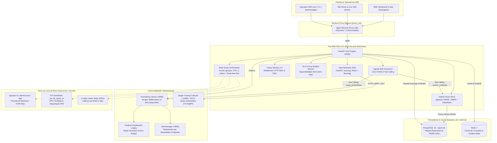
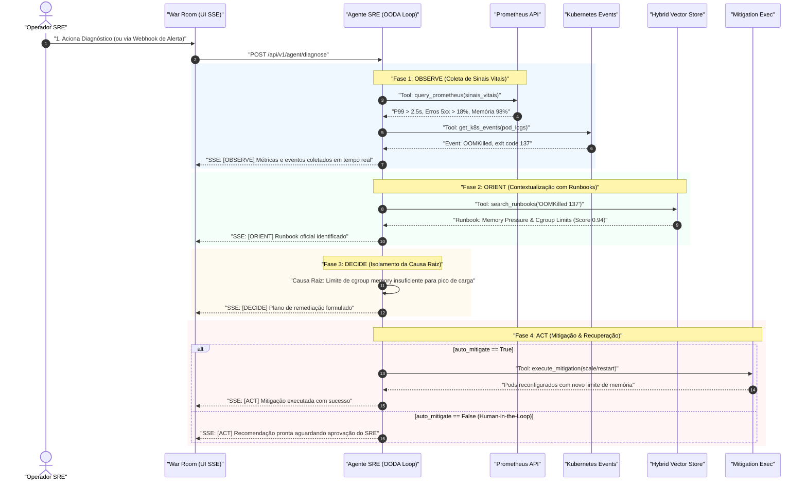
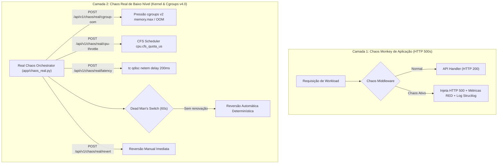
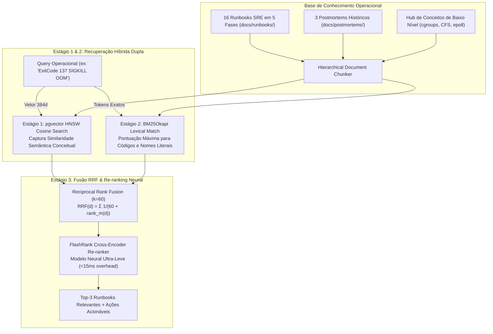
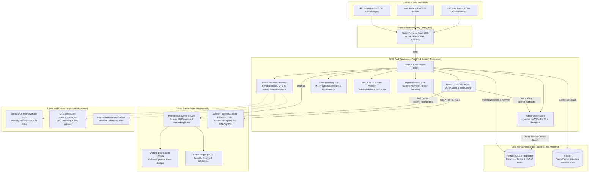
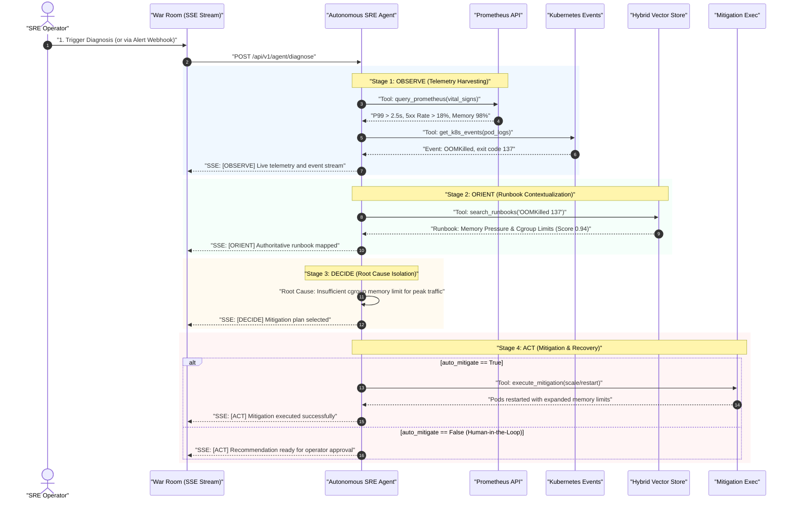
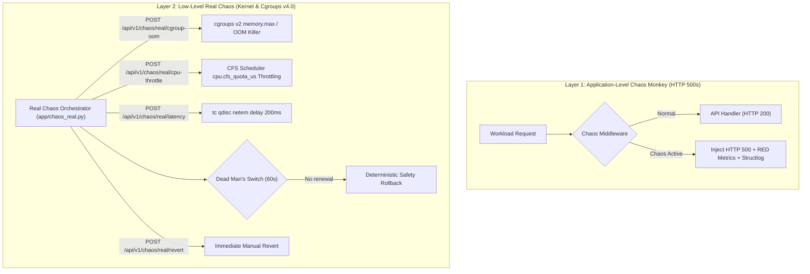
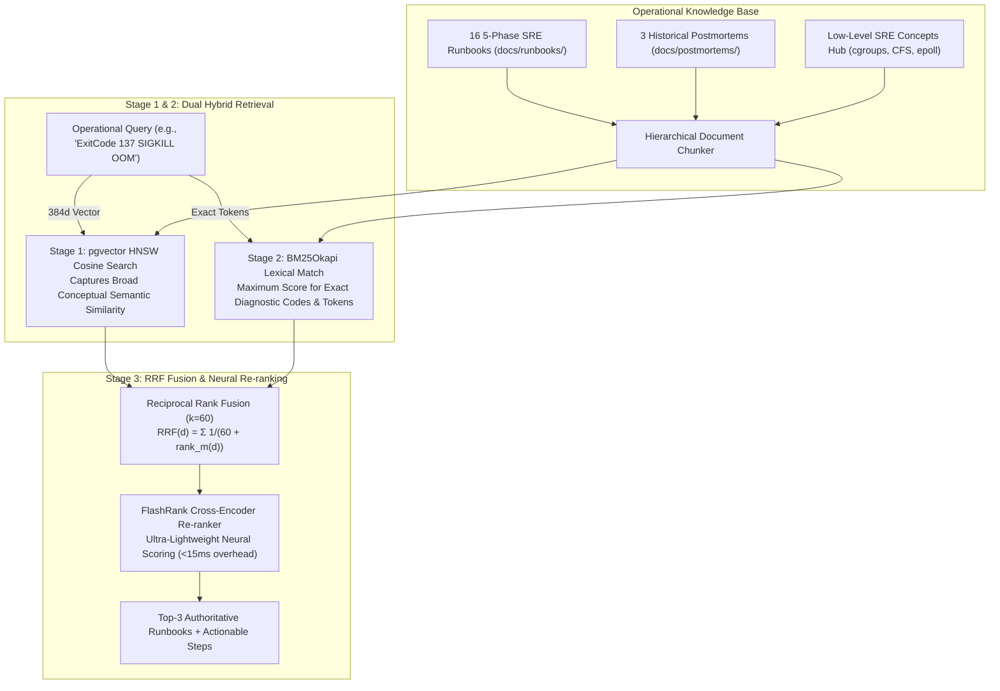

# 🚨 SRE RAG Agent — Incident Simulation Lab & Observability Platform v4.0

[ 🇧🇷 Ler em Português ](#-versão-em-português) &nbsp;|&nbsp; [ 🇺🇸 Read in English ](#-english-version)

---

<a id="-versão-em-português"></a>
## 🇧🇷 Versão em Português

<p align="center">
  
    
  
  
  
  
  
</p>

> **Ambiente Completo de Prática e Engenharia de Confiabilidade (SRE)**: Simulação interativa de incidentes em Kubernetes, motor de busca vetorial RAG (*Retrieval-Augmented Generation*) para Runbooks, injeção de falhas com **Chaos Monkey**, auditoria em tempo real, framework de avaliação de IA e observabilidade ponta a ponta com Prometheus e Grafana.

---

## 🚀 Novidades da Versão v4.0 (Agente SRE OODA, Busca Híbrida pgvector, Chaos Real & OpenTelemetry)
- **🤖 Agente SRE Autônomo com Ciclo OODA**: Agente inteligente com raciocínio closed-loop nos 4 estágios (*Observe, Orient, Decide, Act*), com Tool Calling nativo (`query_prometheus`, `get_k8s_events`, `search_runbooks`, `execute_mitigation`) e streaming de telemetria ao vivo via Server-Sent Events (SSE).
- **🔍 Motor de Busca Híbrida 3-Stage**: Combinação de embeddings densos com pgvector (índice HNSW), busca léxica esparsa BM25Okapi, fusão por Reciprocal Rank Fusion (RRF, $k=60$) e re-ranking semântico neural com FlashRank cross-encoder, elevando a precisão na recuperação de runbooks técnicos e códigos de erro de baixo nível.
- **⚡ Chaos Engineering Real no Kernel & Kubernetes**: Injeção real de pressão de cgroup memory limit, CFS CPU throttling e emulação de latência de rede com `tc netem`, orquestrado com **Dead Man's Switch automático de 60 segundos** para garantir recuperação determinística sem intervenção humana.
- **🔭 Observabilidade Tridimensional com OpenTelemetry & Jaeger**: Rastreamento distribuído ponta a ponta com instrumentação do FastAPI, Asyncpg e Redis via SDK OpenTelemetry, exportação OTLP/gRPC para Jaeger e correlação automática de `trace_id` e `span_id` no structlog.
- **📊 Monitoramento Dinâmico de SLO & Error Budget**: Cálculo em tempo real de disponibilidade, consumo e burn rate de Error Budget no endpoint `/api/v1/slo/error-budget` com alertas preditivos.
- **🛡️ DevSecOps Corporativo & Pod Security Standards (PSS Restricted)**: Hardening com `readOnlyRootFilesystem: true`, `allowPrivilegeEscalation: false`, drop de todas as capabilities do Linux, isolamento Zero-Trust com NetworkPolicies estritas e validação automatizada de vulnerabilidades com Trivy.

## 🚀 Histórico da Versão v3.5 (Persistência Relacional, SSE & Frontend Modular)
- **🏛️ Persistência Relacional com PostgreSQL & Alembic**: Migração do estado em memória (`history_db`, simulações ativas de incidentes e eventos do Chaos Monkey) para tabelas persistentes no PostgreSQL via `SQLAlchemy 2.0` assíncrono (`asyncpg`) e migrações declarativas controladas por `Alembic`, com fallback gracioso em memória caso o banco esteja inacessível.
- **⚡ Server-Sent Events (SSE) em Tempo Real**: Substituição do polling HTTP periódico (`setInterval`) por streaming unidirecional em tempo real via endpoint `/api/v1/events/stream` com heartbeat periódico de 15s.
- **🧩 Modularização do Frontend (ES Modules - ESM)**: Decomposição do monólito `dashboard.js` (2.300+ linhas) em 6 submódulos limpos (`api.js`, `sse.js`, `incidents.js`, `chaos.js`, `terminal.js`, `charts.js`) orquestrados pelo entry point `app.js` via `<script type="module">`.
- **🛡️ Agente Autônomo de Auditoria e Testes**: Criação do `scripts/test_agent.py` (`make test-audit`), executando auditorias contínuas de segurança (CSP, HSTS, Rate Limiting, CORS, Anti-Leak) e benchmarks de performance com geração automatizada de relatórios em `docs/SECURITY_PERF_TEST_REPORT.md`.
- **🧪 Suíte de Testes E2E com Playwright**: Implementação de testes automatizados ponta a ponta (`tests/e2e/test_dashboard_e2e.py`) validando renderização, streaming SSE, jornada completa de incidentes e switch do Chaos Monkey.

## 🚀 Histórico da Versão v3.4
- **🛡️ Pydantic V2 ConfigDict**: Migração completa para `SettingsConfigDict` eliminando todos os warnings de depreciação na inicialização das configurações.
- **⚡ Health Check com Cache TTL & Latência Real**: Proteção contra connection storms causados por probes de liveness/readiness via cache TTL de 5s, com medição precisa de latência para PostgreSQL e Redis.
- **🚀 Embeddings Assíncronos**: Desacoplamento da inferência de embeddings do SentenceTransformer via `asyncio.to_thread`, liberando o event loop do FastAPI sob alta concorrência.
- **🗜️ Compressão GZip Transparente**: Middleware GZip ativo para respostas HTTP maiores que 1KB e compressão de assets estáticos otimizada no proxy Nginx.
- **🔒 Defesa em Profundidade & Segurança HTTP**: Injeção automática de Security Headers (CSP, HSTS, X-Frame-Options, X-Content-Type-Options, Referrer-Policy, Permissions-Policy), CORS restrito por ambiente e Rate Limiting defensivo com `slowapi`.

## 🚀 Histórico da Versão v3.3
- **🔥 Catálogo Expandido com 16 Cenários de Produção**: Dobramos o acervo para **16 cenários reais e balanceados**, distribuídos uniformemente em 4 níveis (4 Fácil, 4 Médio, 4 Difícil, 4 Extremo), cobrindo os 8 pilares vitais de confiabilidade (Disponibilidade, Latência, Recursos & Cgroups, Confiabilidade & Probes, Redes & DNS, Armazenamento & PVCs, Segurança & TLS, e Concorrência de Banco de Dados).
- **📖 Runbooks Estruturados em 5 Fases**: O botão `📖 Revisão` no terminal e a vitrine de cenários agora abrem um **Modal de Passo a Passo Interativo (`#runbook-modal`)** guiando o operador pelas 5 fases consagradas de incidentes: *1. Triagem & Alertas*, *2. Diagnóstico & Inspeção*, *3. Mitigação Imediata*, *4. Causa Raiz & Correção Permanente* e *5. Prevenção & Pós-Morte*.
- **📚 Nova Aba "Conceitos SRE" (`#concepts`)**: Um portal de conhecimento arquitetural profundo integrado aos 16 cenários, dissecando mecanismos de baixo nível do Kernel Linux (cgroups, CFS scheduler throttling, OOM killer `oom_score_adj`, page cache, TCP sockets, epoll) e do Kubernetes Control Plane, com busca instantânea e atalho "Praticar no War Room".
- **🎯 Vitrine de Cenários na Tela Principal**: Grade interativa de cards na aba de simulação com filtros rápidos por nível de dificuldade, componentes e atalhos rápidos para abrir o passo a passo ou simular diretamente.
- **📐 Layout Confinado & Rolagem Resiliente**: Reengenharia da camada de apresentação com Flexbox de contenção estrita (`height: 0; min-height: 0`), garantindo rolagem vertical suave independente em todas as abas, barras de rolagem ergonômicas, isolamento total contra colisão com o rodapé fixo e suporte responsivo a redimensionamentos contínuos de janela.

## 🚀 Histórico da Versão v3.2
- **⚡ Otimização Extrema de Imagens Docker**: Multi-stage build com wheel oficial CPU-only do PyTorch (`--index-url https://download.pytorch.org/whl/cpu`), descarte de binários CUDA da NVIDIA, supressão de bytecode (`PYTHONDONTWRITEBYTECODE=1`), e limpeza de caches na etapa de compilação. Redução de **mais de 70%** no tamanho da imagem (de ~3.5GB para ~800MB).
- **🛡️ Isolamento de Redes no Docker Compose**: Separação estrita em duas redes Docker dedicadas: `proxy_net` (pública para Nginx e API) e `backend_net` (`internal: true` para comunicação interna entre API, PostgreSQL e Redis). Nenhuma porta de banco de dados é exposta no host.
- **💻 War Room (Terminal Interativo Seguro)**: Resolução de incidentes via comandos simulados (`kubectl`, `helm`, etc.) validados estritamente no backend, sem risco de RCE no SO hospedeiro.
- **🎯 4 Níveis de Dificuldade & Zero-Repetição**: Categorização em Fácil, Médio, Difícil e Extremo com filtragem inteligente por histórico local para evitar repetição consecutiva de cenários.
- **📑 Navegação por Abas & Modo Claro Suave**: Abas isoladas para Simulação (Quiz), War Room (Terminal) e Métricas & Histórico, com paleta de cores soft pastel para o tema claro.

---

## 📑 Sumário

- [Visão Geral & Novas Features](#-visão-geral--novas-features)
- [Arquitetura do Sistema](#-arquitetura-do-sistema)
- [Fluxo de Resposta a Incidentes (MTTD & MTTR)](#-fluxo-de-resposta-a-incidentes-mttd--mttr)
- [Chaos Monkey & Trilha de Auditoria](#-chaos-monkey--trilha-de-auditoria)
- [Motor de Busca Vetorial RAG](#-motor-de-busca-vetorial-rag)
- [Framework de Avaliação SRE](#-framework-de-avaliação-sre)
- [Estrutura do Repositório](#-estrutura-do-repositório)
- [Guia Rápido (Quick Start)](#-guia-rápido-quick-start)
- [SLIs, SLOs & Observabilidade](#-slis-slos--observabilidade)
- [Segurança & Ambientes](#-segurança--ambientes)
- [Avaliação Well-Architected Framework](#-avaliação-well-architected-framework)
- [Autor & Licença](#-autor--licença)

---

## 🌟 Visão Geral & Novas Features

Este projeto evoluiu de um protótipo para um **Laboratório de Engenharia SRE de Padrão Google**:

1. **🎯 Painel Interativo de Simulação de Incidentes (`/dashboard`)**:
   - 16 cenários realistas de falha em Kubernetes distribuídos em 4 dificuldades (Fácil, Médio, Difícil, Extremo) cobrindo 8 pilares da confiabilidade.
   - Embaralhamento aleatório das opções de solução a cada simulação, impedindo respostas mecânicas.
   - Cálculo e exibição em tempo real de KPIs: **MTTD Médio**, **MTTR Médio**, **Taxa de Assertividade** e gráficos SVG de tendências.

2. **🐒 Chaos Monkey & Auditoria de Resiliência (`app/chaos.py`)**:
   - Injeção controlada de erros `HTTP 500` no workload de inferência.
   - **Isolamento do Plano de Controle**: O Dashboard, health checks (`/healthz`, `/ready`), métricas Prometheus e endpoints de controle permanecem 100% disponíveis.
   - **Sessões Rastreadas**: Cada janela de teste armazena timestamp de início/fim, duração precisa em segundos e contagem de falhas por endpoint.
   - **Terminal SRE de Auditoria em Tempo Real**: Interface estilo macOS no dashboard com stream ao vivo de logs coloridos (`[ATIVADO]`, `[500 INJETADO]`, `[DESATIVADO]`).
   - Métricas Prometheus dedicadas (`sre_rag_chaos_injections_total`, `sre_rag_chaos_active`).

3. **🧠 Motor RAG com Embeddings Vetoriais Reais (`app/rag/`)**:
   - Substituição de buscas sintéticas por embeddings reais com `sentence-transformers` (`all-MiniLM-L6-v2`, 384 dimensões).
   - Indexador de seções hierárquicas em markdown com cache local persistido em disco (`index_store.json`, 141 chunks).
   - 8 Runbooks completos de padrão Google SRE (`docs/runbooks/`) e 3 Postmortems históricos (`docs/postmortems/`) com Análise de 5 Porquês e itens de ação.
   - Fallback offline transparente: consultas executam em ~20ms mesmo sem conectividade com o Redis local.

4. **📈 Framework de Avaliação Automatizada (`tests/eval/`)**:
   - Dataset de benchmark com 10 casos de teste de verdade-terrestre (`benchmark_dataset.json`).
   - Avaliador matemático calculando **Hit Rate@K** (100%), **MRR** (0.925), **Context Precision** (70%) e **Safety Score** (100%).
   - Geração automática de relatório analítico em [`docs/eval-report.md`](docs/eval-report.md).

5. **🛡️ Endurecimento de Segurança & Swagger Gating**:
   - Documentação Swagger/OpenAPI ativa exclusivamente em ambiente de desenvolvimento/teste (`ENVIRONMENT=development`).
   - Em produção (`ENVIRONMENT=production`), o Swagger é desativado nativamente (`docs_url=None, redoc_url=None, openapi_url=None`) para prevenir reconhecimento de superfície de ataque e enumeração de rotas.
   - Remoção de links públicos ao Swagger na interface principal em consonância com as melhores práticas de DevSecOps.

6. **📑 Navegação por Abas & Hub Conceitual (v3.3)**:
   - 4 abas especializadas: `🎯 Simulação (Quiz & Vitrine)`, `💻 War Room (Terminal Seguro)`, `📊 Histórico & Métricas`, e `📚 Conceitos SRE (Base Teórica e Kernel)`.
   - Roteamento nativo por URL hash (`#simulation`, `#warroom`, `#history`, `#concepts`) com alternância instantânea.
   - Roteamento por hash (`#simulation` / `#history`) com persistência imediata e alternância sem recarregamento de página.
   - Escala tipográfica modernizada (v3.2) com badges expandidos, contraste balanceado e correção de overflow no gráfico de MTTR.

7. **🌐 Suporte Bilíngue Nativo (pt-BR / en-US)**:
   - Seletor de idiomas dinâmico com persistência em `localStorage`.
   - Cobertura completa de traduções: 16 cenários de incidentes, sintomas, diagnósticos de IA, opções de mitigação, estados do Chaos Monkey e relatórios postmortem.

---

## 🏗️ Arquitetura do Sistema (v4.0)

O diagrama abaixo ilustra o ecossistema completo da **versão 4.0**, integrando proxy reverso, redes Docker isoladas, agente SRE com ciclo OODA, motor de busca híbrida com pgvector, orquestrador de caos no kernel e observabilidade tridimensional:



---

## ⏱️ Fluxo de Resposta a Incidentes: Interativo vs. Autônomo OODA (v4.0)

O laboratório suporta dois fluxos complementares de resposta a incidentes:

### 1. Fluxo Autônomo com o Agente SRE (Ciclo OODA)
O agente investiga ativamente o cluster via *Tool Calling*, isola a causa raiz e sugere ou executa a mitigação com streaming ao vivo via SSE:



### 2. Fluxo Interativo de Treinamento no Quiz & War Room
Para treinamento humano, o operador diagnostica e resolve os 16 cenários de produção medindo seu MTTD e MTTR pessoal contra os runbooks estruturados em 5 fases.

---

## 🐒 Engenharia do Caos em Duas Camadas: Aplicação & Kernel Real (v4.0)

A plataforma opera com duas camadas complementares de injeção de falhas:



### Endpoints do Chaos Engineering

| Camada | Método | Endpoint | Descrição |
|--------|--------|----------|-----------|
| **Aplicação** | `POST` | `/api/v1/chaos/500?enable=true|false` | Ativa ou encerra a injeção controlada de HTTP 500s |
| **Aplicação** | `GET` | `/api/v1/chaos/status` | Retorna o status da simulação de 500s e telemetria |
| **Kernel Real** | `POST` | `/api/v1/chaos/real/cgroup-oom` | Injeta limite estrito de memória cgroup v2 forçando OOM Killer |
| **Kernel Real** | `POST` | `/api/v1/chaos/real/cpu-throttle` | Injeta contenção de CPU via agendador CFS do Linux |
| **Kernel Real** | `POST` | `/api/v1/chaos/real/latency` | Injeta atraso e jitter de rede via `tc netem` |
| **Kernel Real** | `GET` | `/api/v1/chaos/real/active` | Lista experimentos reais ativos e tempo restante do Dead Man's Switch |
| **Kernel Real** | `POST` | `/api/v1/chaos/real/revert` | Reversão manual emergencial de todos os experimentos |

---

## 🧠 Motor de Busca Híbrida 3-Stage (pgvector + BM25 + FlashRank v4.0)

O pipeline de recuperação vetorial da v4.0 supera as limitações da busca semântica pura ao unir vetores densos com busca esparsa léxica e re-ranking neural:



---

## 📈 Framework de Avaliação SRE

O framework avalia a qualidade das respostas do RAG contra o dataset de referência:

| Métrica | Meta SRE | Score Obtido | Status | Descrição |
|---------|----------|--------------|--------|-----------|
| **Hit Rate @ 3** | &ge; 80% | **100.0%** | ✅ APROVADO | O documento correto esteve no Top-3 em 100% dos testes |
| **MRR (Mean Reciprocal Rank)** | &ge; 0.70 | **0.925** | ✅ APROVADO | O runbook correto aparece majoritariamente na 1ª posição |
| **Context Precision** | &ge; 60% | **70.0%** | ✅ APROVADO | Precisão do contexto recuperado para mitigação |
| **Safety Score** | 100% | **100.0%** | ✅ APROVADO | Nenhuma ação destrutiva sem aprovação foi sugerida |

Para rodar a avaliação manualmente:
```bash
make eval
# ou: python tests/eval/evaluator.py
```
O relatório consolidado é gerado em [`docs/eval-report.md`](docs/eval-report.md).

---

## 📁 Estrutura do Repositório

```
sre_rag_agent/
├── app/                         # Aplicação Python & FastAPI Core (v4.0)
│   ├── agent/                   # Agente SRE Autônomo com Ciclo OODA (v4.0)
│   │   ├── sre_agent.py         # Orquestrador OODA (Observe, Orient, Decide, Act)
│   │   └── tools.py             # Tool Calling (Prometheus, K8s events, runbooks)
│   ├── chaos.py                 # Chaos Monkey 2.0 (Application-level HTTP 500s)
│   ├── chaos_real.py            # Chaos Real no Kernel (cgroups, CFS, tc netem + Dead Man 60s)
│   ├── config.py                # Configurações Pydantic V2 SettingsConfigDict
│   ├── incidents.py             # 16 Cenários de Produção em 4 Níveis de Dificuldade
│   ├── main.py                  # Servidor API FastAPI, middlewares e rotas v4.0
│   ├── metrics.py               # Métricas do Prometheus (RED, USE e Chaos)
│   ├── healthcheck.py           # Probes K8s com cache TTL de 5s e latência real de DB
│   ├── rag/                     # Motor de Busca Híbrida 3-Stage (v4.0)
│   │   ├── embeddings.py        # Embeddings assíncronos (asyncio.to_thread)
│   │   ├── engine.py            # Orquestrador RAG com fallback gracioso
│   │   ├── indexer.py           # Indexador hierárquico de runbooks e postmortems
│   │   ├── vector_store.py      # pgvector HNSW + BM25Okapi + RRF (k=60) + FlashRank
│   │   └── models.py            # Modelos Pydantic para documentos e chunks
│   ├── static/                  # Frontend Modular ES Modules (ESM)
│   │   ├── css/                 # Folhas de estilo confinadas (dashboard.css)
│   │   └── js/                  # Módulos ESM (app.js, agent.js, api.js, sse.js, etc.)
│   ├── telemetry.py             # OpenTelemetry SDK + Tracing Jaeger + Structlog context
│   └── templates/               # Templates HTML Jinja2 (dashboard.html com War Room OODA)
├── docs/                        # Documentação Técnica e Arquitetural
│   ├── runbooks/                # 16 Runbooks completos em 5 fases operacionais
│   ├── postmortems/             # 3 Postmortems reais com análise de 5 Porquês
│   ├── architecture.md          # Arquitetura detalhada v4.0 e matriz de endpoints
│   ├── incident-response.md     # Guia de resposta interativa e autônoma OODA
│   ├── slo.md                   # Definição de SLOs, Error Budgets e Multi-window Burn Rates
│   └── eval-report.md           # Relatório da avaliação automatizada de IA (SRE-Eval)
├── helm/                        # Helm Charts para Kubernetes
│   └── sre-rag/                 # Chart com HPA, PDB, NetworkPolicies, ServiceMonitor
├── monitoring/                  # Observabilidade
│   ├── prometheus/              # Regras de alerta e scrape config
│   ├── grafana/                 # Dashboards SRE (RED metrics, SLOs, Chaos)
│   └── alertmanager/            # Configuração de rotas de alerta
├── tests/                       # Suíte de Testes Automatizados
│   ├── eval/                    # Benchmark dataset e avaliador
│   ├── test_chaos.py            # Testes do Chaos Monkey e isolamento
│   ├── test_incidents.py        # Testes do motor de simulação
│   └── test_rag.py              # Testes do motor vetorial RAG
├── Makefile                     # Automação de tarefas
├── README.md                    # Documentação em Português
└── README_EN.md                 # Documentação em Inglês
```

---

## 🚀 Guia Rápido (Quick Start)

### Pré-requisitos
- Python 3.12+
- Docker & Docker Compose
- Kind / Kubernetes CLI (`kubectl`)
- Make

### 1. Clonar e Instalar Dependências
```bash
git clone https://github.com/magnomct/sre_rag_agent.git
cd sre_rag_agent

# Criar ambiente virtual e instalar pacotes
make setup
```

### 2. Executar Localmente em Modo Desenvolvimento
```bash
make dev
```
Acesse os serviços nos seguintes endereços:
- **SRE Incident Lab Dashboard**: [http://localhost:8080/dashboard](http://localhost:8080/dashboard)
- **Board de Histórico CRUD**: [http://localhost:8080/board](http://localhost:8080/board)
- **Métricas Prometheus**: [http://localhost:8080/metrics](http://localhost:8080/metrics)
- **Documentação Swagger (Dev)**: [http://localhost:8080/docs](http://localhost:8080/docs)

### 3. Rodar a Suíte Completa de Testes
```bash
make test
```
*Executa os 8 testes unitários e de integração, cobrindo Chaos Monkey, RAG vetorial e simulações.*

### 4. Deploy no Kubernetes Local (Kind)
```bash
# Criar cluster local Kind
make cluster-create

# Fazer build da imagem e deploy via Helm
make build deploy

# Habilitar encaminhamento de portas
make port-forward
```

### 5. Como Desativar o Lab
Para encerrar o ambiente local:
```bash
# Encerrar servidor dev
pkill -f "uvicorn" && fuser -k 8080/tcp 2>/dev/null

# Parar containers auxiliares
docker compose down

# Deletar cluster Kubernetes local (se utilizado)
kind delete cluster --name sre-rag
```

---

## 📊 SLIs, SLOs & Observabilidade

| Serviço | SLI | SLO | Janela | Métrica Prometheus |
|---------|-----|-----|--------|--------------------|
| **API Workload** | Disponibilidade (status < 500) | **99.9%** | 30d | `sli_request_success_total / sli_request_total` |
| **API Latência** | Latência p99 < 500ms | **99.5%** | 30d | `http_request_duration_seconds_bucket` |
| **PostgreSQL** | Conexões ativas < 80% do limite | **99.9%** | 30d | `db_connections_active{database="postgresql"}` |
| **Redis Cache** | Cache Hit Rate > 80% | **99.0%** | 30d | `cache_hits_total / (cache_hits_total + cache_misses_total)` |
| **Chaos Active** | Monitoramento de injeção ativa | N/A | Realtime | `sre_rag_chaos_active` (Gauge: 0 ou 1) |

---

## 🛡️ Segurança & Ambientes

- **Ambiente de Desenvolvimento (`ENVIRONMENT=development`)**:
  - Swagger UI e OpenAPI habilitados em `/docs` e `/openapi.json`.
  - Reload automático ativado.
- **Ambiente de Produção (`ENVIRONMENT=production`)**:
  - Swagger UI e esquemas OpenAPI desabilitados (`docs_url=None`).
  - Links de documentação removidos dos cabeçalhos das páginas.
  - Segurança aprimorada contra reconhecimento e fingerprinting de APIs.

---

## 🏛️ Avaliação Well-Architected Framework

O projeto segue com excelência os 6 pilares do **Cloud Well-Architected Framework** (AWS / Google Cloud / SRE Architecture Framework):

| Pilar | Nota | Implementação no Projeto |
| :--- | :---: | :--- |
| **1. Excelência Operacional** | **9.5/10** | • **Runbooks Estruturados em 5 Fases**: Guias padronizados de resposta operacional (Triagem, Diagnóstico, Mitigação, Causa Raiz e Prevenção) para todos os 16 cenários.<br>• **Postmortems Blameless**: Templates e documentação formal pós-incidente (`docs/postmortems/`).<br>• **Infraestrutura como Código (IaC)**: Deploy automatizado e reproduzível com Helm Charts e Terraform.<br>• **SLOs e Error Budgets Formais**: Definições quantitativas de disponibilidade e queima de erro no Prometheus.<br>• **Chaos Engineering Contínuo**: Módulo nativo Chaos Monkey com injeção controlada de falhas HTTP 500 e trilha de auditoria. |
| **2. Segurança** | **9.0/10** | • **Contêiner Não-Root**: Dockerfile executa estritamente sob `appuser` sem privilégios de root (`/sbin/nologin`).<br>• **Isolamento de Rede Multi-Camadas**: `NetworkPolicies` no Kubernetes e rede `backend_net` interna (`internal: true`) no Docker Compose isolando PostgreSQL e Redis.<br>• **Sandbox contra RCE**: Terminal do War Room opera via string matching validado no backend, sem executar comandos no host.<br>• **Gestão Segura de Configurações**: Pydantic Settings tipado com validação e segregação estrita de ambientes. |
| **3. Confiabilidade** | **9.5/10** | • **Probes de Ciclo de Vida**: `startupProbe`, `livenessProbe` e `readinessProbe` configurados no Kubernetes.<br>• **Alta Disponibilidade**: `HorizontalPodAutoscaler` (HPA) e `PodDisruptionBudget` (`minAvailable: 1`) garantindo resiliência em drenagens de nós.<br>• **Padrões de Resiliência**: Biblioteca `tenacity` com retentativas exponenciais com jitter e fallback gracioso no RAG.<br>• **Persistência Segura**: StatefulSets com PVCs para banco de dados relacional e cache. |
| **4. Eficiência de Performance** | **9.0/10** | • **I/O Assíncrono Não-Bloqueante**: FastAPI + Uvicorn + asyncpg/httpx.<br>• **Cache Distribuído**: Redis de baixa latência cacheando embeddings e consultas RAG frequentes.<br>• **Benchmark Quantitativo (SRE-Eval)**: Suite automatizada medindo precisão, relevância de contexto e latência.<br>• **Monitoramento dos 4 Golden Signals**: Latência (p50/p95/p99), Tráfego (RPS), Taxa de Erros e Saturação instrumentados. |
| **5. Otimização de Custos** | **9.0/10** | • **Eliminação do Bloat CUDA/GPU**: Multi-stage build forçando wheel oficial de CPU do PyTorch (`--index-url https://download.pytorch.org/whl/cpu`), reduzindo a imagem de ~3.5 GB para ~800 MB e o `.venv` de ~6 GB para ~1.2 GB.<br>• **Dimensionamento Racional de Recursos**: Requests e Limits calibrados evitando sobrealocação e throttling de CPU.<br>• **Autoscaling Elástico**: Redução para a cota mínima de réplicas durante períodos de baixo tráfego. |
| **6. Sustentabilidade** | **8.5/10** | • **Pegada Computacional Enxuta**: Modelos de embeddings leves (`all-MiniLM-L6-v2`) operando com consumo energético mínimo em CPU x86_64.<br>• **Imagens Base Minimalistas**: Uso de Alpine Linux e Debian Slim sem dependências compiladas ociosas. |

> **Oportunidades de Evolução Enterprise:** Rastreamento distribuído com OpenTelemetry (OTel/Jaeger), integração a cofre centralizado (HashiCorp Vault / External Secrets Operator) e Service Mesh mTLS nativo.

---

## 👤 Autor & Licença

Desenvolvido por **Carlos Magno Cordeiro**  
GitHub: [@magnomct](https://github.com/magnomct) &middot; Repositório: [sre_rag_agent](https://github.com/magnomct/sre_rag_agent)

Distribuído sob a licença **MIT**. Consulte o arquivo [LICENSE](LICENSE) para obter mais informações.

---

<a id="-english-version"></a>
## 🇺🇸 English Version

## 🚀 What's New in v4.0 (Autonomous SRE OODA Agent, pgvector Hybrid Search, Real Chaos & OpenTelemetry)
- **🤖 Autonomous SRE Agent with OODA Loop**: Intelligent closed-loop incident responder cycling through 4 stages (*Observe, Orient, Decide, Act*), equipped with native Tool Calling (`query_prometheus`, `get_k8s_events`, `search_runbooks`, `execute_mitigation`) and live SSE reasoning streams.
- **🔍 3-Stage Hybrid Search Engine**: Synergy of pgvector dense cosine search (HNSW index), BM25Okapi sparse lexical scoring, Reciprocal Rank Fusion (RRF, $k=60$), and FlashRank neural cross-encoder re-ranking for pinpoint accuracy on Kubernetes runbooks and error codes.
- **⚡ Real-World Chaos Engineering at Kernel & Kubernetes Level**: Deterministic fault injection via Linux cgroups memory pressure, CFS CPU throttling, and `tc netem` packet latency, governed by an automatic **60-second Dead Man's Switch** safety harness.
- **🔭 3D Observability with OpenTelemetry & Jaeger**: Distributed tracing spanning FastAPI, Asyncpg, and Redis using OpenTelemetry SDK, OTLP/gRPC export to Jaeger, and contextual injection of `trace_id` and `span_id` into structured JSON logs.
- **📊 Dynamic SLO & Error Budget Calculation**: Real-time evaluation of service availability, remaining budget, and burn rate via `/api/v1/slo/error-budget`.
- **🛡️ Enterprise DevSecOps & Pod Security Standards (PSS Restricted)**: Full adherence to Kubernetes PSS Restricted profile (`readOnlyRootFilesystem: true`, non-root execution, `drop: ["ALL"]` capabilities, `seccompProfile: RuntimeDefault`), Zero-Trust NetworkPolicies, and Trivy automated vulnerability auditing.

## 🚀 Version History — v3.5 (Relational Persistence, SSE & Modular Frontend)
- **🏛️ Relational Persistence with PostgreSQL & Alembic**: Full migration of volatile in-memory collections (`history_db`, incident simulations, chaos events) to relational PostgreSQL tables via `SQLAlchemy 2.0` async engine (`asyncpg`) and declarative migrations managed by `Alembic`, with resilient in-memory fallback.
- **⚡ Real-Time Server-Sent Events (SSE)**: Complete elimination of polling loops (`setInterval`) in favor of low-latency unidirectional real-time streaming via `/api/v1/events/stream` with 15s keep-alive heartbeats.
- **🧩 Modular Frontend Architecture (ES Modules - ESM)**: Decoupling of monolithic `dashboard.js` (2,300+ lines) into 6 isolated ES modules (`api.js`, `sse.js`, `incidents.js`, `chaos.js`, `terminal.js`, `charts.js`) coordinated by `app.js` using `<script type="module">`.
- **🛡️ Autonomous Test & Security Audit Agent**: Introduction of `scripts/test_agent.py` (`make test-audit`), continuously benchmarking performance percentiles and auditing defense-in-depth security policies into `docs/SECURITY_PERF_TEST_REPORT.md`.
- **🧪 End-to-End (E2E) Test Suite**: Addition of comprehensive integration and UI journey tests (`tests/e2e/test_dashboard_e2e.py`) validating web interface rendering, SSE handshakes, and incident lifecycles.

## 🚀 Historical Highlights: v3.4
- **🛡️ Pydantic V2 ConfigDict**: Full migration to `SettingsConfigDict`, completely eliminating Pydantic deprecation warnings upon configuration bootstrap.
- **⚡ Health Check TTL Cache & Real Latency Measurement**: Protection against probe connection storms via 5s TTL caching, with accurate round-trip latency measurements for PostgreSQL and Redis.
- **🚀 Non-Blocking Asynchronous Embeddings**: SentenceTransformer query embedding offloaded to thread pools via `asyncio.to_thread`, keeping FastAPI's async event loop unblocked under heavy concurrent traffic.
- **🗜️ Transparent GZip Compression**: Automatic GZip compression middleware for HTTP responses over 1KB, paired with optimized Nginx asset caching and compression.
- **🔒 Defense in Depth & HTTP Security**: Automated security headers (CSP, HSTS, X-Frame-Options, X-Content-Type-Options, Referrer-Policy, Permissions-Policy), environment-aware CORS restrictions, and defensive Redis-backed Rate Limiting via `slowapi`.

## 🚀 Historical Highlights: v3.3
- **🔥 Expanded Catalog with 16 Production Scenarios**: Doubled the scenario library to **16 production-grade, balanced scenarios**, evenly distributed across 4 tiers (4 Easy, 4 Medium, 4 Hard, 4 Extreme) covering the 8 vital reliability pillars (Availability, Latency, Resources & Cgroups, Reliability & Probes, Networking & DNS, Storage & PVCs, Security & TLS, and Database Concurrency).
- **📖 5-Phase Interactive Runbooks**: The `📖 Review` button and scenario catalog cards open an **Interactive Step-by-Step Runbook Modal (`#runbook-modal`)** guiding engineers through the 5 industry-standard incident phases: *1. Triage & Alerting*, *2. Diagnosis & Cluster Inspection*, *3. Fast Mitigation*, *4. Root Cause Analysis & Permanent Fix*, and *5. Prevention & Postmortem*.
- **📚 Dedicated "SRE Concepts" Tab (`#concepts`)**: A deep systems architecture knowledge hub mapped directly to all 16 scenarios, unpacking low-level Linux Kernel mechanics (cgroups, CFS scheduler throttling, OOM killer `oom_score_adj`, page cache, TCP socket states) and Kubernetes control plane controllers, featuring live search and direct "Practice in War Room" shortcuts.
- **🎯 Main Screen Scenario Catalog**: Interactive scenario cards on the simulation dashboard with real-time difficulty filtering, affected components, and instant runbook inspection.
- **📐 Viewport Confinement & Resilient Scrolling**: Layout refactoring using strict Flexbox viewport containment (`height: 0; min-height: 0`), ensuring seamless independent vertical scrolling across all tabs, sleek ergonomic scrollbars, absolute clearance from the fixed footer, and fluid responsiveness when resizing browser windows.

## 🚀 Historical Highlights: v3.2
- **⚡ Extreme Docker Image Size Optimization**: Multi-stage build pulling the official CPU-only PyTorch wheel (`https://download.pytorch.org/whl/cpu`), eliminating massive NVIDIA CUDA/cuDNN GPU binaries, suppressing bytecode generation (`PYTHONDONTWRITEBYTECODE=1`), and stripping build caches. Image size reduced by **over 70%** (from ~3.5GB to ~800MB).
- **🛡️ Docker Compose Dual-Network Isolation**: Strict network segmentation with `proxy_net` (public DMZ connecting Nginx proxy and FastAPI app) and `backend_net` (fully internal `internal: true` bridging the app to PostgreSQL and Redis). No database ports are exposed to the host machine or public internet.
- **💻 War Room (Interactive Web Terminal)**: Simulated command-line interface allowing users to triage and remediate incidents using real `kubectl` and `helm` commands with strict string validation preventing any host RCE.
- **🎯 4 Dynamic Difficulties & Zero-Repetition**: Incidents categorized into Easy, Medium, Hard, and Extreme with client-side history exclusion preventing immediate back-to-back question repeats.
- **📑 Tabbed Architecture & Enhanced Light Theme**: Dedicated tabs for Quiz, War Room, and Metrics & History, with soft pastel color palettes and balanced typography.

<p align="center">
    
  
  
  
  
  
  
</p>

> **Full-Stack Site Reliability Engineering (SRE) Practice & Simulation Lab**: Interactive incident response dynamics on Kubernetes, vector-based RAG (*Retrieval-Augmented Generation*) for operational runbooks, controlled fault injection with **Chaos Monkey**, live audit trail streaming, automated AI evaluation framework, and end-to-end observability via Prometheus and Grafana.

---

## 📑 Table of Contents

- [Overview & Key Features](#-overview--key-features)
- [System Architecture](#-system-architecture)
- [Incident Response Lifecycle (MTTD & MTTR)](#-incident-response-lifecycle-mttd--mttr)
- [Chaos Monkey & Audit Trail](#-chaos-monkey--audit-trail)
- [Vector RAG Retrieval Engine](#-vector-rag-retrieval-engine)
- [SRE Evaluation Framework](#-sre-evaluation-framework)
- [Repository Structure](#-repository-structure)
- [Quick Start Guide](#-quick-start-guide)
- [SLIs, SLOs & Observability](#-slis-slos--observability)
- [Security & Environment Gating](#-security--environment-gating)
- [Well-Architected Framework Assessment](#-well-architected-framework-assessment)
- [Author & License](#-author--license)

---

## 🌟 Overview & Key Features

This project was built and evolved into a **Google SRE-standard Practice and Training Lab**:

1. **🎯 Interactive Incident Simulation Dashboard (`/dashboard`)**:
   - 16 authentic Kubernetes incident scenarios distributed across 4 difficulties (Easy, Medium, Hard, Extreme) covering 8 core reliability pillars.
   - Solution options are dynamically shuffled on each simulation to avoid rote memorization.
   - Real-time calculation and visualization of SRE KPIs: **Average MTTD**, **Average MTTR**, **Success Rate**, and SVG trend charts.

2. **🐒 Chaos Monkey & Resilience Audit System (`app/chaos.py`)**:
   - Controlled `HTTP 500` fault injection targeted specifically at workload inference endpoints.
   - **Control Plane Isolation**: The Dashboard, health probes (`/healthz`, `/ready`), Prometheus metrics, and management APIs remain 100% operational.
   - **Tracked Sessions**: Every chaos session records start/end timestamps, exact duration in seconds, and an affected endpoint failure map.
   - **Live SRE Audit Terminal**: A macOS-styled terminal on the dashboard streaming real-time colored event logs (`[ACTIVATED]`, `[500 INJECTED]`, `[DEACTIVATED]`).
   - Dedicated Prometheus metrics (`sre_rag_chaos_injections_total`, `sre_rag_chaos_active`).

3. **🧠 Vector RAG Knowledge Retrieval Engine (`app/rag/`)**:
   - Real vector embeddings powered by `sentence-transformers` (`all-MiniLM-L6-v2`, 384 dimensions).
   - Hierarchical markdown section parser with local disk caching (`index_store.json`, 141 chunks).
   - 8 comprehensive Google-SRE-grade Runbooks (`docs/runbooks/`) and 3 realistic historical Postmortems (`docs/postmortems/`) featuring 5 Whys analysis and action items.
   - Seamless offline fallback: queries execute in ~20ms even when local Redis is offline.

4. **📈 Automated SRE Evaluation Framework (`tests/eval/`)**:
   - Benchmark dataset with 10 ground-truth test cases (`benchmark_dataset.json`).
   - Evaluator computing **Hit Rate@K** (100%), **MRR** (0.925), **Context Precision** (70%), and **Safety Score** (100%).
   - Automated report generation in [`docs/eval-report.md`](docs/eval-report.md).

5. **🛡️ Production Security & Swagger Gating**:
   - Swagger / OpenAPI documentation is active exclusively in development/testing mode (`ENVIRONMENT=development`).
   - In production (`ENVIRONMENT=production`), Swagger is natively disabled (`docs_url=None, redoc_url=None, openapi_url=None`) to prevent endpoint enumeration and schema reconnaissance.
   - Public Swagger links removed from the main header following DevSecOps hardening best practices.

6. **📑 Tabbed Architecture & Conceptual Hub (v3.3)**:
   - 4 specialized workspaces: `🎯 Simulação (Quiz & Catalog)`, `💻 War Room (Secure Terminal)`, `📊 Histórico & Métricas`, and `📚 Conceitos SRE (Systems Internals & Kernel)`.
   - Native URL hash routing (`#simulation`, `#warroom`, `#history`, `#concepts`) with instant view switching.
   - URL hash routing (`#simulation` / `#history`) providing seamless instant tab switching with state persistence.
   - Modernized typography scale (v3.2) featuring enhanced readability, expanded badge padding, and fixed MTTR sparkline chart overflow.

7. **🌐 Native Bilingual Support (pt-BR / en-US)**:
   - Dynamic client-side language switcher with `localStorage` state persistence.
   - 100% translation coverage across all 16 incident scenarios, symptoms, AI root-cause diagnostics, mitigation options, Chaos Monkey states, and metrics.

---

## 🏗️ System Architecture (v4.0)

The diagram below illustrates the complete **v4.0** ecosystem, integrating reverse proxy routing, isolated Docker networks, autonomous SRE agent with OODA loop, 3-stage hybrid search with pgvector, real kernel chaos, and distributed tracing:



---

## ⏱️ Incident Response Lifecycle: Interactive vs. Autonomous OODA (v4.0)

The platform supports two complementary operational response workflows:

### 1. Autonomous SRE Agent Workflow (OODA Loop)
The agent autonomously investigates telemetry via *Tool Calling*, isolates root causes, and recommends or executes verified mitigations with real-time SSE streaming:



### 2. Interactive Operator Training Workflow
For human learning, operators diagnose and solve the 16 production scenarios, tracking their personal MTTD and MTTR against 5-phase structured runbooks.

---

## 🐒 Dual-Layer Chaos Engineering: Application & Real Kernel (v4.0)

The platform operates across two complementary fault injection layers:



### Chaos Engineering API Endpoints

| Layer | Method | Endpoint | Description |
|-------|--------|----------|-------------|
| **Application** | `POST` | `/api/v1/chaos/500?enable=true|false` | Toggles controlled HTTP 500 fault injection |
| **Application** | `GET` | `/api/v1/chaos/status` | Returns application chaos status and telemetry |
| **Real Kernel** | `POST` | `/api/v1/chaos/real/cgroup-oom` | Injects strict cgroup v2 memory limit forcing OOM Killer |
| **Real Kernel** | `POST` | `/api/v1/chaos/real/cpu-throttle` | Injects CFS CPU scheduler constraints |
| **Real Kernel** | `POST` | `/api/v1/chaos/real/latency` | Injects packet delay and jitter via `tc netem` |
| **Real Kernel** | `GET` | `/api/v1/chaos/real/active` | Lists active experiments and remaining Dead Man's Switch time |
| **Real Kernel** | `POST` | `/api/v1/chaos/real/revert` | Immediate emergency revert of all active chaos faults |

---

## 🧠 3-Stage Hybrid Retrieval Engine (pgvector + BM25 + FlashRank v4.0)

The v4.0 retrieval pipeline transcends pure semantic search limitations by uniting dense embeddings with sparse lexical scoring and cross-encoder re-ranking:



---

## 📈 SRE Evaluation Framework

The evaluation framework automatically scores RAG retrieval quality against ground-truth benchmarks:

| Metric | Target | Result Score | Status | Description |
|--------|--------|--------------|--------|-------------|
| **Hit Rate @ 3** | &ge; 80% | **100.0%** | ✅ PASSED | The correct runbook was in the Top-3 in 100% of test cases |
| **MRR (Mean Reciprocal Rank)** | &ge; 0.70 | **0.925** | ✅ PASSED | The relevant document ranks in the 1st position in most queries |
| **Context Precision** | &ge; 60% | **70.0%** | ✅ PASSED | Precision of context retrieved for incident troubleshooting |
| **Safety Score** | 100% | **100.0%** | ✅ PASSED | Zero destructive commands were suggested without approval gates |

Run evaluation manually via:
```bash
make eval
# or: python tests/eval/evaluator.py
```
A consolidated report is written to [`docs/eval-report.md`](docs/eval-report.md).

---

## 📁 Repository Structure

```
sre_rag_agent/
├── app/                         # Python Application & FastAPI Core (v4.0)
│   ├── agent/                   # Autonomous SRE Agent with OODA Loop (v4.0)
│   │   ├── sre_agent.py         # OODA Orchestrator (Observe, Orient, Decide, Act)
│   │   └── tools.py             # Tool Calling (Prometheus, K8s events, runbooks)
│   ├── chaos.py                 # Chaos Monkey 2.0 (Application-level HTTP 500s)
│   ├── chaos_real.py            # Real Kernel Chaos (cgroups, CFS, tc netem + Dead Man 60s)
│   ├── config.py                # Pydantic V2 SettingsConfigDict configurations
│   ├── incidents.py             # 16 Production Scenarios across 4 Tiers
│   ├── main.py                  # Main API FastAPI server, middlewares & v4.0 routes
│   ├── metrics.py               # Prometheus metrics (RED, USE, and Chaos)
│   ├── healthcheck.py           # K8s probes with 5s TTL cache & real database latency
│   ├── rag/                     # 3-Stage Hybrid Retrieval Engine (v4.0)
│   │   ├── embeddings.py        # Asynchronous embeddings (asyncio.to_thread)
│   │   ├── engine.py            # RAG orchestrator with graceful in-memory fallback
│   │   ├── indexer.py           # Hierarchical indexer for runbooks & postmortems
│   │   ├── vector_store.py      # pgvector HNSW + BM25Okapi + RRF (k=60) + FlashRank
│   │   └── models.py            # Pydantic schemas for documents and chunks
│   ├── static/                  # Modular Frontend (ES Modules - ESM)
│   │   ├── css/                 # Flexbox confined stylesheet (dashboard.css)
│   │   └── js/                  # ESM modules (app.js, agent.js, api.js, sse.js, etc.)
│   ├── telemetry.py             # OpenTelemetry SDK + Jaeger Tracing + Structlog context
│   └── templates/               # Jinja2 HTML templates (dashboard.html with War Room OODA)
├── docs/                        # Technical & Architectural Documentation
│   ├── runbooks/                # 16 comprehensive 5-phase incident runbooks
│   ├── postmortems/             # 3 real-world postmortems with 5 Whys analysis
│   ├── architecture.md          # In-depth v4.0 architecture & endpoints matrix
│   ├── incident-response.md     # Interactive and autonomous OODA response guide
│   ├── slo.md                   # SLOs, Error Budgets and Multi-window Burn Rates specification
│   └── eval-report.md           # Automated AI evaluation report (SRE-Eval)
├── helm/                        # Kubernetes Helm Charts
│   └── sre-rag/                 # Production chart with HPA, PDB, NetworkPolicies
├── monitoring/                  # Observability
│   ├── prometheus/              # Alert rules & Prometheus scrape configuration
│   ├── grafana/                 # Dashboards (RED metrics, SLOs, Chaos)
│   └── alertmanager/            # Routing configuration for incident alerts
├── tests/                       # Automated Test Suite
│   ├── eval/                    # Benchmark dataset & evaluator
│   ├── test_chaos.py            # Chaos Monkey lifecycle & isolation tests
│   ├── test_incidents.py        # Simulation lifecycle tests
│   └── test_rag.py              # Vector RAG tests
├── Makefile                     # Task automation
├── README.md                    # Portuguese Documentation
└── README_EN.md                 # English Documentation
```

---

## 🚀 Quick Start Guide

### Prerequisites
- Python 3.12+
- Docker & Docker Compose
- Kind / Kubernetes CLI (`kubectl`)
- Make

### 1. Clone and Install Dependencies
```bash
git clone https://github.com/magnomct/sre_rag_agent.git
cd sre_rag_agent

# Create virtual environment and install dependencies
make setup
```

### 2. Run Locally in Development Mode
```bash
make dev
```
Access the application services:
- **SRE Incident Lab Dashboard**: [http://localhost:8080/dashboard](http://localhost:8080/dashboard)
- **History Board (CRUD)**: [http://localhost:8080/board](http://localhost:8080/board)
- **Prometheus Metrics**: [http://localhost:8080/metrics](http://localhost:8080/metrics)
- **Swagger Documentation (Dev)**: [http://localhost:8080/docs](http://localhost:8080/docs)

### Alternative: Lightweight Run (Docker Compose)
For a faster development environment using our secure isolated network architecture (Proxy -> API -> Internal DBs):
```bash
# Start the stack (Proxy port 80)
make compose-up

# Access locally
# SRE Incident Lab Dashboard: http://localhost/dashboard

# Stop the stack
make compose-down
```

### 3. Run the Automated Test Suite
```bash
make test
```
*Runs all 8 unit and integration tests covering Chaos Monkey, vector RAG, and incident workflows.*

### 4. Deploy to Local Kubernetes (Kind)
```bash
# Create local Kind cluster
make cluster-create

# Build container image and deploy via Helm
make build deploy

# Enable port forwarding
make port-forward
```

### 5. How to Stop / Deactivate the Lab
To cleanly tear down the local lab:
```bash
# Stop dev server and release port 8080
pkill -f "uvicorn" && fuser -k 8080/tcp 2>/dev/null

# Stop Docker Compose containers
docker compose down

# Delete local Kubernetes cluster (if created)
kind delete cluster --name sre-rag
```

---

## 📊 SLIs, SLOs & Observability

| Service | SLI | SLO | Window | Prometheus Metric |
|---------|-----|-----|--------|-------------------|
| **API Workload** | Availability (status < 500) | **99.9%** | 30d | `sli_request_success_total / sli_request_total` |
| **API Latency** | p99 Latency < 500ms | **99.5%** | 30d | `http_request_duration_seconds_bucket` |
| **PostgreSQL** | Active connections < 80% limit | **99.9%** | 30d | `db_connections_active{database="postgresql"}` |
| **Redis Cache** | Cache Hit Rate > 80% | **99.0%** | 30d | `cache_hits_total / (cache_hits_total + cache_misses_total)` |
| **Chaos Active** | Fault injection monitoring | N/A | Realtime | `sre_rag_chaos_active` (Gauge: 0 or 1) |

---

## 🛡️ Security & Environment Gating

- **Development Environment (`ENVIRONMENT=development`)**:
  - Swagger UI and OpenAPI documentation enabled at `/docs` and `/openapi.json`.
  - Hot reload enabled for rapid iteration.
- **Production Environment (`ENVIRONMENT=production`)**:
  - Swagger UI and OpenAPI specifications disabled (`docs_url=None`).
  - Swagger navigation links removed from dashboard headers.
  - Defense-in-depth against API scanning and automated fingerprinting.

---

## 🏛️ Well-Architected Framework Assessment

The project strictly follows the core principles across all 6 pillars of the **Cloud Well-Architected Framework** (AWS / Google Cloud / SRE Architecture Framework):

| Pillar | Score | Project Implementation |
| :--- | :---: | :--- |
| **1. Operational Excellence** | **9.5/10** | • **5-Phase Structured Runbooks**: Standardized incident response workflows (Triage, Diagnosis, Fast Mitigation, Root Cause, and Prevention) for all 16 production scenarios.<br>• **Blameless Postmortems**: Standardized post-incident review templates and culture (`docs/postmortems/`).<br>• **Infrastructure as Code (IaC)**: Reproducible and automated deployments using Helm Charts and Terraform.<br>• **Formal SLOs & Error Budgets**: Quantitative availability targets and PromQL Error Budget burn rate alerts.<br>• **Continuous Chaos Engineering**: Native Chaos Monkey module with controlled HTTP 500 fault injection and full telemetry audit stream. |
| **2. Security** | **9.0/10** | • **Non-Root Container Hardening**: Multi-stage Dockerfile enforces non-privileged execution under `appuser` (`/sbin/nologin`).<br>• **Multi-Tier Network Segmentation**: Kubernetes `NetworkPolicies` and Docker Compose internal bridge network (`backend_net`, `internal: true`) isolating PostgreSQL and Redis.<br>• **RCE Sandbox Mitigation**: War Room terminal relies on strict server-side command matching against an expected answer key, never executing arbitrary commands on the host OS.<br>• **Strict Configuration Segregation**: Typed Pydantic Settings with distinct environment validation. |
| **3. Reliability** | **9.5/10** | • **Comprehensive Probes**: Configured `startupProbe`, `livenessProbe`, and `readinessProbe` preventing traffic forwarding to degraded instances.<br>• **High Availability & Disruption Tolerance**: Kubernetes `HorizontalPodAutoscaler` (HPA) and `PodDisruptionBudget` (`minAvailable: 1`) ensuring resilience during node rotations.<br>• **Resilience Patterns**: `tenacity` exponential backoff with jitter and graceful degradation fallbacks in the RAG pipeline.<br>• **Durable Persistence**: StatefulSets backed by Persistent Volume Claims (PVCs) for stateful tiers. |
| **4. Performance Efficiency** | **9.0/10** | • **Non-Blocking Asynchronous I/O**: High-performance FastAPI ASGI engine on Uvicorn with asyncpg/httpx.<br>• **Distributed Caching**: Low-latency Redis cache for semantic embeddings and frequent RAG queries.<br>• **Quantitative Benchmarking (SRE-Eval)**: Automated evaluation suite measuring accuracy, context relevance, and retrieval latency.<br>• **4 Golden Signals Instrumentation**: Real-time telemetry monitoring Latency (p50/p95/p99), Traffic (RPS), Error Rate, and CPU/Cgroup Saturation. |
| **5. Cost Optimization** | **9.0/10** | • **GPU/CUDA Bloat Elimination**: Multi-stage build pulling the official CPU-only PyTorch wheel (`--index-url https://download.pytorch.org/whl/cpu`), shrinking image size from ~3.5 GB to ~800 MB and virtual environment from ~6 GB to ~1.2 GB.<br>• **Right-Sized Resource Quotas**: Calibrated CPU/memory Requests and Limits preventing node overprovisioning.<br>• **Elastic Scale-Down**: Automatic downscaling to baseline capacity during off-peak periods. |
| **6. Sustainability** | **8.5/10** | • **Minimal Compute Footprint**: Quantized embedding models (`all-MiniLM-L6-v2`) running with minimal watt consumption on standard CPU x86_64 nodes.<br>• **Lightweight Container Distros**: Base images built on Alpine Linux and Debian Slim, discarding unused build dependencies. |

> **Enterprise Roadmap Enhancements:** Distributed tracing via OpenTelemetry (OTel/Jaeger), centralized secret store integration (HashiCorp Vault / External Secrets Operator), and strict mTLS service mesh.

---

## 👤 Author & License

Developed by **Carlos Magno Cordeiro**  
GitHub: [@magnomct](https://github.com/magnomct) &middot; Repository: [sre_rag_agent](https://github.com/magnomct/sre_rag_agent)

Distributed under the **MIT License**. See the [LICENSE](LICENSE) file for more information.
