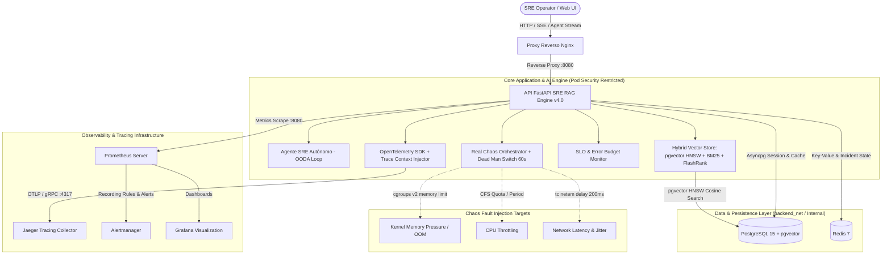

# Arquitetura do SRE Production Lab (v4.0)

## Visão Geral

O **SRE Production Lab v4.0** é uma plataforma corporativa avançada projetada para simulação, engenharia de caos, observabilidade tridimensional e resposta autônoma a incidentes baseada nos princípios modernos de **Site Reliability Engineering (SRE)** do Google e **Agentic AI**.

A arquitetura evoluiu para uma malha distribuída resiliente, incorporando agentes com ciclo OODA, recuperação híbrida de conhecimento via vetores e léxico, injeção de caos em nível de kernel com salvaguardas determinísticas, rastreamento distribuído OpenTelemetry ponta a ponta e conformidade estrita com o perfil **Pod Security Standards (PSS) Restricted**.

---

## Diagrama da Arquitetura v4.0

---

## Componentes da Arquitetura v4.0

### 1. Agente SRE Autônomo com Ciclo OODA (`app/agent/`)
- **Ciclo OODA (Observe, Orient, Decide, Act):**
  - **Observe (Observar):** Consulta métricas em tempo real no Prometheus (`query_prometheus`) e inspeciona eventos recentes de pods e nós no Kubernetes (`get_k8s_events`).
  - **Orient (Orientar):** Executa busca híbrida 3-stage no acervo de runbooks operacionais (`search_runbooks`) para correlacionar os sintomas com padrões conhecidos.
  - **Decide (Decidir):** Avalia os runbooks retornados, isola a provável causa raiz e seleciona o plano de mitigação ótimo.
  - **Act (Agir):** Executa ações corretivas (`execute_mitigation`), como escala de réplicas, reinicialização graciosa de pods em CrashLoop ou rollbacks, sob aprovação configurável (`auto_mitigate`).
- **Streaming de Telemetria:** Transmite cada estágio do raciocínio e execução ao vivo para o War Room via Server-Sent Events (SSE).

### 2. Motor de Busca Vetorial Híbrido 3-Stage (`app/rag/vector_store.py`)
- **Fase 1 (Recuperação Densa):** Busca por similaridade de cosseno usando `pgvector` com índice **HNSW** (`m=16`, `ef_construction=64`) para recall semântico profundo.
- **Fase 2 (Recuperação Esparsa):** Busca léxica com algoritmo **BM25Okapi** (`rank-bm25`), garantindo precisão em termos exatos como códigos de erro de contêiner (`exit code 137`), sinais do kernel (`SIGKILL`, `SIGTERM`) e nomes de anotações do Kubernetes.
- **Fase 3 (Fusão & Re-ranking):**
  - **Reciprocal Rank Fusion (RRF, $k=60$):** Combina as duas listas ordenadas de forma agnóstica à escala dos scores originais:
    $$RRF\_Score(d) = \sum_{m \in \{dense, sparse\}} rac{1}{60 + rank_m(d)}$$
  - **Cross-Encoder Re-ranking com FlashRank:** Reavalia os top $N$ documentos através de um modelo neural cross-encoder ultra-leve, garantindo ordenação precisa com sobretaxa de latência inferior a 15ms.
  - **Fallback Gracioso:** Opera automaticamente com o índice vetorial em memória (`sre_indexer`) caso o PostgreSQL ou pgvector estejam temporariamente indisponíveis.

### 3. Orquestrador de Chaos Engineering Real (`app/chaos_real.py`)
- **Injeção de Baixo Nível:**
  - **Pressão de Memória / OOM:** Manipulação direta de limites do cgroup v2 (`memory.max` / `memory.high`) simulando vazamentos e disparos do OOM Killer.
  - **CPU Throttling:** Ajuste fino do agendador CFS do Linux (`cpu.cfs_quota_us` / `cpu.cfs_period_us`) simulando contenção de processamento.
  - **Latência de Rede:** Emulação de atraso e jitter de pacotes utilizando `tc qdisc add dev eth0 root netem delay 200ms 40ms distribution normal`.
- **Dead Man's Switch Automático (60 Segundos):** Cada experimento inicia um temporizador assíncrono em background. Caso nenhuma intervenção manual ou reversão ocorra, o sistema restaura automaticamente os cgroups e qdiscs de rede para o estado padrão, prevenindo indisponibilidade permanente no cluster.

### 4. Observabilidade Tridimensional com OpenTelemetry & Jaeger (`app/telemetry.py`)
- **OpenTelemetry SDK:** TracerProvider configurado com recurso declarativo (`service.name=sre-rag-api`, `service.version=4.0`).
- **Instrumentação Automática:** Spans distribuídos gerados automaticamente para requisições FastAPI, transações assíncronas do PostgreSQL via `AsyncPGInstrumentor` e operações de cache com `RedisInstrumentor`.
- **Exportação OTLP/gRPC:** Spans são enviados via BatchSpanProcessor para o coletor Jaeger (`http://jaeger:4317`) com fallback silencioso para console em ambientes sem tracing.
- **Correlação Métrica-Log-Trace:** Processor dedicado no `structlog` (`inject_otel_context`) injeta `trace_id` e `span_id` em todos os eventos JSON estruturados, permitindo saltar de um log de erro diretamente para o rastreamento no Jaeger.

### 5. Monitoramento Dinâmico de SLO & Error Budget (`/api/v1/slo/error-budget`)
- **Cálculo em Tempo Real:** Avalia disponibilidade de 30 dias com base no target definido (e.g., 99.9% de uptime para rotas de saúde e consulta).
- **Consumo e Burn Rate:** Monitora percentual consumido e restante do Error Budget, emitindo alertas operacionais com status `healthy`, `warning` ou `critical`.

### 6. DevSecOps Corporativo & Pod Security Standards (PSS Restricted)
- **Deployment Helm:**
  - `readOnlyRootFilesystem: true` com volumes `emptyDir` efêmeros em `/tmp` e `/run`.
  - `runAsNonRoot: true` e `runAsUser: 10001`.
  - `allowPrivilegeEscalation: false`.
  - `capabilities.drop: ["ALL"]`.
  - `seccompProfile.type: RuntimeDefault`.
- **Zero-Trust NetworkPolicies:**
  - Isolamento estrito de tráfego ingress/egress.
  - A API só comunica com PostgreSQL na porta 5432, Redis na 6379, Jaeger na 4317 e CoreDNS na porta 53.
  - Banco de dados e cache rejeitam qualquer conexão externa à API.
- **Auditoria de Vulnerabilidades com Trivy:** Scan automatizado de arquivos de infraestrutura e dependências Python, garantindo ausência de CVEs críticas e prevenção de vazamento de credenciais.

---

## Matriz de Endpoints da API v4.0

| Método | Endpoint | Descrição |
| :--- | :--- | :--- |
| `POST` | `/api/v1/agent/diagnose` | Aciona o ciclo OODA do Agente SRE para diagnóstico e mitigação |
| `GET` | `/api/v1/agent/stream` | Stream SSE em tempo real das etapas de raciocínio do Agente |
| `POST` | `/api/v1/chaos/real/cgroup-oom` | Injeta limite estrito de cgroup memory gerando pressão de OOM |
| `POST` | `/api/v1/chaos/real/cpu-throttle`| Injeta limitação agressiva no agendador CFS de CPU |
| `POST` | `/api/v1/chaos/real/latency` | Injeta latência e jitter de rede via `tc netem` |
| `POST` | `/api/v1/chaos/real/revert` | Reversão manual imediata de todos os experimentos ativos |
| `GET` | `/api/v1/chaos/real/active` | Lista experimentos de caos ativos e tempo restante do Dead Man's Switch |
| `GET` | `/api/v1/slo/error-budget` | Retorna métricas de disponibilidade e queima de Error Budget |
| `POST` | `/api/v1/query` | Consulta RAG assistida pelo motor de busca híbrida 3-stage |
| `GET` | `/api/v1/events/stream` | Stream SSE de métricas operacionais e eventos do laboratório |
| `GET` | `/health` | Health check resiliente com latência real e cache TTL de 5s |
