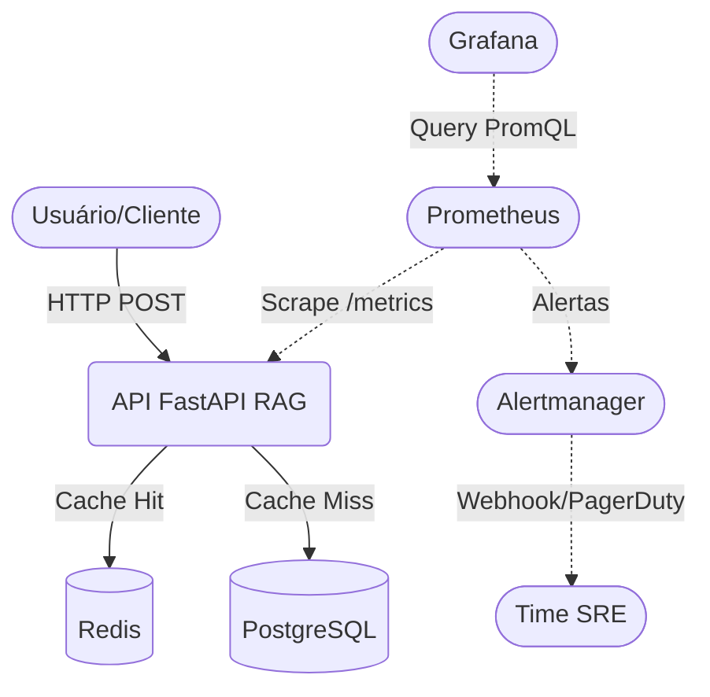

# Arquitetura do SRE Production Lab (v3.4)

## Visão Geral

Este laboratório simula um ambiente de produção moderno operado sob os princípios de **Site Reliability Engineering (SRE)**. A arquitetura foi desenhada para ser resiliente, observável e escalável.

## Componentes

### 1. Aplicação (API RAG) — v3.4
- **Tecnologia:** Python 3.12, FastAPI, LangChain, Sentence-transformers, `slowapi`.
- **Função:** Fornece um endpoint `POST /api/v1/query` de RAG (Retrieval-Augmented Generation) com embeddings assíncronos via `asyncio.to_thread`.
- **Chaos Engineering:** Possui um endpoint `POST /api/v1/chaos/500` para injeção de falhas controladas, permitindo testar a observabilidade e resposta a incidentes.
- **Segurança & Performance (v3.4):**
  - Rate limiting defensivo com `slowapi` (30 req/min no `/api/v1/query`, 200 req/min globais).
  - Security Headers automáticos em todas as respostas: `X-Frame-Options`, `Content-Security-Policy`, `X-Content-Type-Options`, `Referrer-Policy`, `Strict-Transport-Security` (produção).
  - CORS configurável por ambiente (wildcard em dev, allowlist restrita em produção).
  - Compressão GZip transparente para respostas > 1KB (`GZipMiddleware`).
  - Health checks com cache TTL de 5s para proteção contra connection storms em alta escala.

### 2. Proxy Reverso (Nginx) — v3.4
- **Função:** Recebe requisições externas na porta 80 e roteia para a API FastAPI (`http://api:8080`).
- **Compressão:** `gzip on` com `gzip_comp_level 6` para todos os tipos MIME relevantes (HTML, CSS, JSON, JS, SVG).
- **Cache de Estáticos:** `location /static/` com `expires 1h` e `Cache-Control: public, immutable` para assets versionados.
- **Timeouts Defensivos:** `proxy_connect_timeout 5s`, `proxy_read_timeout 30s`, `proxy_send_timeout 10s`.

### 3. Bancos de Dados e Cache
- **PostgreSQL (Vector DB Mock):** Armazena os embeddings e documentos. Implantado como um `StatefulSet` no Kubernetes com volumes persistentes.
- **Redis:** Atua como camada de cache para consultas frequentes, diminuindo a carga no banco de dados e melhorando a latência. Também roda como `StatefulSet`.

### 4. Kubernetes (Plataforma)
- **Deployment & HPA:** A API roda sob um `Deployment` gerenciado por um `HorizontalPodAutoscaler` (HPA) baseado em CPU/Memória.
- **PodDisruptionBudget (PDB):** Garante alta disponibilidade (minAvailable) durante manutenções nos nós.
- **NetworkPolicies:** Aplica o princípio de privilégio mínimo (Zero Trust). A API só pode falar com Postgres/Redis. Postgres/Redis só aceitam tráfego da API.

### 5. Observabilidade (Stack Prometheus)
- **Prometheus:** Coleta métricas da API (RED methodology - Rate, Errors, Duration) e recursos do cluster via `ServiceMonitor`. Contém Recording Rules para computar SLIs em tempo real.
- **Grafana:** Visualização dos SLOs, Taxa de Queima (Burn Rate) de Error Budget e Sinais Dourados (Golden Signals).
- **Alertmanager:** Configurado para roteamento baseado em severidade (`critical` vs `warning`), com regras de supressão (inhibition).

### 6. CI/CD (GitHub Actions)
- **CI Pipeline:** Lint (Ruff), Testes unitários/cobertura, Scan de segurança em dependências e contêineres (Trivy), Helm Lint, Docker Build & Push.
- **CD Pipeline:** Deploy automático em Staging, execução de Smoke Tests, Deploy manual ou automático em Produção (com rollback automático em caso de falha de rollout).

## Diagrama de Fluxo

