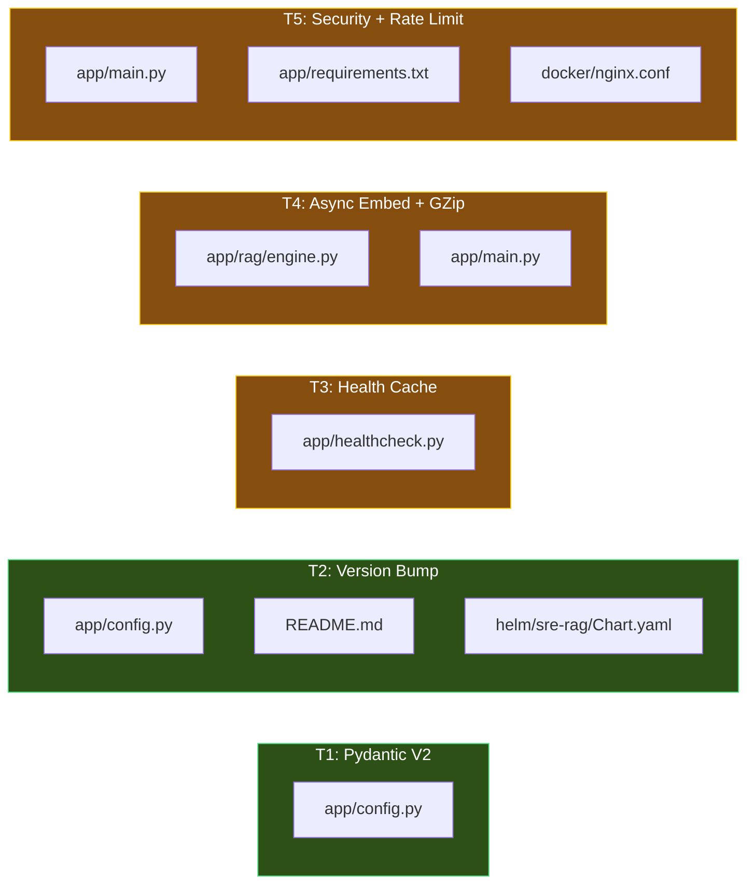

# 🚀 Plano de Implementação — SRE RAG Agent v3.4
## Quick Wins & Hardening — Deadline: 16 de Outubro de 2026

> [!IMPORTANT]
> Este documento detalha **todas** as alterações planejadas para a versão 3.4, com diffs exatos, ordem de execução e testes de validação. **Nenhuma execução foi feita.** O plano está pronto para ser executado amanhã.

---

## 📋 Sumário das Tarefas (5 Tasks)

| # | Task | Arquivo(s) Alvo | Risco | Esforço |
|---|---|---|---|---|
| T1 | Correção Pydantic V2 `ConfigDict` | [`config.py`](../app/config.py) | 🟢 Baixo | ~5 min |
| T2 | Bump de versão para `3.4` | [`config.py`](../app/config.py), [`README.md`](../README.md), [`Chart.yaml`](../helm/sre-rag/Chart.yaml) | 🟢 Baixo | ~5 min |
| T3 | Health Check com Cache TTL + Latência Real | [`healthcheck.py`](../app/healthcheck.py) | 🟡 Médio | ~20 min |
| T4 | `asyncio.to_thread` para embeddings + GZip | [`rag/engine.py`](../app/rag/engine.py), [`main.py`](../app/main.py) | 🟡 Médio | ~15 min |
| T5 | Rate Limiting + Security Headers + CORS | [`main.py`](../app/main.py), [`requirements.txt`](../app/requirements.txt), [`nginx.conf`](../docker/nginx.conf) | 🟡 Médio | ~25 min |

**Tempo Total Estimado**: ~70 minutos (sem contar testes)

---

## ✅ Pré-requisitos de Validação

Antes de iniciar, confirmar que os testes atuais passam sem regressões:

```bash
cd /home/magno/sre_rag_agent
PYTHONPATH=app ./app/.venv/bin/pytest tests/test_incidents.py tests/test_chaos.py -v
```

Resultado esperado: **4 passed** (confirmado em 15/10/2026)

---

## T1. Correção Pydantic V2 `ConfigDict`

### Problema
[`app/config.py`](../app/config.py) usa `class Config:` interno (linha 95-97) que é depreciado no Pydantic V2, gerando o warning:
```
PydanticDeprecatedSince20: Support for class-based `config` is deprecated,
use ConfigDict instead. Deprecated in Pydantic V2.0 to be removed in V3.0.
```

### Diff Planejado

```diff
 """
 SRE RAG Agent — Configuration Module
 Loads settings from environment variables with sensible defaults.
 """

-from pydantic_settings import BaseSettings
+from pydantic_settings import BaseSettings, SettingsConfigDict
 from pydantic import Field


 class Settings(BaseSettings):
     """Application settings loaded from environment variables."""

+    model_config = SettingsConfigDict(
+        env_prefix="",
+        case_sensitive=False,
+        extra="ignore",
+    )
+
     # Application
     app_name: str = Field(default="sre-rag-api", description="Application name")
```

E remover a `class Config` depreciada no final da classe:

```diff
     @property
     def redis_url(self) -> str:
         auth = f":{self.redis_password}@" if self.redis_password else ""
         return f"redis://{auth}{self.redis_host}:{self.redis_port}/{self.redis_db}"

-    class Config:
-        env_prefix = ""
-        case_sensitive = False
-

 settings = Settings()
```

### Validação

```bash
PYTHONPATH=app python3 -c "from config import settings; print(settings.app_version)"
# Não deve emitir nenhum DeprecationWarning

PYTHONPATH=app python3 -W error::DeprecationWarning -c "from config import settings"
# Deve sair com código 0 (sem warnings)
```

---

## T2. Bump de Versão para `3.4`

### Diff em `app/config.py`

```diff
     # Application
     app_name: str = Field(default="sre-rag-api", description="Application name")
-    app_version: str = Field(default="3.3", description="Application version")
+    app_version: str = Field(default="3.4", description="Application version")
```

### Diff em `helm/sre-rag/Chart.yaml`

```diff
-appVersion: "3.3"
+appVersion: "3.4"
```

### Diff em `README.md`

Atualizar badges de versão e adicionar seção de novidades v3.4 no topo do changelog (em ambos os idiomas, PT e EN). O conteúdo exato do changelog será determinado após implementação das tasks T3-T5, mas deverá incluir:

- Eliminação de deprecation warnings do Pydantic V2
- Cache TTL no healthcheck (proteção contra connection storms)
- Embeddings assíncronos com `asyncio.to_thread`
- Compressão GZip no FastAPI e Nginx
- Rate limiting defensivo com `slowapi`
- Headers de segurança HTTP (CSP, HSTS, X-Frame-Options)
- CORS middleware configurável por ambiente

---

## T3. Health Check com Cache TTL + Latência Real

### Problema Atual

Em [`app/healthcheck.py`](../app/healthcheck.py), cada chamada a `check_postgres()` (L32-L48) e `check_redis()` (L50-L67) abre uma **nova conexão socket síncrona**, executa uma query e fecha imediatamente. Com probes do kubelet a cada 5 segundos e `N` réplicas, isso gera até `N * 12` conexões de banco por minuto apenas para health checks.

**Dois bugs adicionais identificados**:
1. `check_postgres()` retorna `"latency_ms": 0` hardcoded — nunca mede a latência real.
2. `check_redis()` cria um novo client mas não aplica cache, e o `client.close()` gera overhead desnecessário.

### Diff Planejado

```diff
 """
 SRE RAG Agent — Health Check Module
 Implements liveness, readiness, and startup probe endpoints.
 """

 import time
+from typing import Optional
 import redis
 import psycopg2
 import structlog
 from config import settings

 logger = structlog.get_logger()

+# Cache TTL in seconds — shields databases from probe storms
+_HEALTH_CACHE_TTL = 5.0
+

 class HealthChecker:
     """Checks health of all dependencies."""

     def __init__(self):
         self._started = False
         self._start_time = time.time()
+        # TTL-cached health check results
+        self._cached_postgres: Optional[dict] = None
+        self._cached_postgres_at: float = 0.0
+        self._cached_redis: Optional[dict] = None
+        self._cached_redis_at: float = 0.0

     def mark_started(self):
         """Mark application as fully started."""
         self._started = True

     @property
     def uptime_seconds(self) -> float:
         return time.time() - self._start_time

     def check_postgres(self) -> dict:
-        """Check PostgreSQL connectivity."""
+        """Check PostgreSQL connectivity with TTL cache."""
+        now = time.time()
+        if self._cached_postgres and (now - self._cached_postgres_at) < _HEALTH_CACHE_TTL:
+            return self._cached_postgres
+
         try:
+            start = time.time()
             conn = psycopg2.connect(
                 host=settings.postgres_host,
                 port=settings.postgres_port,
                 dbname=settings.postgres_db,
                 user=settings.postgres_user,
                 password=settings.postgres_password,
                 connect_timeout=3,
             )
             cursor = conn.cursor()
             cursor.execute("SELECT 1")
             cursor.close()
             conn.close()
-            return {"status": "healthy", "latency_ms": 0}
+            latency = (time.time() - start) * 1000
+            result = {"status": "healthy", "latency_ms": round(latency, 2)}
         except Exception as e:
             logger.error("postgres_health_check_failed", error=str(e))
-            return {"status": "unhealthy", "error": str(e)}
+            result = {"status": "unhealthy", "error": str(e)}
+
+        self._cached_postgres = result
+        self._cached_postgres_at = now
+        return result

     def check_redis(self) -> dict:
-        """Check Redis connectivity."""
+        """Check Redis connectivity with TTL cache."""
+        now = time.time()
+        if self._cached_redis and (now - self._cached_redis_at) < _HEALTH_CACHE_TTL:
+            return self._cached_redis
+
         try:
             client = redis.Redis(
                 host=settings.redis_host,
                 port=settings.redis_port,
                 db=settings.redis_db,
                 password=settings.redis_password or None,
                 socket_timeout=3,
             )
             start = time.time()
             client.ping()
             latency = (time.time() - start) * 1000
             client.close()
-            return {"status": "healthy", "latency_ms": round(latency, 2)}
+            result = {"status": "healthy", "latency_ms": round(latency, 2)}
         except Exception as e:
             logger.error("redis_health_check_failed", error=str(e))
-            return {"status": "unhealthy", "error": str(e)}
+            result = {"status": "unhealthy", "error": str(e)}
+
+        self._cached_redis = result
+        self._cached_redis_at = now
+        return result
```

### Validação

```bash
PYTHONPATH=app python3 -c "
from healthcheck import health_checker
import time

# 1a chamada: abre conexao real
r1 = health_checker.check_postgres()
print('1st call (real):', r1)

# 2a chamada < 5s: deve retornar cache
r2 = health_checker.check_postgres()
print('2nd call (cached):', r2)
assert r1 is r2, 'Should be same cached dict'
print('Cache TTL OK')
"
```

---

## T4. `asyncio.to_thread` para Embeddings + GZip Middleware

### Problema Atual

Em [`app/rag/engine.py`](../app/rag/engine.py) (L112), `generate_query_embedding(question)` executa `SentenceTransformer.encode()` sincronamente na thread principal do event loop do FastAPI. Isso bloqueia **todas** as requisições HTTP concorrentes durante o cálculo do embedding (~20-50ms por query no CPU).

### Diff em `app/rag/engine.py`

Adicionar `import asyncio` nos imports do topo:

```diff
+import asyncio
 import json
 import time
 import hashlib
 import structlog
 import redis
 from config import settings
```

Alterar a chamada síncrona para assíncrona no método `query()`:

```diff
     async def query(self, question: str) -> dict:
         """
         Process a RAG query: embed -> retrieve -> synthesize SRE answer.
         """
         start_time = time.time()

         try:
             # 1. Check cache
             cached = self._get_cached_result(question)
             if cached:
                 RAG_QUERIES_TOTAL.labels(status="cache_hit").inc()
                 cached["from_cache"] = True
                 return cached

-            # 2. Generate query embedding
-            query_embedding = generate_query_embedding(question)
+            # 2. Generate query embedding (offloaded to thread pool to avoid blocking event loop)
+            query_embedding = await asyncio.to_thread(generate_query_embedding, question)
```

### Diff em `app/main.py` — GZip Middleware

Adicionar import e middleware de compressão HTTP logo após a criação do `app` e antes do `app.mount`:

```diff
+from fastapi.middleware.gzip import GZipMiddleware

 # ... (FastAPI app creation) ...

+# Enable transparent GZip compression for responses > 1KB
+app.add_middleware(GZipMiddleware, minimum_size=1000)
+
 # Mount static files
 app.mount("/static", StaticFiles(directory=str(STATIC_DIR)), name="static")
```

### Validação

```bash
# Testar que o endpoint de query RAG funciona com async offload
PYTHONPATH=app ./app/.venv/bin/pytest tests/test_rag.py -v -k "test_rag_engine"

# Testar compressao GZip via curl (comparar tamanhos)
# Sem GZip:
curl -s -o /dev/null -w "Without gzip: %{size_download} bytes\n" http://localhost:8080/dashboard
# Com GZip:
curl -s -H "Accept-Encoding: gzip" -o /dev/null -w "With gzip: %{size_download} bytes\n" http://localhost:8080/dashboard
```

---

## T5. Rate Limiting + Security Headers + CORS

### T5a. Nova Dependência em `requirements.txt`

```diff
 python-dotenv==1.0.1
+slowapi==0.1.9
```

> [!NOTE]
> `slowapi` puxa `limits` como dependência transitiva que suporta Redis como backend de contagem de tokens, alinhado ao Redis já existente no docker-compose.

### T5b. Rate Limiting em `app/main.py`

Adicionar nos imports:

```diff
+from slowapi import Limiter, _rate_limit_exceeded_handler
+from slowapi.util import get_remote_address
+from slowapi.errors import RateLimitExceeded
+from starlette.middleware.cors import CORSMiddleware
```

Adicionar logo após a criação do FastAPI `app`:

```diff
 app = FastAPI(
     title=settings.app_name,
     ...
 )

+# ============================================================
+# Rate Limiting (Redis-backed)
+# ============================================================
+limiter = Limiter(
+    key_func=get_remote_address,
+    default_limits=["200/minute"],
+)
+app.state.limiter = limiter
+app.add_exception_handler(RateLimitExceeded, _rate_limit_exceeded_handler)
+
+# ============================================================
+# CORS — Restrict origins in production
+# ============================================================
+app.add_middleware(
+    CORSMiddleware,
+    allow_origins=["*"] if not settings.is_production else [
+        "https://sre-rag.example.com",
+    ],
+    allow_methods=["GET", "POST", "DELETE"],
+    allow_headers=["*"],
+    allow_credentials=True,
+)
```

Aplicar limite estrito no endpoint de query RAG (o mais custoso computacionalmente):

```diff
 @app.post("/api/v1/query", tags=["RAG"])
+@limiter.limit("30/minute")
 async def query_rag(request: Request, body: dict):
```

### T5c. Security Headers Middleware em `app/main.py`

Adicionar um **novo middleware de segurança HTTP** imediatamente antes do `metrics_middleware` existente. A ordem importa: o FastAPI executa middlewares na **ordem inversa de registro**, então o security headers middleware registrado antes será executado depois — garantindo que os headers sejam injetados em todas as respostas, inclusive nas geradas pelo metrics_middleware e pelo chaos monkey.

```diff
+# ============================================================
+# Middleware: HTTP Security Headers
+# ============================================================
+@app.middleware("http")
+async def security_headers_middleware(request: Request, call_next):
+    """Inject defensive HTTP security headers into every response."""
+    response = await call_next(request)
+    response.headers["X-Frame-Options"] = "DENY"
+    response.headers["X-Content-Type-Options"] = "nosniff"
+    response.headers["Referrer-Policy"] = "strict-origin-when-cross-origin"
+    response.headers["Permissions-Policy"] = "camera=(), microphone=(), geolocation=()"
+    response.headers["X-XSS-Protection"] = "1; mode=block"
+    if settings.is_production:
+        response.headers["Strict-Transport-Security"] = (
+            "max-age=31536000; includeSubDomains"
+        )
+    response.headers["Content-Security-Policy"] = (
+        "default-src 'self'; "
+        "script-src 'self' 'unsafe-inline'; "
+        "style-src 'self' 'unsafe-inline' https://fonts.googleapis.com; "
+        "font-src 'self' https://fonts.gstatic.com; "
+        "img-src 'self' data:; "
+        "connect-src 'self'"
+    )
+    return response
+
+
 # ============================================================
 # Middleware: Metrics Collection
 # ============================================================
 @app.middleware("http")
 async def metrics_middleware(request: Request, call_next):
```

### T5d. Nginx Compression & Static Caching em `docker/nginx.conf`

```diff
 server {
     listen 80;

+    # --- Compression ---
+    gzip on;
+    gzip_vary on;
+    gzip_proxied any;
+    gzip_comp_level 6;
+    gzip_min_length 1024;
+    gzip_types
+        text/plain
+        text/css
+        text/javascript
+        application/json
+        application/javascript
+        image/svg+xml;
+
     location / {
         proxy_pass http://api:8080;
         proxy_set_header Host $host;
         proxy_set_header X-Real-IP $remote_addr;
         proxy_set_header X-Forwarded-For $proxy_add_x_forwarded_for;
         proxy_set_header X-Forwarded-Proto $scheme;
+
+        # Proxy timeouts
+        proxy_connect_timeout 5s;
+        proxy_read_timeout 30s;
+        proxy_send_timeout 10s;
     }
+
+    # Cache static assets
+    location /static/ {
+        proxy_pass http://api:8080/static/;
+        proxy_cache_valid 200 1h;
+        expires 1h;
+        add_header Cache-Control "public, immutable";
+    }
 }
```

### Validação

```bash
# Instalar slowapi no .venv
cd /home/magno/sre_rag_agent
./app/.venv/bin/pip install slowapi==0.1.9

# Testar que a aplicacao inicializa sem erros
PYTHONPATH=app ./app/.venv/bin/python -c "from main import app; print('App init OK')"

# Verificar security headers na resposta
curl -s -D- http://localhost:8080/healthz | grep -iE "x-frame|x-content-type|referrer|content-security"

# Testar rate limiting (excesso de 30 req/min em /api/v1/query)
for i in $(seq 1 35); do
  STATUS=$(curl -s -o /dev/null -w "%{http_code}" -X POST http://localhost:8080/api/v1/query \
    -H "Content-Type: application/json" -d '{"question":"test"}')
  echo "Request $i: HTTP $STATUS"
done
# Espera-se: HTTP 429 (Too Many Requests) a partir do 31o request
```

---

## 📝 Checklist Pos-Implementacao

### Testes Obrigatorios

```bash
# 1. Testes unitarios existentes (regressao)
PYTHONPATH=app ./app/.venv/bin/pytest tests/test_incidents.py tests/test_chaos.py -v

# 2. Validacao de sintaxe JS do frontend (nao alterado, mas confirmar)
node -c app/static/js/dashboard.js

# 3. Validacao de sintaxe Python de todos os modulos modificados
python3 -m py_compile app/config.py
python3 -m py_compile app/healthcheck.py
python3 -m py_compile app/rag/engine.py
python3 -m py_compile app/main.py

# 4. Sem deprecation warnings
PYTHONPATH=app python3 -W error::DeprecationWarning -c "from config import settings; print('No warnings')"

# 5. Docker build smoke test
docker compose build api
```

### Validacao com Docker Compose

```bash
docker compose up -d
sleep 10

# Health check
curl -s http://localhost/healthz | python3 -m json.tool

# Security headers
curl -s -D- http://localhost/dashboard 2>&1 | head -20

# GZip
curl -s -H "Accept-Encoding: gzip" -o /dev/null -w "Size: %{size_download}\n" http://localhost/dashboard

docker compose down
```

---

## 📁 Mapa de Arquivos Impactados



---

## ⏱️ Ordem de Execucao Recomendada

```mermaid
gantt
    title Sequencia de Execucao — v3.4
    dateFormat HH:mm
    axisFormat %H:%M
    section Fundacao
    T1 - Pydantic V2 ConfigDict           :t1, 09:00, 5m
    T2 - Version bump 3.3 para 3.4        :t2, after t1, 5m
    section Core
    T3 - Healthcheck Cache TTL            :t3, after t2, 20m
    T4 - asyncio.to_thread + GZip         :t4, after t3, 15m
    section Security
    T5 - Rate Limit + Headers + CORS      :t5, after t4, 25m
    section Validacao
    Testes unitarios + Docker build        :t6, after t5, 20m
```



---

## 🔒 Critérios de Aceite (Definition of Done)

- [ ] Nenhum `DeprecationWarning` do Pydantic ao inicializar `settings`
- [ ] `app_version` retorna `"3.4"` em `/healthz` e `/docs`
- [ ] `check_postgres()` retorna latência real em `latency_ms` (não mais `0`)
- [ ] Chamadas consecutivas a `/ready` em < 5s reusam resultado cacheado
- [ ] Embedding de queries RAG não bloqueia o event loop (executado via `asyncio.to_thread`)
- [ ] Header `Content-Encoding: gzip` presente em respostas > 1KB
- [ ] Headers de segurança (`X-Frame-Options`, `CSP`, `X-Content-Type-Options`) presentes em todas as respostas
- [ ] Rate limiting ativo: HTTP 429 após exceder 30 req/min no `/api/v1/query`
- [ ] CORS configurado com wildcard em dev e origins restritas em produção
- [ ] Nginx comprime `.js`, `.css` e cacheia `/static/` com `expires 1h`
- [ ] Todos os 4 testes existentes passam sem regressões
- [ ] `docker compose build api` completa sem erros
