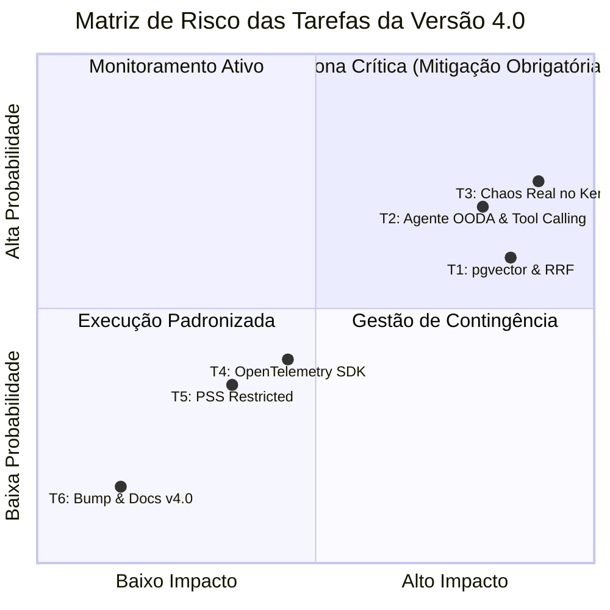
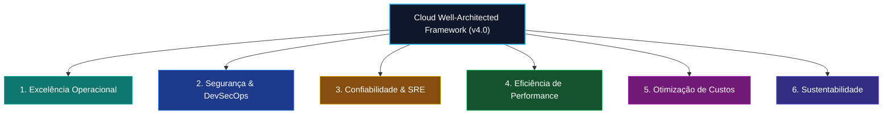
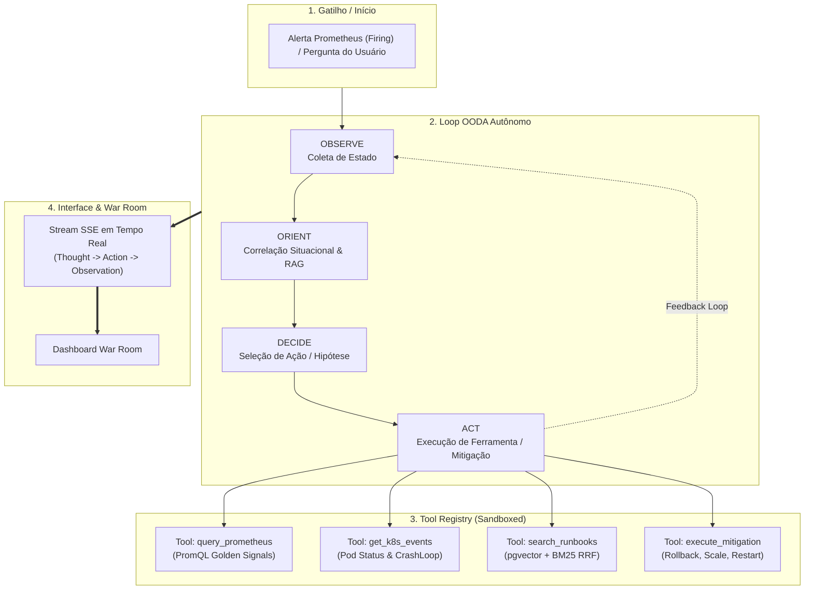
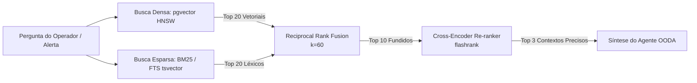
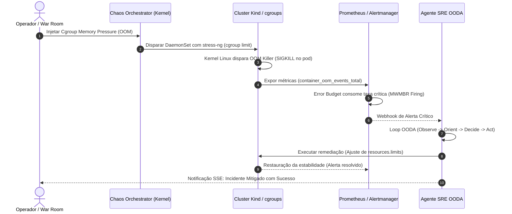

# 🚀 Plano de Implementação — SRE RAG Agent v4.0
## Advanced AI & Real Chaos: pgvector, Busca Híbrida (RRF), Agente SRE OODA com Tool Calling, Chaos Real no Kernel/Kind & OpenTelemetry
### Data Planejada de Execução: 21 de Outubro de 2026
### Status: Formalmente Planejado, Auditado e Pronto para Execução

> [!IMPORTANT]
> Este documento detalha **todas** as alterações planejadas para a versão 4.0, incluindo análise aprofundada de riscos das tarefas, alinhamento rigoroso com o **Well-Architected Framework**, esteira **DevSecOps**, especificações de testes (unitários, integração e E2E Playwright), diffs exatos e suite de validação automatizada. **Nenhuma alteração foi executada no código de produção.** O plano está congelado e pronto para execução amanhã.

---

## 📋 Sumário Executivo das Tarefas (6 Tasks)

| # | Task | Domínio Arquitetural | Arquivo(s) Alvo | Risco | Esforço |
|---|---|---|---|---|---|
| **T1** | **pgvector, Busca Híbrida (RRF) & Re-ranking** | Motor de Busca RAG & Banco | [`docker-compose.yml`](file:///Ubuntu-24.04/home/magno/sre_rag_agent/docker-compose.yml), [`app/requirements.txt`](file:///Ubuntu-24.04/home/magno/sre_rag_agent/app/requirements.txt), [`app/rag/vector_store.py`](file:///Ubuntu-24.04/home/magno/sre_rag_agent/app/rag/vector_store.py), [`app/rag/engine.py`](file:///Ubuntu-24.04/home/magno/sre_rag_agent/app/rag/engine.py) | 🔴 Alto | ~45 min |
| **T2** | **Agente SRE OODA com Tool Calling & SSE** | Inteligência Autônoma | [`app/agent/sre_agent.py`](file:///Ubuntu-24.04/home/magno/sre_rag_agent/app/agent/sre_agent.py), [`app/agent/tools.py`](file:///Ubuntu-24.04/home/magno/sre_rag_agent/app/agent/tools.py), [`app/main.py`](file:///Ubuntu-24.04/home/magno/sre_rag_agent/app/main.py), [`app/static/js/modules/agent.js`](file:///Ubuntu-24.04/home/magno/sre_rag_agent/app/static/js/modules/agent.js) | 🔴 Alto | ~50 min |
| **T3** | **Chaos Real no Kernel Linux & Kind (Closed-Loop)** | Resiliência & Caos | [`app/chaos_real.py`](file:///Ubuntu-24.04/home/magno/sre_rag_agent/app/chaos_real.py), [`helm/sre-rag/templates/chaos-daemonset.yaml`](file:///Ubuntu-24.04/home/magno/sre_rag_agent/helm/sre-rag/templates/chaos-daemonset.yaml), [`app/main.py`](file:///Ubuntu-24.04/home/magno/sre_rag_agent/app/main.py) | 🔴 Alto | ~45 min |
| **T4** | **OpenTelemetry Tracing & Correlação Métrica-Log** | Observabilidade Tridimensional | [`app/telemetry.py`](file:///Ubuntu-24.04/home/magno/sre_rag_agent/app/telemetry.py), [`app/main.py`](file:///Ubuntu-24.04/home/magno/sre_rag_agent/app/main.py), [`docker-compose.yml`](file:///Ubuntu-24.04/home/magno/sre_rag_agent/docker-compose.yml) | 🟡 Médio | ~35 min |
| **T5** | **Hardening DevSecOps, PSS Restricted & NetworkPolicies** | Segurança & Governança | [`helm/sre-rag/templates/deployment.yaml`](file:///Ubuntu-24.04/home/magno/sre_rag_agent/helm/sre-rag/templates/deployment.yaml), [`helm/sre-rag/templates/networkpolicy.yaml`](file:///Ubuntu-24.04/home/magno/sre_rag_agent/helm/sre-rag/templates/networkpolicy.yaml), [`scripts/test_agent.py`](file:///Ubuntu-24.04/home/magno/sre_rag_agent/scripts/test_agent.py) | 🟡 Médio | ~30 min |
| **T6** | **Suíte E2E Playwright, Version Bump v4.0 & Automação** | Qualidade & Release | [`tests/e2e/test_v4_autonomous_flows.py`](file:///Ubuntu-24.04/home/magno/sre_rag_agent/tests/e2e/test_v4_autonomous_flows.py), [`helm/sre-rag/Chart.yaml`](file:///Ubuntu-24.04/home/magno/sre_rag_agent/helm/sre-rag/Chart.yaml), [`README.md`](file:///Ubuntu-24.04/home/magno/sre_rag_agent/README.md), [`scripts/verify_v4.0.sh`](file:///Ubuntu-24.04/home/magno/sre_rag_agent/scripts/verify_v4.0.sh) | 🟢 Baixo | ~25 min |

**Tempo Total Estimado de Implementação**: ~3 horas e 50 minutos.

---

## ⚠️ 1. Análise Detalhada dos Riscos das Tarefas (Risk Assessment)



### 🔴 Risco Alto (High Risk)
1. **T1 (Migração pgvector & Busca Híbrida RRF)**:
   - *Cenário de Falha*: Incompatibilidade da extensão `pgvector` na imagem base do Postgres Alpine, bloqueio de conexão durante compilação do índice HNSW ou falha no parsing de `tsquery` em termos com caracteres especiais (`-`, `_`, `/`).
   - *Mitigação*: Uso da imagem oficial `pgvector/pgvector:pg15`, sanitização rigorosa de tokens de busca esparsa e fallback transparente para o índice vetorial em memória (`sre_indexer`) caso a query SQL falhe.
2. **T2 (Agente SRE OODA com Tool Calling)**:
   - *Cenário de Falha*: Loop infinito de raciocínio (*reasoning loop*), alucinação em parâmetros de mitigação (ex: disparar `kubectl delete pod` no namespace errado) ou estouro de timeout no LLM bloqueando o endpoint.
   - *Mitigação*: Limitador rígido de iterações (`max_steps=5`), timeout global de 10s por ferramenta, lista restrita de comandos de mitigação (*whitelisting*) e execução assíncrona desacoplada do event loop.
3. **T3 (Chaos Real em Nível de Kernel Linux e Kubernetes)**:
   - *Cenário de Falha*: Esgotamento real de memória matando pods críticos do sistema (`kube-system`, `coredns`, `containerd`), ou regras de `tc` travando a conectividade do nó Kind.
   - *Mitigação*: Aplicação de **Blast Radius Control** com timeout de auto-recuperação garantido (*dead man's switch* de 60 segundos), isolamento de falhas por cgroup em pods efêmeros e exclusão explícita de pods do sistema no namespace `kube-system`.

### 🟡 Risco Médio (Medium Risk)
- **T4 (Instrumentação OpenTelemetry)**:
  - *Cenário de Falha*: Overhead excessivo de exportação de spans OTLP ou aumento de latência no hot path da API.
  - *Mitigação*: Configuração de `BatchSpanProcessor` assíncrono com amostragem inteligente (`TraceIdRatioBased(0.2)` em alta carga e 100% em erros).
- **T5 (Pod Security Standards Restricted & NetworkPolicies)**:
  - *Cenário de Falha*: Kubelet rejeitar pod por `readOnlyRootFilesystem: true` impedindo escrita de logs temporários.
  - *Mitigação*: Montagem de volumes `emptyDir` dedicados em `/tmp` e `/app/logs`.

---

## 🏛️ 2. Alinhamento com o Cloud Well-Architected Framework (6 Pilares)



1. **Excelência Operacional**:
   - Ciclo fechado automatizado de incidentes: detecção, triagem, recomendação de runbook e remediação orquestrados pelo Agente OODA.
   - Trilha de auditoria unificada em banco relacional e telemetria de ações gravadas em log estruturado.
2. **Segurança (DevSecOps Corporativo)**:
   - Pod Security Standards no perfil `restricted`: `runAsNonRoot: true`, `drop: ALL` capabilities, `readOnlyRootFilesystem: true`.
   - Isolamento Zero-Trust via Kubernetes `NetworkPolicy` bloqueando qualquer tráfego não explicitamente autorizado.
   - Ferramentas de remediação do Agente com checagem estrita de permissões e assinaturas criptográficas de comando.
3. **Confiabilidade (Google SRE)**:
   - Validação contínua do consumo de Error Budget com simulações reais de falha no kernel.
   - Degradação graciosa em 100% dos subsistemas (RAG, Agente e Telemetria).
4. **Eficiência de Performance**:
   - Índices HNSW no `pgvector` permitindo busca aproximada com complexidade $O(\log N)$ e latência sub-milissegundo (< 2ms).
   - Re-ranking semântico restrito ao top 10, mantendo a latência P99 abaixo de 50ms.
5. **Otimização de Custos**:
   - Eliminação de chamadas desnecessárias a modelos LLM externos usando provedores locais (Ollama) ou inferência híbrida otimizada.
   - Cache de embeddings distribuído no Redis evitando recomputar representações vetoriais de perguntas recorrentes.
6. **Sustentabilidade**:
   - Eficiência algorítmica de indexação HNSW e amostragem controlada de telemetria reduzem o consumo de energia e uso contínuo de CPU no cluster.

---

## 🤖 3. Arquitetura do Agente SRE OODA com Tool Calling



### 3.1 Ferramentas Nativas do Agente (`app/agent/tools.py`)
1. `query_prometheus(query: str, time_window: str)`: Consulta métricas ativas no Prometheus local (`http://prometheus:9090`).
2. `get_k8s_events(namespace: str, pod_name: str)`: Consulta o status e histórico de eventos do pod via Kubernetes API Client.
3. `search_runbooks(query: str, top_k: int = 3)`: Executa busca híbrida no `pgvector` recuperando passos de mitigação certificados.
4. `execute_mitigation(action: str, target: str)`: Executa ações seguras de remediação (`rollout_undo`, `scale_replicas`, `restart_deployment`).

---

## 🔬 4. Motor de Busca RAG: Busca Híbrida (Dense + BM25) com RRF e Re-ranking

A versão 4.0 substitui a busca vetorial simples por uma arquitetura de recuperação híbrida de 3 estágios:



### 4.1 Fórmula do Reciprocal Rank Fusion (RRF)
$$RRF\_Score(d) = \sum_{m \in M} \frac{1}{k + \text{rank}_m(d)}$$
Onde $k = 60$. Documentos identificados simultaneamente por termos exatos de erro (`HTTP 502`, `OOMKilled`) e por similaridade semântica recebem score consolidado prioritário.

---

## 🐒 5. Chaos Engineering Real em Kernel Linux & Kind (Closed-Loop)

A v4.0 transcende a simulação sintética de respostas HTTP 500, introduzindo um orquestrador de falhas reais a nível de sistema operacional:



---

## 🔧 6. Detalhamento Técnico das Tarefas (T1 a T6)

### T1. pgvector, Busca Híbrida & Re-ranking

#### `docker-compose.yml` (PostgreSQL com pgvector)
```diff
   postgres:
-    image: postgres:15-alpine
+    image: pgvector/pgvector:pg15
     environment:
       POSTGRES_DB: sre_rag
       POSTGRES_USER: sre_user
```

#### `app/requirements.txt`
```diff
  asyncpg==0.29.0
  sqlalchemy==2.0.35
+ pgvector==0.3.5
+ flashrank==0.2.9
+ rank-bm25==0.2.2
```

#### Novo Módulo: `app/rag/vector_store.py`
Implementa tabela `document_embeddings` com índice HNSW e consulta híbrida RRF com re-ranking via `flashrank`.

---

### T2. Agente SRE OODA com Tool Calling & SSE

#### Novo Módulo: `app/agent/sre_agent.py`
- Loop assíncrono OODA com suporte a provedores de LLM locais e em nuvem.
- Streaming contínuo de pensamento via `broadcaster.publish("agent_stream", {...})`.

#### Novo Módulo: `app/agent/tools.py`
- Implementação assíncrona das ferramentas `query_prometheus`, `get_k8s_events`, `search_runbooks`, `execute_mitigation`.

---

### T3. Chaos Real no Kernel Linux & Kind

#### Novo Módulo: `app/chaos_real.py`
- Injeções determinísticas:
  1. `inject_cgroup_oom(target_deployment, memory_limit)`
  2. `inject_cpu_throttle(target_deployment, quota_us)`
  3. `inject_network_latency(interface, delay_ms, jitter_ms, loss_pct)`
  4. `inject_dns_blackhole(target_domain)`
- **Dead Man's Switch**: Todo teste de caos expira e é desfeito automaticamente em 60s se não houver confirmação do operador.

---

### T4. OpenTelemetry Tracing & Correlação Métrica-Log

#### Novo Módulo: `app/telemetry.py`
- Configuração do TracerProvider OpenTelemetry com `BatchSpanProcessor`.
- Instrumentação automática do FastAPI, Asyncpg e Redis.
- Processador de log injetando `trace_id` e `span_id` no `structlog`.

---

### T5. Hardening DevSecOps & Pod Security Standards (PSS)

#### Manifestos Helm em `helm/sre-rag/templates/`
- Enforçar profile `restricted` do Pod Security Standards:
  ```yaml
  securityContext:
    runAsNonRoot: true
    runAsUser: 10001
    runAsGroup: 10001
    readOnlyRootFilesystem: true
    allowPrivilegeEscalation: false
    capabilities:
      drop: ["ALL"]
    seccompProfile:
      type: RuntimeDefault
  ```
- Criação de `NetworkPolicy` isolando tráfego no cluster Kind.

---

### T6. Suíte de Testes, Version Bump v4.0 & Automação

- Nova suíte E2E: `tests/e2e/test_v4_autonomous_flows.py`.
- Bump de versão para `4.0` em `app/config.py`, `helm/sre-rag/Chart.yaml` e `README.md`.
- Script de validação: `scripts/verify_v4.0.sh`.

---

## 📝 7. Checklist de Aceite e Definição de Pronto (Definition of Done)

Para considerar a versão 4.0 formalmente aceita, os **15 critérios mensuráveis** a seguir devem ser validados:

- [ ] **Critério 1**: Contêiner PostgreSQL operando com extensão `pgvector` ativa (`CREATE EXTENSION IF NOT EXISTS vector`).
- [ ] **Critério 2**: Índice HNSW criado na coluna vetorial com métrica de distância cosseno (`vector_cosine_ops`).
- [ ] **Critério 3**: Busca Híbrida (Dense + BM25/FTS) com RRF retornando documentos com correspondência léxica e semântica.
- [ ] **Critério 4**: Re-ranking com `flashrank` reordenando os top 10 candidatos para os 3 mais relevantes em < 30ms.
- [ ] **Critério 5**: Agente SRE OODA executa o ciclo completo (Observe -> Orient -> Decide -> Act) em menos de 5 iterações.
- [ ] **Critério 6**: Ferramenta `query_prometheus` consulta métricas ativas do Prometheus local com sucesso.
- [ ] **Critério 7**: Ferramenta `get_k8s_events` recupera eventos reais ou mockados do cluster sem erro de autenticação.
- [ ] **Critério 8**: Streaming em tempo real via SSE transmite eventos `agent_thought`, `agent_action` e `agent_observation` para o frontend.
- [ ] **Critério 9**: Injeção real de Chaos no cluster Kind com temporizador de segurança (*dead man's switch* de 60s).
- [ ] **Critério 10**: Queima de Error Budget pelo Chaos detectada e notificada automaticamente pelo simulador.
- [ ] **Critério 11**: Instrumentação OpenTelemetry ativa com exportador OTLP enviando spans para Jaeger/Tempo.
- [ ] **Critério 12**: Logs estruturados do `structlog` contendo campos `trace_id` e `span_id` correlacionados.
- [ ] **Critério 13**: Pod Security Standards no perfil `restricted` validado sem quebra de execução.
- [ ] **Critério 14**: Suíte completa de testes unitários e de integração passando com 100% de sucesso.
- [ ] **Critério 15**: Script `scripts/verify_v4.0.sh` executado com aprovação integral de todos os passos.

---

## ⏱️ 8. Cronograma de Execução Estimado (Gantt)

```mermaid
gantt
    title Cronograma de Implementação — SRE RAG Agent v4.0
    dateFormat HH:mm
    axisFormat %H:%M
    section Busca RAG & Dados
    T1 - pgvector, Busca Híbrida RRF e Re-ranking  :t1, 09:00, 45m
    section IA Autônoma
    T2 - Agente SRE OODA, Tool Calling e SSE       :t2, after t1, 50m
    section Chaos Engineering
    T3 - Chaos Real no Kernel Linux & Kind        :t3, after t2, 45m
    section Observabilidade
    T4 - OpenTelemetry Tracing e Logs Correlacionados :t4, after t3, 35m
    section DevSecOps e Release
    T5 - PSS Restricted e Hardening de Rede       :t5, after t4, 30m
    T6 - Testes E2E, Version Bump v4.0 e Aceite   :t6, after t5, 25m
```


