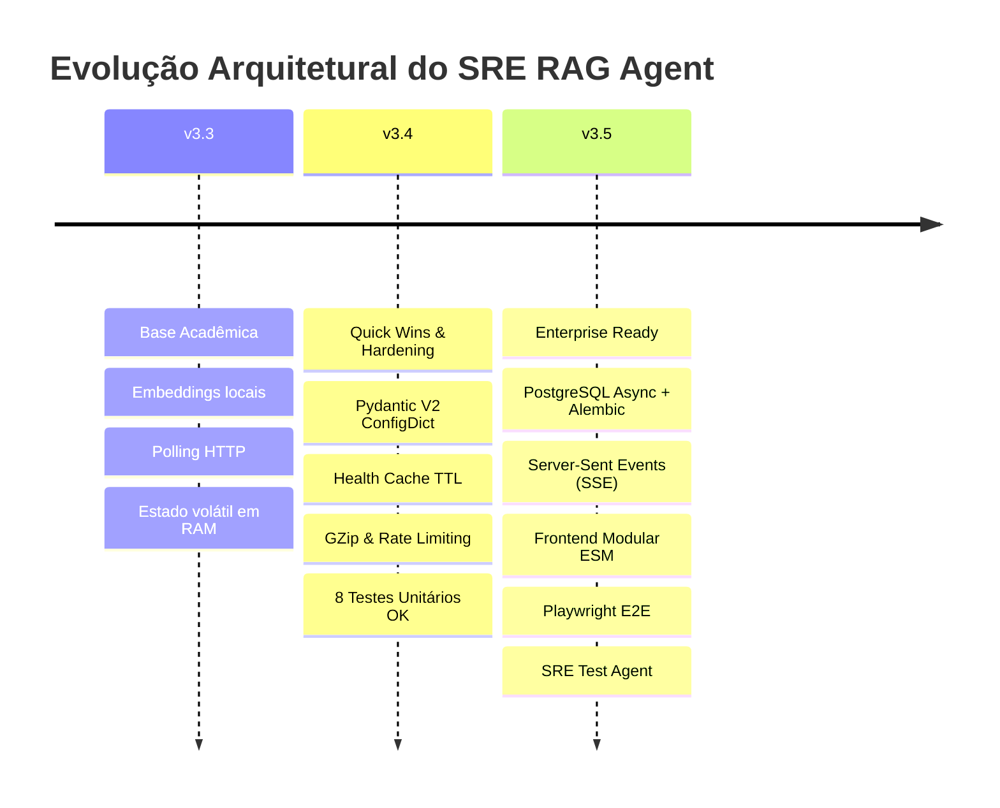
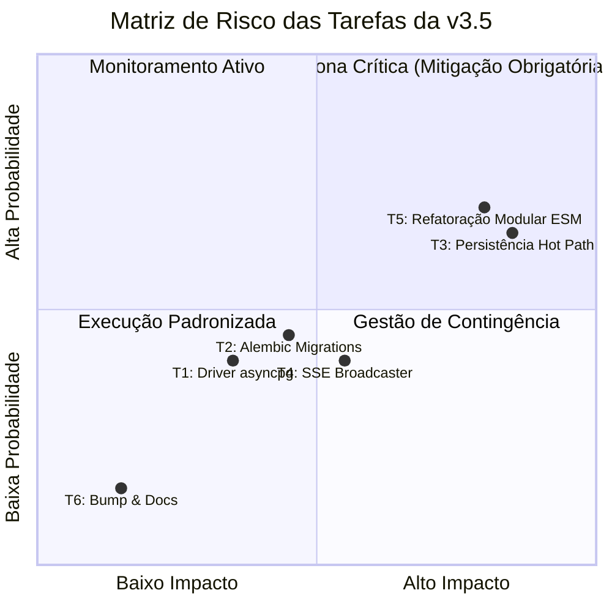
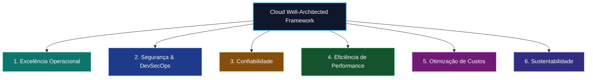
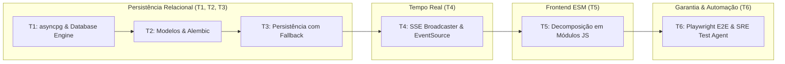

# 📑 Relatório Consolidado de Revisão Arquitetural e Planejamento — v3.5
## SRE RAG Agent — Incident Simulation Lab
**Data do Registro da Revisão**: 16 de Outubro de 2026  
**Status**: Formalmente Revisado, Auditado e Aprovado para Execução

---

## 🎯 1. Visão Geral e Contexto de Transição (v3.4 ➔ v3.5)

Este documento consolida o registro integral da etapa de **Revisão da Versão 3.5** do **SRE RAG Agent**, estabelecendo a ponte entre a estabilização alcançada na versão 3.4 e a transformação arquitetural planejada para a versão 3.5.

### 1.1 Estado do Baseline v3.4 (Congelado)
Antes de iniciar qualquer alteração para a v3.5, a versão 3.4 foi concluída e validada com **100% de sucesso** nos testes unitários (`8 passed`), garantindo:
- **Resolução de Warnings**: Substituição de `class Config` depreciada por `SettingsConfigDict` em [`app/config.py`](../app/config.py).
- **Proteção contra Connection Storms**: Cache TTL de 5s em [`app/healthcheck.py`](../app/healthcheck.py) para neutralizar tempestades de sockets causadas por probes do Kubelet.
- **Offloading Assíncrono**: Envolvimento da inferência de embeddings do SentenceTransformer via `asyncio.to_thread` em [`app/rag/engine.py`](../app/rag/engine.py).
- **Segurança e Egress**: `GZipMiddleware` ativo para payloads > 1KB, headers HTTP defensivos (`CSP`, `HSTS`, `X-Frame-Options: DENY`, `X-Content-Type-Options: nosniff`) e Rate Limiting defensivo com `slowapi` (30 req/min no endpoint de query).

---

## 🔍 2. Diagnóstico Arquitetural e Limitações Identificadas

A partir da análise detalhada documentada em [`melhorias.md`](../melhorias.md), foram isolados quatro débitos técnicos críticos que impediam a operação em escala corporativa:

| Domínio | Estado Atual (v3.4) | Impacto / Limitação | Estado Alvo (v3.5) |
|---|---|---|---|
| **Persistência de Dados** | Estado volátil em listas Python em memória RAM (`history_db`, `self.history`, `chaos.sessions`) | Reinicializações de pod perdem todo o histórico de treinamento; impede réplicas concorrentes (`replicas > 1`) | Banco relacional PostgreSQL assíncrono (`asyncpg`), SQLAlchemy 2.0 e migrações declarativas com Alembic |
| **Comunicação Frontend** | Polling HTTP repetitivo a cada 2s e 3s via `setInterval` em `dashboard.js` | Desperdício contínuo de CPU e banda de rede; latência de atualização de até 3s em eventos de caos | Streaming unidirecional em tempo real via Server-Sent Events (SSE) com reconexão automática e heartbeat |
| **Arquitetura Frontend** | Monólito em vanilla JS com mais de 2.338 linhas compartilhando escopo global | Alto acoplamento; qualquer edição em eventos ou cards corre o risco de quebrar a navegação global | Separação em 6 ES Modules (ESM) coesos: `api.js`, `sse.js`, `incidents.js`, `chaos.js`, `terminal.js` e `charts.js` |
| **Garantia de Qualidade** | Apenas testes unitários de backend (`pytest`); zero cobertura de interface gráfica | Regressões visuais ou erros de sintaxe JS passam despercebidos pelo CI | Suíte de testes ponta a ponta (E2E) com Playwright validando navegação, simulações e Chaos Monkey |

---

## ⚠️ 3. Análise Detalhada dos Riscos das Tarefas (Risk Assessment)

A classificação de risco adotada analisa a **Probabilidade de Falha $\times$ Raio de Impacto (Blast Radius)**:

### 3.1 🟢 Risco Baixo
- **Tarefas**: Version Bump semântico (`3.5`), documentação (`README.md`, `Chart.yaml`, `AGENTS.md`).
- **Blast Radius**: Nulo em tempo de execução; estritamente declarativo.

### 3.2 🟡 Risco Médio
- **T1 (Configuração do Banco Assíncrono - `asyncpg`)**:
  - *Cenário de Falha*: Conexão recusada ao PostgreSQL durante o startup ou vazamento de sockets do pool.
  - *Mitigação*: Configuração de `pool_pre_ping=True`, timeouts de 3s e inicialização resiliente com log estruturado.
- **T2 (Modelagem Relacional & Migrações Alembic)**:
  - *Cenário de Falha*: Travamento de DDL ou incompatibilidade de tipos de dados nas colunas.
  - *Mitigação*: Scripts de migração assíncronos versionados em `app/migrations/versions/` com suporte a `alembic downgrade -1`.
- **T4 (Server-Sent Events - SSE Streaming)**:
  - *Cenário de Falha*: Buffering em proxies reversos (Nginx) ou queda de conexão após 60s ociosos.
  - *Mitigação*: Heartbeat periódico de 15s (`: ping\n\n`), flag `proxy_buffering off` no Nginx e limite de fila de 100 eventos por subscriber.
- **T6 (Testes E2E com Playwright)**:
  - *Cenário de Falha*: Instabilidade e flakiness em seletores dinâmicos da interface no navegador headless.
  - *Mitigação*: Esperas explícitas assíncronas do Playwright (`expect(locator).to_be_visible()`).

### 3.3 🔴 Risco Alto
- **T3 (Persistência do Estado com Fallback Resiliente)**:
  - *Cenário de Falha*: Deadlocks ou latência de banco bloqueando o hot path de `/api/v1/query`, simulações de incidentes ou acionamento do Chaos Monkey.
  - *Mitigação*: **Degradação Graciosa (Graceful Degradation)** — todo acesso ao banco é encapsulado em blocos `try/except` defensivos que realizam fallback transparente para memória, garantindo que o simulador nunca retorne HTTP 500 por falha de banco.
- **T5 (Modularização do Frontend em ES Modules - ESM)**:
  - *Cenário de Falha*: Quebra da renderização do dashboard (2.338 linhas de JS legado), rompendo a troca de abas, terminais interativos e relógio de incidentes.
  - *Mitigação*: Comunicação desacoplada via `CustomEvent`, validação estrita com `node -c` em cada módulo antes da homologação e preservação de `dashboard.js` como fallback.

---

## 🏛️ 4. Alinhamento com o Cloud Well-Architected Framework & Google SRE

O planejamento v3.5 foi estruturado sob os **6 Pilares do Well-Architected Framework**:

1. **Excelência Operacional**: Esquema de banco de dados gerenciado via migrações versionadas no Git com Alembic; 16 cenários de incidentes reais de engenharia de confiabilidade com guias em 5 fases.
2. **Segurança (DevSecOps)**: Acesso ao banco parametrizado via ORM (anti-SQL Injection), isolamento de rede interna (`backend_net`), execução do container com usuário non-root (`appuser`), headers de segurança HTTP restritivos e rate limiting.
3. **Confiabilidade (SRE)**: Degradação graciosa mantendo a aplicação funcional mesmo com PostgreSQL offline; eliminação de tempestades de sockets através de cache TTL no health check.
4. **Eficiência de Performance**: Desacoplamento não-bloqueante no loop de eventos do FastAPI via `asyncpg` e `asyncio.to_thread`; substituição de polling por SSE nativo; compressão HTTP GZip.
5. **Otimização de Custos**: Eliminação de milhares de requisições de polling diárias; imagem Docker otimizada com PyTorch CPU-only (< 800MB vs ~6GB com CUDA).
6. **Sustentabilidade**: Redução do footprint computacional, minimizando uso ocioso de CPU e tráfego de rede no cluster.

---

## 🤖 5. O Agente Autônomo de Auditoria e Testes (`scripts/test_agent.py`)

A revisão 3.5 formalizou a inclusão de um agente de auditoria contínua, documentado na Seção 8 do [`AGENTS.md`](../AGENTS.md) e acionável por `make test-audit`:

### 5.1 Capacidades do Agente de Auditoria
- **Bateria de Segurança (`Security Battery`)**:
  - `SEC-001`: Validação de 100% dos Security Headers (CSP, HSTS, X-Frame-Options, X-Content-Type, Referrer, Permissions).
  - `SEC-002`: Verificação defensiva de Rate Limiting (rajada de requisições validando retorno HTTP 429).
  - `SEC-003`: Auditoria de política de CORS e rejeição de wildcard em ambiente produtivo.
  - `SEC-004`: Sanitização de erros contra vazamento de stack traces e paths de sistema.
  - `SEC-005`: Inspeção de segurança do Dockerfile (usuário non-root e HEALTHCHECK ativo).
- **Bateria de Performance (`Performance Battery`)**:
  - `PERF-001`: Medição de latência do health check e validação do cache TTL de 5s.
  - `PERF-002`: Distribuição de percentis de latência (P50, P90, P95, P99) em rajada de 50 requisições.
  - `PERF-003`: Eficiência de compressão GZip e redução de tráfego de saída.
  - `PERF-004`: Validação de não-bloqueio do event loop no cálculo de embeddings com `asyncio.to_thread`.
- **Relatório Automatizado**: Geração contínua de evidências em [`docs/SECURITY_PERF_TEST_REPORT.md`](../docs/SECURITY_PERF_TEST_REPORT.md).

---

## 📋 6. Especificação Técnica Detalhada das Tarefas (T1 a T6)

### T1. Dependências & Configuração Assíncrona do Banco
- **Dependências**: `sqlalchemy==2.0.35`, `asyncpg==0.29.0`, `alembic==1.13.3`, `sse-starlette==2.1.3`.
- **Configuração**: Adição de `postgres_pool_size: int = 10`, `postgres_max_overflow: int = 20` e property `async_postgres_url` em [`app/config.py`](../app/config.py).
- **Novo Módulo**: [`app/database.py`](../app/database.py) instanciando `AsyncEngine` com `pool_pre_ping=True`, session factory `async_sessionmaker` e helper `init_db()` com fallback tolerante a falhas.

### T2. Modelagem Relacional & Migrações com Alembic
- **Novo Módulo**: [`app/models.py`](../app/models.py) declarando com tipagem SQLAlchemy 2.0:
  - `QueryHistoryRecord` (tabela `query_history`): consultas e respostas do RAG.
  - `IncidentSimulationRecord` (tabela `incident_simulations`): registro de simulações com MTTD/MTTR e pontuação.
  - `ChaosSessionRecord` (tabela `chaos_sessions`): histórico de sessões do Chaos Monkey.
  - `ChaosEventRecord` (tabela `chaos_events`): trilha de auditoria fina de injeção de falhas.
  - Índices compostos de telemetria `idx_incident_perf` e `idx_chaos_audit`.
- **Alembic**: Configuração de `app/alembic.ini` e script assíncrono em `app/migrations/versions/0001_initial_schema.py`.

### T3. Persistência de Estado com Fallback Resiliente
- **Modificações**: [`app/main.py`](../app/main.py), [`app/incidents.py`](../app/incidents.py) e [`app/chaos.py`](../app/chaos.py).
- **Mecanismo de Resiliência**: Gravação assíncrona com commits protegidos por blocos `try/except` defensivos que salvam em memória caso o banco esteja indisponível, impedindo falhas em cascata.

### T4. Server-Sent Events (SSE) para Streaming em Tempo Real
- **Novo Módulo**: [`app/events.py`](../app/events.py) provendo broadcaster pub/sub baseado em `asyncio.Queue` isoladas por cliente.
- **Endpoint**: `GET /api/v1/events/stream` via `EventSourceResponse`, transmitindo telemetria, eventos de incidentes e heartbeat a cada 15 segundos.

### T5. Modularização do Frontend em ES Modules (ESM)
- **Decomposição Modular**: Substituição do monólito `dashboard.js` (2.338 linhas) por 6 módulos focados em `app/static/js/modules/`:
  1. `api.js`: Cliente de requisições com tratamento padronizado de timeouts.
  2. `sse.js`: Receptor de EventSource com algoritmo de reconexão exponencial.
  3. `incidents.js`: Catálogo de 16 cenários, cronômetro e modal de avaliação.
  4. `chaos.js`: Interface de injeção e blast radius do Chaos Monkey.
  5. `terminal.js`: Emulador de terminal com histórico e suporte a comandos.
  6. `charts.js`: Renderização de métricas RED e gráficos de disponibilidade.
  7. `app.js`: Ponto de entrada carregado via `<script type="module" src="/static/js/app.js">` em [`app/templates/dashboard.html`](../app/templates/dashboard.html).

### T6. Suíte de Testes E2E (Playwright), Version Bump & Automação
- **Novo Arquivo**: [`tests/e2e/test_dashboard_e2e.py`](../tests/e2e/test_dashboard_e2e.py) validando no navegador: carregamento do dashboard, fluxo completo de simulação de incidente e toggle do Chaos Monkey.
- **Governança**: Bump de versão para `3.5` em [`helm/sre-rag/Chart.yaml`](../helm/sre-rag/Chart.yaml) e [`README.md`](../README.md).

---

## 📝 7. Checklist de Aceite e Definição de Pronto (Definition of Done)

Para considerar a versão 3.5 formalmente aceita, foram estipulados **13 critérios mensuráveis**:

- [ ] **Critério 1**: Novas dependências instaladas no ambiente (`sqlalchemy`, `asyncpg`, `alembic`, `sse-starlette`).
- [ ] **Critério 2**: `Settings.app_version` retorna `"3.5"` e `async_postgres_url` é calculada com sucesso.
- [ ] **Critério 3**: Módulo `app/database.py` inicializa engine assíncrona com pool pre-ping.
- [ ] **Critério 4**: Módulo `app/models.py` declara as 4 tabelas relacionais e índices de telemetria.
- [ ] **Critério 5**: Endpoint `/api/v1/history` persiste registros no PostgreSQL com fallback resiliente para memória.
- [ ] **Critério 6**: Simulações de incidentes concluídas são gravadas na tabela `incident_simulations`.
- [ ] **Critério 7**: Eventos de auditoria do Chaos Monkey são gravados na tabela `chaos_events`.
- [ ] **Critério 8**: Endpoint SSE `/api/v1/events/stream` transmite eventos em tempo real com ping de 15s.
- [ ] **Critério 9**: Frontend modular em `app/static/js/modules/` carrega via `<script type="module">` sem erros de console.
- [ ] **Critério 10**: Polling contínuo (`setInterval`) no frontend eliminado e substituído por SSE.
- [ ] **Critério 11**: Baseline de testes unitários mantido com 100% de sucesso (`8 passed`).
- [ ] **Critério 12**: Suíte E2E com Playwright valida o fluxo completo de resolução de incidentes.
- [ ] **Critério 13**: Agente de Auditoria [`scripts/test_agent.py`](../scripts/test_agent.py) aprovado com relatório vivo em [`docs/SECURITY_PERF_TEST_REPORT.md`](../docs/SECURITY_PERF_TEST_REPORT.md).

---

## ⏱️ 8. Cronograma de Execução Estimado (Gantt)

```mermaid
gantt
    title Cronograma de Implementação — SRE RAG Agent v3.5
    dateFormat HH:mm
    axisFormat %H:%M
    section Banco e Config
    T1 - Dependências e Async Database Engine  :t1, 09:00, 25m
    T2 - Modelagem Relacional e Migrações      :t2, after t1, 30m
    section Backend Core
    T3 - Persistência com Fallback Resiliente   :t3, after t2, 40m
    T4 - Server-Sent Events (SSE) Broadcaster  :t4, after t3, 30m
    section Frontend ESM
    T5 - Decomposição Modular do Frontend      :t5, after t4, 45m
    section Testes e Validação
    T6 - Testes E2E, Version Bump e Aceite     :t6, after t5, 30m
```

---

## 🔒 9. Estado de Congelamento ao Final da Etapa de Revisão

- **Documentação de Referência**: Plano consolidado em [`plano_v3.5.md`](../plano_v3.5.md).
- **Código de Produção**: **Inalterado**. Todo o código de produção permaneceu rigorosamente congelado no baseline homologado da v3.4 durante a etapa de revisão.
- **Validação Automatizada**: Criação do script de checagem preliminar [`scripts/verify_v3.5.sh`](../scripts/verify_v3.5.sh) para auditoria contínua de conformidade antes e depois da execução.
