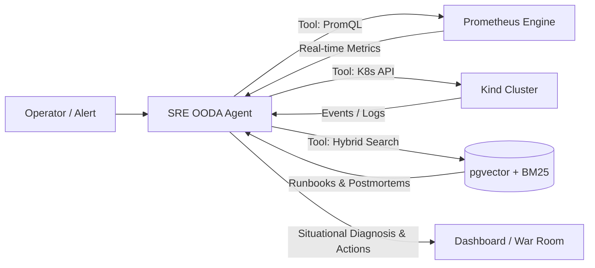

# 📋 Plano de Melhorias & Otimizações Arquiteturais — SRE RAG Agent
## Architectural Improvement Plan & Optimization Roadmap

[ 🇧🇷 Ler em Português do Brasil ](#-versão-em-português-do-brasil) &nbsp;|&nbsp; [ 🇺🇸 Read in US English ](#-us-english-version)

---

<a id="-versão-em-português-do-brasil"></a>
# 🇧🇷 Versão em Português do Brasil

## 🎯 1. Sumário Executivo & Diagnóstico de Maturidade Atual (v3.3)

O projeto **SRE RAG Agent** consolidou-se como um laboratório prático de alta relevância para a Engenharia de Confiabilidade de Sites (*Site Reliability Engineering*), integrando simulação interativa de incidentes em Kubernetes, motor vetorial RAG (*Retrieval-Augmented Generation*) local com `sentence-transformers`, injeção controlada de falhas (*Chaos Monkey*), catálogo com 16 cenários de produção balanceados em 4 níveis de dificuldade, Runbooks estruturados em 5 fases e observabilidade completa com Prometheus e Grafana.

Entretanto, para transformar esta plataforma em uma solução corporativa de alta resiliência, pronta para escala horizontal, avaliação contínua e arquitetura em nuvem de ponta (alinhada aos padrões de engenharia do Google SRE, CNCF e AWS Well-Architected Framework), é fundamental endereçar limitações técnicas identificadas na base de código atual.

### 📊 Matriz de Diagnóstico Arquitetural: Onde Estamos vs. Onde Queremos Chegar

| Domínio Arquitetural | Estado Atual (v3.3) | Limitação Identificada | Estado Alvo Recomendado (v3.4+) |
|---|---|---|---|
| **Persistência de Dados** | Estado volátil em memória (`history_db`, `self.history`, `chaos.sessions`) | Reinicializações de pod perdem histórico; impossibilita múltiplas réplicas | Banco relacional (PostgreSQL) com SQLAlchemy 2.0 assíncrono e Alembic |
| **Motor de Busca RAG** | Vetores em arquivo JSON plano (`index_store.json`) com busca por força bruta | Complexidade $O(N)$ em memória; falta de busca léxica por termos técnicos | `pgvector` nativo, Busca Híbrida (Dense + BM25 com RRF) e Re-ranking |
| **Síntese de Diagnóstico** | Concatenação de templates markdown estáticos (`_generate_answer`) | Respostas rígidas sem raciocínio situacional profundo | LLM integrado (Ollama local / APIs) com Function Calling para PromQL e K8s |
| **Chaos Engineering** | Toggle de middleware HTTP 500 no endpoint de inferência | Falhas de infraestrutura (OOM, DNS, PVC) são apenas simuladas no terminal | Injeção real de caos no cluster Kind (Chaos Mesh / cgroups / tc-netem) |
| **Observabilidade** | Métricas RED/USE no Prometheus; sem rastreamento distribuído | Impossível rastrear o ciclo de vida completo de requisições e inferências | Instrumentação OpenTelemetry (OTel), correlação Métrica-Log-Trace e Jaeger |
| **Segurança & DevSecOps** | Sem rate limiting; CORS irrestrito; sem headers de proteção HTTP | Vulnerabilidade a DoS e ausência de políticas defensivas no navegador | Rate limiter (Redis), Security Headers (CSP, HSTS) e External Secrets |
| **Frontend & UX** | Monólito em vanilla JS (`dashboard.js` 2300+ linhas) com polling contínuo | Dificuldade de manutenção e tráfego HTTP desnecessário | Módulos ES (ESM), Server-Sent Events (SSE) e terminal interativo com autocompletion |
| **Qualidade & Testes** | 4 arquivos de teste focados no backend; sem testes E2E de interface | Mudanças no frontend correm risco de quebras silenciosas | Suíte E2E com Playwright, contract testing com Schemathesis e pre-commit hooks |
| **Desempenho & Async** | CPU-bound embedding e conexões de banco executadas no event loop | Bloqueio do loop assíncrono do FastAPI sob carga concorrente | `asyncio.to_thread` para inferência de embeddings e connection pooling com asyncpg |

---

## 🏛️ 2. Persistência de Dados, Modelagem Relacional & Gestão de Conexões

### 2.1 Diagnóstico do Estado Atual
Atualmente, o estado operacional da aplicação é mantido puramente em coleções voláteis em memória RAM:
- `history_db: list[QueryHistory] = []` em `app/main.py`: armazena as perguntas e respostas do endpoint `/api/v1/history`.
- `self.history: list[SimulationResult] = []` em `app/incidents.py`: armazena os resultados de simulação de incidentes, timestamps, MTTD e MTTR.
- `self.sessions` e `self.events` em `app/chaos.py`: mantêm o histórico de sessões do Chaos Monkey e a trilha de auditoria.

**Impacto Operacional**: Qualquer reinicialização de container (`kubectl rollout restart` ou crash de pod) resulta na perda irreversível de métricas históricas de treinamento. Além disso, torna inviável a execução de réplicas concorrentes do backend (`replicas > 1`), pois o estado não é compartilhado.

Adicionalmente, em `app/healthcheck.py`, a função `check_postgres()` instancia uma nova conexão síncrona `psycopg2.connect()` a cada requisição de `/ready`. Em ambientes Kubernetes com múltiplos pods e probes a cada 5 segundos, isso causa tempestades de conexão (*connection storms*) e exaustão de descritores de socket no PostgreSQL.

### 2.2 Recomendações de Implementação
1. **Modelagem Relacional com SQLAlchemy 2.0 / SQLModel**:
   - Criar tabelas persistentes no PostgreSQL existente:
     - `incident_simulations`: `id`, `scenario_id`, `difficulty`, `status`, `start_time`, `end_time`, `mttd_seconds`, `mttr_seconds`, `operator_solution`, `is_correct`, `commands_executed`.
     - `chaos_sessions`: `session_id`, `fault_type`, `started_at`, `ended_at`, `duration_seconds`, `injected_count`, `affected_endpoints`.
     - `audit_events`: `id`, `timestamp`, `event_type`, `source`, `endpoint`, `client_ip`, `payload`.
     - `rag_query_logs`: `id`, `query_text`, `answer_text`, `top_score`, `retrieved_chunks`, `latency_ms`, `from_cache`.
2. **Versionamento Declarativo de Banco com Alembic**:
   - Inicializar o Alembic no diretório `app/` (`alembic init migrations`) e automatizar a aplicação de migrações no startup do container ou via init container (`alembic upgrade head`).
3. **Pool de Conexões Assíncrono com AsyncPG / Psycopg Pool**:
   - Substituir conexões pontuais por pool gerenciado no `lifespan` do FastAPI:
     ```python
     # app/database.py
     from sqlalchemy.ext.asyncio import create_async_engine, async_sessionmaker, AsyncSession
     from sqlalchemy.orm import DeclarativeBase
     from config import settings

     class Base(DeclarativeBase):
         pass

     engine = create_async_engine(
         settings.postgres_async_dsn,
         pool_size=10,
         max_overflow=20,
         pool_pre_ping=True,
         pool_recycle=1800,
     )

     AsyncSessionLocal = async_sessionmaker(engine, class_=AsyncSession, expire_on_commit=False)

     async def get_db():
         async with AsyncSessionLocal() as session:
             yield session
     ```
4. **Cache de Health Check com TTL**:
   - Armazenar o resultado da checagem de saúde de dependências em cache por 3 a 5 segundos, evitando disparar queries ativas (`SELECT 1` / `PING`) a cada probe do kubelet.

---

## 🧠 3. Evolução do Motor RAG & Agente de Investigação Autônomo

### 3.1 Diagnóstico do Estado Atual
- **Índice Estático em Disco**: O arquivo `app/rag/index_store.json` (141 chunks) armazena os embeddings gerados previamente. O método `search()` em `app/rag/indexer.py` normaliza e calcula a similaridade cosseno iterando linearmente sobre todos os chunks via Python puro. Isso apresenta complexidade $O(N)$ em memória e não escala para repositórios com centenas de runbooks e postmortems.
- **Busca Puramente Vetorial (Dense-only)**: Termos técnicos específicos (como códigos de status `HTTP 502`, nomes de alertas `SLOAvailabilityBurnRateCritical` ou identificadores de cgroups) sofrem atenuação semântica no modelo de embedding geral, perdendo precisão em comparação com buscas exatas.
- **Síntese Baseada em Template Fixo**: `_generate_answer()` em `app/rag/engine.py` utiliza interpolação de strings básica. Não há raciocínio ativo de um modelo de linguagem para correlacionar múltiplos sintomas.
- **Bloqueio do Event Loop do FastAPI**: `generate_query_embedding()` invoca `SentenceTransformer.encode()`, uma rotina pesada de CPU que roda na thread principal do FastAPI, degradando a taxa de transferência e a latência de requisições concorrentes.

### 3.2 Recomendações de Implementação
1. **Migração para PostgreSQL com pgvector**:
   - Habilitar a extensão `pgvector` no container do PostgreSQL:
     ```sql
     CREATE EXTENSION IF NOT EXISTS vector;
     ```
   - Armazenar chunks em uma coluna `embedding vector(384)` indexada com HNSW (*Hierarchical Navigable Small World*) para buscas aproximadas de vizinhos mais próximos em tempo sub-milissegundo:
     ```sql
     CREATE INDEX idx_chunks_hnsw ON document_chunks USING hnsw (embedding vector_cosine_ops);
     ```
2. **Busca Híbrida (Dense + Sparse) com Reciprocal Rank Fusion (RRF)**:
   - Combinar busca vetorial densa com busca léxica via PostgreSQL Full-Text Search (`tsvector`/`tsquery`) ou BM25.
   - Algoritmo RRF para consolidação de rankings:
     $$RRF\_Score(d) = \sum_{m \in M} rac{1}{k + rank_m(d)}$$
     onde $k = 60$. Garante que documentos com correspondência exata de tokens de erro ou similaridade conceitual sejam priorizados.
3. **Re-ranking com Cross-Encoder**:
   - Adicionar uma etapa de re-ranking leve com `flashrank` ou `bge-reranker-base` sobre os top 10 resultados para reordenar os 3 mais relevantes antes de enviá-los para a síntese.
4. **Execução Não-Bloqueante de Embeddings**:
   - Envolver a inferência do PyTorch com `asyncio.to_thread`:
     ```python
     query_embedding = await asyncio.to_thread(generate_query_embedding, question)
     ```
5. **Agente SRE OODA com Function Calling / Tool Use**:
   - Integrar um provedor de LLM configurável (Ollama com Llama 3 / Mistral para laboratórios locais 100% offline; Claude / GPT / Gemini via LiteLLM para nuvem).
   - Equipar o agente com ferramentas reais de investigação:
     - `query_prometheus(query: str, time_window: str)`: Consulta métricas ativas de Golden Signals no Prometheus.
     - `get_k8s_events(namespace: str, pod: str)`: Consulta eventos recentes do cluster Kubernetes via API.
     - `search_runbooks(query: str)`: Recupera procedimentos de mitigação no banco de conhecimento.


---

## 🐒 4. Chaos Engineering em Nível de Cluster Real (K8s & Linux Kernel)

### 4.1 Diagnóstico do Estado Atual
O módulo `app/chaos.py` atual simula falhas exclusivamente injetando respostas HTTP 500 no endpoint `/api/v1/query`. Os outros 15 cenários de incidentes descritos em `app/incidents.py` (como `oom-killed-worker`, `cgroup-cpu-throttling`, `coredns-crashloop`, `tls-certificate-expired`, `disk-pressure-pvc`) são resolvidos pelo usuário via respostas em múltiplo escolha ou comandos no terminal simulado do War Room, sem causar impactos reais no cluster Kind.

### 4.2 Recomendações de Implementação
1. **Injeção de Falhas Reais no Cluster Kind**:
   - Implementar scripts ou DaemonSets de injeção determinística de falhas:
     - **Cgroup Memory Pressure**: Pod efêmero com `stress-ng --vm 1 --vm-bytes 1G` forçando o Linux OOM Killer a eliminar processos sob cgroups limitados.
     - **CPU Throttling**: Alteração direta de `cpu.cfs_quota_us` e `cpu.cfs_period_us` nos containers de destino.
     - **Latência e Perda de Pacotes**: Injeção via `tc` (*Linux Traffic Control*) e `netem`:
       ```bash
       tc qdisc add dev eth0 root netem delay 250ms 50ms loss 15%
       ```
     - **Partição de DNS**: Escalar temporariamente o deployment do `coredns` para 0 réplicas em `kube-system`.
2. **Integração com Chaos Mesh ou LitmusChaos**:
   - Disponibilizar um profile Helm para instalar o Chaos Mesh no cluster de laboratório, permitindo orquestração declarativa via CRDs (`NetworkChaos`, `PodChaos`, `StressChaos`, `DNSChaos`).
3. **Validação de Ciclo Fechado (Closed-Loop Incident Lifecycle)**:
   - Conectar o simulador a um ciclo operacional automatizado:
     1. Disparo de Caos Real no Kind.
     2. Queima do Error Budget e disparo de alerta MWMBR no Alertmanager.
     3. Notificação e diagnóstico pelo RAG Agent.
     4. Remediação pelo operador no War Room (ex: `helm rollback`, patch de PVC, ajuste de limits).
     5. Resolução automática detectada pelo fim do firing alert no Alertmanager.

---

## 📈 5. Observabilidade de Ponta a Ponta, OpenTelemetry & Tracing

### 5.1 Diagnóstico do Estado Atual
O repositório conta com instrumentação de métricas RED no FastAPI (`metrics.py`) e regras de alertas multi-burn-rate (`slo-rules.yml`). Porém:
- Não há rastreamento distribuído (*Distributed Tracing*): se uma requisição de consulta ou simulação apresentar lentidão, não é possível inspecionar visualmente os spans de tempo gastos no banco de dados, no Redis, na inferência do modelo ou no template Jinja.
- Falta correlação bi-direcional entre logs e traces: os logs em JSON do `structlog` não carregam identificadores de correlação (`trace_id`, `span_id`).
- Os dados de SLO e consumo de Error Budget calculados no Prometheus não são visíveis diretamente no Dashboard do operador.

### 5.2 Recomendações de Implementação
1. **Instrumentação com OpenTelemetry**:
   - Adicionar as bibliotecas:
     - `opentelemetry-api` e `opentelemetry-sdk`
     - `opentelemetry-instrumentation-fastapi`
     - `opentelemetry-instrumentation-asyncpg`
     - `opentelemetry-instrumentation-redis`
     - `opentelemetry-exporter-otlp`
   - Configurar exportador OTLP apontando para Jaeger ou Grafana Tempo.
2. **Correlação Traces & Logs no Structlog**:
   - Adicionar processador no `structlog` para injetar o contexto ativo do OpenTelemetry em todos os registros de log:
     ```python
     from opentelemetry import trace

     def inject_otel_context(logger, method_name, event_dict):
         span = trace.get_current_span()
         if span.is_recording():
             ctx = span.get_span_context()
             event_dict["trace_id"] = trace.format_trace_id(ctx.trace_id)
             event_dict["span_id"] = trace.format_span_id(ctx.span_id)
         return event_dict
     ```
3. **Widget Dinâmico de Error Budget no Dashboard**:
   - Consumir via backend a métrica calculada do Prometheus:
     `1 - (sum(rate(sre_rag_http_errors_total[1h])) / sum(rate(sre_rag_http_requests_total[1h])))`
   - Exibir no topo do Dashboard um velocímetro/indicador de saúde do Error Budget (ex: "99.82% disponível - 18% consumido nas últimas 24h").

---

## 🛡️ 6. Segurança de Aplicação & DevSecOps Corporativo

### 6.1 Diagnóstico do Estado Atual
- **Ausência de Rate Limiting**: Os endpoints de query RAG e simulação podem sofrer ataques de negação de serviço (DoS) por excesso de requisições.
- **CORS Não Restritivo**: Não há middleware CORS configurado explicitamente com domínios autorizados.
- **Falta de Headers de Segurança HTTP**: A aplicação não envia `Content-Security-Policy` (CSP), `X-Frame-Options`, `X-Content-Type-Options` ou `Strict-Transport-Security` (HSTS).
- **Segredos em Texto Plano**: `docker-compose.yml` e scripts de teste possuem senhas hardcoded (`POSTGRES_PASSWORD=sre_password`).
- **Segurança do Kubernetes**: O Helm chart e os manifests em `kubernetes/` carecem de políticas restritivas do Pod Security Standards (profile `restricted`).

### 6.2 Recomendações de Implementação
1. **Rate Limiting Defensivo**:
   - Integrar `slowapi` utilizando Redis como backend de chave móvel:
     ```python
     from slowapi import Limiter
     from slowapi.util import get_remote_address

     limiter = Limiter(key_func=get_remote_address, default_limits=["100/minute"])
     app.state.limiter = limiter
     ```
2. **Middleware de Headers de Segurança HTTP**:
   - Adicionar middleware com políticas defensivas estritas:
     - `X-Frame-Options: DENY` (previne clickjacking).
     - `X-Content-Type-Options: nosniff`.
     - `Content-Security-Policy: default-src 'self'; script-src 'self' 'unsafe-inline'; style-src 'self' 'unsafe-inline' https://fonts.googleapis.com; font-src 'self' https://fonts.gstatic.com;`.
     - `Referrer-Policy: strict-origin-when-cross-origin`.
3. **Gerenciamento Seguro de Segredos**:
   - Substituir variáveis planas pelo **External Secrets Operator (ESO)** com AWS Secrets Manager, HashiCorp Vault ou Azure Key Vault.
   - Para ambientes locais/Kind, utilizar **Sealed Secrets** da Bitnami para permitir versionamento seguro de manifestos encriptados no Git.
4. **Hardening de Pods Kubernetes**:
   - Atualizar `helm/sre-rag/templates/deployment.yaml`:
     ```yaml
     securityContext:
       allowPrivilegeEscalation: false
       readOnlyRootFilesystem: true
       runAsNonRoot: true
       runAsUser: 10001
       capabilities:
         drop:
           - ALL
       seccompProfile:
         type: RuntimeDefault
     ```
   - Definir `NetworkPolicy` estrita permitindo tráfego somente entre Nginx -> API e API -> PostgreSQL/Redis.

---

## 💻 7. Modernização do Frontend, Arquitetura Modular & DX/UX

### 7.1 Diagnóstico do Estado Atual
- **Código Monolítico no Frontend**: `app/static/js/dashboard.js` ultrapassa 2.300 linhas de código vanilla imperativo em um único arquivo, acumulando gerenciamento de abas, renderização de cards, internacionalização, streams de auditoria e lógica do terminal do War Room. Qualquer alteração corre risco de quebrar escopos globais.
- **Polling HTTP Recorrente**: A aplicação realiza requisições periódicas (`setInterval`) para atualizar métricas e eventos do Chaos Monkey, gerando overhead no servidor e na rede.
- **Experiência do Terminal do War Room**: Ausência de recursos padrão como autocompletação por Tab, histórico navegável com setas para cima/baixo e feedback formatado de comandos.

### 7.2 Recomendações de Implementação
1. **Modularização em ES Modules (ESM Nativo)**:
   - Dividir `dashboard.js` em submódulos desacoplados:
     - `modules/i18n.js`: Dicionário e tradução dinâmica de chaves.
     - `modules/terminal.js`: Lógica do emulador de terminal, histórico de comandos e handlers de autocompletion.
     - `modules/chaos_stream.js`: Gerenciamento do fluxo de auditoria e conexões.
     - `modules/scenarios.js`: Grid interativo, filtragem por dificuldade e acionamento de simulações.
     - `modules/charts.js`: Renderização de gráficos SVG e métricas MTTD/MTTR.
2. **Substituição de Polling por Server-Sent Events (SSE)**:
   - Criar endpoint SSE no FastAPI: `/api/v1/stream/events`.
   - Transmitir em tempo real atualizações de novos alertas, execuções de comandos no War Room e status do Chaos Monkey via `EventSource` no navegador, eliminando tráfego ocioso.
3. **Aprimoramentos de Usabilidade no War Room**:
   - Armazenar histórico de comandos no `localStorage` e permitir navegação via teclas `ArrowUp` / `ArrowDown`.
   - Implementar autocompletion via tecla `Tab` para comandos comuns de Kubernetes (`kubectl get pods`, `kubectl describe`, `helm rollback`, `kubectl logs`).
   - Botão "Copiar Linha de Comando" e syntax highlighting para logs de saída.
4. **Exportação de Relatórios Pós-Incidente (Postmortem Generator)**:
   - Adicionar botão "📄 Gerar Postmortem" no modal de conclusão de incidente.
   - Gerar automaticamente um arquivo Markdown estruturado contendo a linha do tempo precisa do incidente, tempo de detecção (MTTD), tempo de reparo (MTTR), comandos executados pelo operador e ações preventivas recomendadas.

---

## 🧪 8. Qualidade de Software, Testes Abrangentes & CI/CD

### 8.1 Diagnóstico do Estado Atual
- Os testes atuais (`tests/test_incidents.py`, `tests/test_chaos.py`, `tests/test_rag.py`) testam apenas regras de negócio isoladas no Python.
- Não existem testes de ponta a ponta (E2E) para a interface web. Erros de JavaScript que impedem troca de abas ou quebram modais não são detectados no CI.
- O pipeline do GitHub Actions (`ci.yml`) não valida contratos de OpenAPI nem realiza testes de mutação.
- Avisos de depreciação do Pydantic V2 (`PydanticDeprecatedSince20`) presentes na inicialização da configuração.

### 8.2 Recomendações de Implementação
1. **Suíte de Testes E2E com Playwright**:
   - Criar `tests/e2e/test_dashboard_flows.py` usando `pytest-playwright`:
     - Teste de troca fluida entre as 4 abas (`#simulation`, `#warroom`, `#concepts`, `#metrics`).
     - Teste de inicialização de cenário, execução de comando no War Room e validação de sucesso.
     - Teste de abertura e navegação pelas 5 fases do modal de Runbook.
     - Teste de toggle de idioma (PT ⇋ EN) verificando tradução dinâmica de todos os textos.
2. **Migração do Pydantic V2**:
   - Atualizar `app/config.py` substituindo a subclasse `Config` por `SettingsConfigDict`:
     ```python
     from pydantic_settings import BaseSettings, SettingsConfigDict

     class Settings(BaseSettings):
         model_config = SettingsConfigDict(
             env_prefix="",
             case_sensitive=False,
             extra="ignore"
         )
     ```
3. **Testes de Contrato de API com Schemathesis**:
   - Adicionar etapa no CI para testar conformidade da API com seu esquema OpenAPI:
     `schemathesis run http://localhost:8080/openapi.json --checks all`
4. **Pre-commit Hooks Padronizados**:
   - Configurar `.pre-commit-config.yaml` com:
     - `ruff` (linting e formatting ultrarrápido).
     - `mypy` com checagem de tipos estrita.
     - `gitleaks` para prevenir commit acidental de chaves de API e credenciais.
     - `actionlint` para validar sintaxe de workflows do GitHub Actions.

---

## ⚡ 9. Desempenho, Concorrência & Práticas Cloud-Native

### 9.1 Diagnóstico do Estado Atual
- A API executa chamadas bloqueantes de I/O e CPU no mesmo processo.
- Falta compressão HTTP nos arquivos estáticos pesados (`dashboard.js` e `dashboard.css`).
- O autoscaling no Kubernetes está baseado puramente em consumo médio de CPU/Memória, o que não reflete a saturação real do serviço RAG.

### 9.2 Recomendações de Implementação
1. **Compressão HTTP Dinâmica**:
   - Ativar `GZipMiddleware` no FastAPI para respostas superiores a 1KB:
     ```python
     from fastapi.middleware.gzip import GZipMiddleware
     app.add_middleware(GZipMiddleware, minimum_size=1000)
     ```
   - Configurar compressão `gzip` e `brotli` no `docker/nginx.conf` para arquivos `.js`, `.css` e `.svg`.
2. **Dimensionamento Automático Baseado em Eventos (KEDA)**:
   - Configurar o KEDA (*Kubernetes Event-driven Autoscaling*) para escalar os pods da API baseado em métricas de negócio do Prometheus:
     - Taxa de requisições ativas (`rate(sre_rag_http_requests_total[2m]) > 50`).
     - Latência P95 superior ao SLO (`histogram_quantile(0.95, rate(sre_rag_http_request_duration_seconds_bucket[5m])) > 0.5`).
3. **Cache Distribuído de Embeddings no Redis**:
   - Atualmente apenas a resposta final é armazenada no Redis. Adicionar cache vetorial para evitar recalcular embeddings de perguntas idênticas ou similares.

---

## 🗓️ 10. Matriz de Priorização & Roadmap de Implementação

```mermaid
quadrantChart
    title Matriz de Priorização de Melhorias (Esforço vs Impacto)
    x-axis Baixo Esforço --> Alto Esforço
    y-axis Baixo Impacto --> Alto Impacto
    quadrant-1 Ganhos Estratégicos (Investir)
    quadrant-2 Vitórias Rápidas (Fazer Imediatamente)
    quadrant-3 Baixa Prioridade (Postergar)
    quadrant-4 Tarefas Complexas / Refatoração (Avaliar)
    "Fix Pydantic V2 ConfigDict": [0.15, 0.55]
    "Rate Limiting & Security Headers": [0.25, 0.75]
    "Connection Pooling no Healthcheck": [0.20, 0.80]
    "asyncio.to_thread para Embeddings": [0.18, 0.70]
    "Persistência Postgres + Alembic": [0.45, 0.90]
    "Server-Sent Events (SSE)": [0.40, 0.85]
    "Modularização Frontend (ESM)": [0.50, 0.78]
    "Testes E2E Playwright": [0.35, 0.82]
    "pgvector + Busca Híbrida (RRF)": [0.70, 0.95]
    "LLM Real + PromQL Tool Calling": [0.80, 0.98]
    "Chaos Mesh no Cluster Kind": [0.75, 0.92]
    "OpenTelemetry + Distributed Tracing": [0.65, 0.88]
    "GitOps com ArgoCD": [0.60, 0.65]
```

### 📅 Cronograma Sugerido por Versão

| Versão | Foco Principal | Principais Entregas | Esforço Estimado |
|---|---|---|---|
| **v3.4** | **Quick Wins & Robustez** | Correção Pydantic V2, Connection Pooling com cache no healthcheck, `asyncio.to_thread` para embeddings, Rate limiting e Security Headers | 2 a 3 semanas |
| **v3.5** | **Persistência & Frontend ESM** | Persistência relacional com PostgreSQL e Alembic, Server-Sent Events (SSE), refatoração modular do frontend em ESM e testes E2E com Playwright | 4 a 6 semanas |
| **v4.0** | **IA Avançada & Chaos Real** | `pgvector` com busca híbrida (Dense + BM25), Agente autônomo com PromQL Tool Calling, Chaos Mesh no Kind e OpenTelemetry ponta a ponta | 8 a 10 semanas |

---

<a id="-us-english-version"></a>
# 🇺🇸 US English Version

## 🎯 1. Executive Summary & Current Maturity Assessment (v3.3)

The **SRE RAG Agent** project has matured into a premier Site Reliability Engineering laboratory, featuring interactive Kubernetes incident simulations, a local vector RAG engine powered by `sentence-transformers`, controlled fault injection (*Chaos Monkey*), 16 production-grade scenarios balanced across 4 difficulty tiers, 5-phase structured runbooks, and comprehensive observability via Prometheus and Grafana.

However, to elevate this platform into an enterprise-ready, scalable, and resilient training and diagnostic system (adhering to Google SRE best practices, CNCF cloud-native patterns, and the AWS Well-Architected Framework), addressing the underlying architectural bottlenecks is paramount.

### 📊 Architectural Diagnostic Matrix: Current State vs. Target State

| Architectural Domain | Current State (v3.3) | Identified Bottleneck | Recommended Target State (v3.4+) |
|---|---|---|---|
| **Data Persistence** | Volatile in-memory state (`history_db`, `self.history`, `chaos.sessions`) | Pod restarts wipe history; prevents multi-replica horizontal autoscaling | Relational persistence (PostgreSQL) with async SQLAlchemy 2.0 and Alembic |
| **RAG Retrieval Engine** | Static flat JSON (`index_store.json`) with brute-force cosine search | $O(N)$ linear memory search; lacks exact lexical keyword matching | Native `pgvector`, Hybrid Search (Dense + BM25 with RRF), and Re-ranking |
| **Diagnostic Synthesis** | Static markdown string template interpolation (`_generate_answer`) | Rigid answers without dynamic contextual reasoning | Integrated LLM (Local Ollama / APIs) with PromQL & K8s Function Calling |
| **Chaos Engineering** | Application-level HTTP 500 toggle on the inference endpoint | Infrastructure faults (OOM, DNS, PVC) are simulated only in terminal UI | Real in-cluster chaos on Kind (Chaos Mesh / cgroups / tc-netem) |
| **Observability** | Prometheus RED/USE metrics; no distributed tracing | Impossible to trace transaction lifecycle across database, cache, and RAG | OpenTelemetry (OTel) instrumentation, Metric-Log-Trace correlation, and Jaeger |
| **Security & DevSecOps** | No rate limiting; unconstrained CORS; missing HTTP security headers | Vulnerable to DoS; missing defensive browser policies | Redis-backed rate limiter, Security Headers (CSP, HSTS), and External Secrets |
| **Frontend & UX** | Monolithic vanilla JS (`dashboard.js` 2300+ lines) with periodic polling | High maintenance complexity; unnecessary HTTP network overhead | Modular ES Modules (ESM), Server-Sent Events (SSE), and terminal autocomplete |
| **Quality & Testing** | 4 isolated backend test files; zero frontend E2E tests | Frontend regressions and broken DOM event bindings go unnoticed | Playwright E2E suite, OpenAPI contract testing (Schemathesis), and pre-commit |
| **Performance & Async** | CPU-bound embedding and DB checks execute inside the async event loop | Concurrency latency spikes caused by event loop thread starvation | `asyncio.to_thread` for embeddings and connection pooling via asyncpg |

---

## 🏛️ 2. Data Persistence, Relational Modeling & Connection Management

### 2.1 Current State Diagnosis
Currently, the operational state of the application is stored entirely within transient in-memory arrays:
- `history_db: list[QueryHistory] = []` in `app/main.py`: stores RAG query and response pairs.
- `self.history: list[SimulationResult] = []` in `app/incidents.py`: stores scenario attempts, timestamps, MTTD, and MTTR records.
- `self.sessions` and `self.events` in `app/chaos.py`: stores active and historical Chaos Monkey sessions and audit trails.

**Operational Impact**: Any container recreation (`kubectl rollout restart` or pod eviction) causes total loss of training telemetry. Furthermore, running multiple concurrent backend replicas (`replicas > 1`) is impossible because state is not centralized.

Additionally, in `app/healthcheck.py`, `check_postgres()` opens an unpooled, synchronous `psycopg2.connect()` socket on every single `/ready` probe. In Kubernetes clusters with multiple replicas and probes firing every 5 seconds, this creates connection storms and socket exhaustion on PostgreSQL.

### 2.2 Recommended Implementations
1. **Relational Data Modeling with SQLAlchemy 2.0 / SQLModel**:
   - Establish dedicated database entities in the existing PostgreSQL instance:
     - `incident_simulations`: `id`, `scenario_id`, `difficulty`, `status`, `start_time`, `end_time`, `mttd_seconds`, `mttr_seconds`, `operator_solution`, `is_correct`, `commands_executed`.
     - `chaos_sessions`: `session_id`, `fault_type`, `started_at`, `ended_at`, `duration_seconds`, `injected_count`, `affected_endpoints`.
     - `audit_events`: `id`, `timestamp`, `event_type`, `source`, `endpoint`, `client_ip`, `payload`.
     - `rag_query_logs`: `id`, `query_text`, `answer_text`, `top_score`, `retrieved_chunks`, `latency_ms`, `from_cache`.
2. **Declarative Database Versioning via Alembic**:
   - Initialize Alembic within `app/` (`alembic init migrations`) and automate schema upgrades during deployment or via Kubernetes init containers (`alembic upgrade head`).
3. **Asynchronous Connection Pooling with AsyncPG / Psycopg Pool**:
   - Replace unpooled calls with a centralized connection pool managed within the FastAPI `lifespan`:
     ```python
     # app/database.py
     from sqlalchemy.ext.asyncio import create_async_engine, async_sessionmaker, AsyncSession
     from sqlalchemy.orm import DeclarativeBase
     from config import settings

     class Base(DeclarativeBase):
         pass

     engine = create_async_engine(
         settings.postgres_async_dsn,
         pool_size=10,
         max_overflow=20,
         pool_pre_ping=True,
         pool_recycle=1800,
     )

     AsyncSessionLocal = async_sessionmaker(engine, class_=AsyncSession, expire_on_commit=False)

     async def get_db():
         async with AsyncSessionLocal() as session:
             yield session
     ```
4. **Cached Health Checks with TTL**:
   - Cache downstream health status results for 3 to 5 seconds to shield the database from excessive kubelet probe load.

---

## 🧠 3. AI & RAG Engine Evolution: From Static Search to Autonomous SRE Agent

### 3.1 Current State Diagnosis
- **Static Flat-file Index**: The precomputed vector index `app/rag/index_store.json` (141 chunks) is loaded entirely into RAM. `search()` in `app/rag/indexer.py` normalizes and evaluates cosine distances linearly in pure Python, exhibiting $O(N)$ linear complexity that fails to scale beyond trivial corpus sizes.
- **Purely Dense Retrieval**: Exact terms (such as error codes `HTTP 502`, alert names `SLOAvailabilityBurnRateCritical`, or specific cgroup parameters) suffer from vector semantic smoothing and may score lower than desired.
- **Template-bound Synthesis**: `_generate_answer()` in `app/rag/engine.py` is a static string template concatenator, incapable of contextual multi-factor root cause diagnosis.
- **Event-Loop Starvation**: `SentenceTransformer.encode()` is executed synchronously in the FastAPI event loop thread, blocking all concurrent HTTP request processing during embedding calculation.

### 3.2 Recommended Implementations
1. **PostgreSQL pgvector Migration**:
   - Enable `pgvector` inside the PostgreSQL container:
     ```sql
     CREATE EXTENSION IF NOT EXISTS vector;
     ```
   - Store document chunk embeddings in a `vector(384)` column indexed with HNSW (*Hierarchical Navigable Small World*) for sub-millisecond approximate nearest neighbor searches:
     ```sql
     CREATE INDEX idx_chunks_hnsw ON document_chunks USING hnsw (embedding vector_cosine_ops);
     ```
2. **Hybrid Search (Dense + Sparse) with Reciprocal Rank Fusion (RRF)**:
   - Combine dense vector retrieval with sparse lexical retrieval via PostgreSQL Full-Text Search (`tsvector`/`tsquery`) or BM25.
   - RRF Formula:
     $$RRF\_Score(d) = \sum_{m \in M} rac{1}{k + rank_m(d)}$$
     where $k = 60$. Ensures equal prioritization for semantic intent and exact incident tokens.
3. **Cross-Encoder Re-ranking**:
   - Implement a lightweight re-ranker stage (`flashrank` or `bge-reranker-base`) across the top 10 candidates to re-score the top 3 chunks before feeding context to the synthesis layer.
4. **Non-blocking Asynchronous Embedding Offload**:
   - Wrap CPU-intensive PyTorch embedding generation inside `asyncio.to_thread`:
     ```python
     query_embedding = await asyncio.to_thread(generate_query_embedding, question)
     ```
5. **Autonomous OODA Agent with Function Calling**:
   - Introduce an LLM abstraction layer (local Ollama for private offline setups; OpenAI / Anthropic / Gemini via LiteLLM for cloud environments).
   - Equip the agent with real operational tools:
     - `query_prometheus(query: str, time_window: str)`: Inspect real-time traffic, error, and saturation metrics.
     - `get_k8s_events(namespace: str, pod: str)`: Pull live Kubernetes cluster events.
     - `search_runbooks(query: str)`: Semantic search over the indexed corpus.



---

## 🐒 4. Real Cluster Chaos Engineering (Kubernetes & Linux Kernel)

### 4.1 Current State Diagnosis
The current `app/chaos.py` injects faults solely as application-level HTTP 500 status codes on `/api/v1/query`. The remaining 15 production scenarios in `app/incidents.py` (e.g., `oom-killed-worker`, `cgroup-cpu-throttling`, `coredns-crashloop`, `tls-certificate-expired`, `disk-pressure-pvc`) are simulated through multi-choice questions and simulated terminal commands without mutating cluster state.

### 4.2 Recommended Implementations
1. **Real In-Cluster Fault Injection on Kind**:
   - Develop chaos injection jobs and helper DaemonSets:
     - **Cgroup Memory Pressure**: Run a stress container (`stress-ng --vm 1 --vm-bytes 1G`) to trigger authentic Linux kernel OOM killer actions via high `oom_score_adj`.
     - **CPU Throttling**: Modify container cgroup v2 parameters (`cpu.cfs_quota_us` and `cpu.cfs_period_us`).
     - **Network Latency / Packet Drop**: Inject latency and packet corruption via Linux Traffic Control:
       ```bash
       tc qdisc add dev eth0 root netem delay 250ms 50ms loss 15%
       ```
     - **DNS Outages**: Scale `coredns` deployment replicas to 0 in `kube-system`.
2. **Chaos Mesh / LitmusChaos Integration**:
   - Provide an optional Helm profile to deploy Chaos Mesh in the Kind cluster, enabling declarative chaos experiments via CRDs (`NetworkChaos`, `PodChaos`, `StressChaos`, `DNSChaos`).
3. **Closed-Loop Incident Lifecycle**:
   - Automate the end-to-end operational loop:
     1. Real fault injected into the Kind cluster.
     2. Prometheus multi-burn-rate alert fires and Alertmanager triggers.
     3. RAG Agent detects symptoms and guides operator triage.
     4. Operator applies remediation via War Room terminal.
     5. Prometheus alerts resolve, confirming automated incident recovery.

---

## 📈 5. End-to-End Observability, OpenTelemetry & Distributed Tracing

### 5.1 Current State Diagnosis
While Prometheus RED metrics (`metrics.py`) and multi-window multi-burn-rate rules (`slo-rules.yml`) are well-architected:
- There is no distributed tracing: troubleshooting latency in RAG queries cannot visually break down time spent in PostgreSQL, Redis, vector embeddings, or template generation.
- Structured logs generated by `structlog` lack correlation identifiers (`trace_id`, `span_id`).
- Operator-facing Error Budget consumption is not exposed dynamically in the dashboard UI.

### 5.2 Recommended Implementations
1. **OpenTelemetry Instrumentation**:
   - Adopt the OpenTelemetry ecosystem:
     - `opentelemetry-instrumentation-fastapi`
     - `opentelemetry-instrumentation-asyncpg`
     - `opentelemetry-instrumentation-redis`
     - `opentelemetry-exporter-otlp`
   - Export OTLP spans to Jaeger or Grafana Tempo.
2. **Trace-to-Log Correlation in Structlog**:
   - Inject active OpenTelemetry context into every structured JSON log line:
     ```python
     from opentelemetry import trace

     def inject_otel_context(logger, method_name, event_dict):
         span = trace.get_current_span()
         if span.is_recording():
             ctx = span.get_span_context()
             event_dict["trace_id"] = trace.format_trace_id(ctx.trace_id)
             event_dict["span_id"] = trace.format_span_id(ctx.span_id)
         return event_dict
     ```
3. **Live Error Budget Widget on Dashboard**:
   - Expose the Prometheus-evaluated SLO query:
     `1 - (sum(rate(sre_rag_http_errors_total[1h])) / sum(rate(sre_rag_http_requests_total[1h])))`
   - Render a real-time Error Budget gauge directly on the dashboard header (e.g., "99.82% Available — 18% Budget Burned").

---

## 🛡️ 6. Application Security & Cloud-Native DevSecOps

### 6.1 Current State Diagnosis
- **Missing Rate Limiting**: RAG query and simulation endpoints are vulnerable to DoS resource exhaustion.
- **Unrestricted CORS**: No explicit domain-whitelisted CORS middleware is attached.
- **Missing HTTP Security Headers**: No `Content-Security-Policy` (CSP), `X-Frame-Options`, `X-Content-Type-Options`, or `HSTS` headers.
- **Hardcoded Development Secrets**: Passwords in `docker-compose.yml` (`POSTGRES_PASSWORD=sre_password`).
- **Kubernetes Pod Security**: Pod specs lack restricted Pod Security Standards (PSS).

### 6.2 Recommended Implementations
1. **Defensive Rate Limiting**:
   - Implement `slowapi` with Redis sliding window tokens:
     ```python
     from slowapi import Limiter
     from slowapi.util import get_remote_address

     limiter = Limiter(key_func=get_remote_address, default_limits=["100/minute"])
     app.state.limiter = limiter
     ```
2. **HTTP Security Headers Middleware**:
   - Enforce defensive browser headers:
     - `X-Frame-Options: DENY` (anti-clickjacking).
     - `X-Content-Type-Options: nosniff`.
     - `Content-Security-Policy: default-src 'self'; script-src 'self' 'unsafe-inline'; style-src 'self' 'unsafe-inline' https://fonts.googleapis.com; font-src 'self' https://fonts.gstatic.com;`.
     - `Strict-Transport-Security: max-age=31536000; includeSubDomains`.
3. **Secure Secrets Management**:
   - Integrate **External Secrets Operator (ESO)** with cloud secret stores (AWS Secrets Manager, HashiCorp Vault, Azure Key Vault).
   - Use **Bitnami Sealed Secrets** for local Kind clusters to support GitOps encryption.
4. **Kubernetes Pod Hardening**:
   - Enforce PSS restricted profile in `helm/sre-rag/templates/deployment.yaml`:
     ```yaml
     securityContext:
       allowPrivilegeEscalation: false
       readOnlyRootFilesystem: true
       runAsNonRoot: true
       runAsUser: 10001
       capabilities:
         drop:
           - ALL
       seccompProfile:
         type: RuntimeDefault
     ```
   - Deploy Kubernetes `NetworkPolicy` isolating ingress/egress between Nginx, API, PostgreSQL, and Redis.

---

## 💻 7. Frontend Modernization, Modular Architecture & UX

### 7.1 Current State Diagnosis
- **Monolithic Vanilla Frontend**: `app/static/js/dashboard.js` spans over 2,300 lines of imperative JavaScript handling tabs, scenarios, modals, terminal emulation, and internationalization in a single global scope.
- **Periodic Polling Overhead**: `setInterval` HTTP polling fetches chaos events and metrics continuously, incurring unnecessary network and CPU utilization.
- **War Room Terminal Limitations**: Lacks command history recall (Up/Down arrows) and tab autocompletion.

### 7.2 Recommended Implementations
1. **ES Modules Refactoring (Native ESM)**:
   - Split `dashboard.js` into focused modules:
     - `modules/i18n.js`: Localization dictionary and text translation engine.
     - `modules/terminal.js`: Terminal emulator, command registry, and keyboard navigation.
     - `modules/chaos_stream.js`: Audit log event stream management.
     - `modules/scenarios.js`: Scenario catalog, difficulty filtering, and simulation handlers.
     - `modules/charts.js`: SVG metric rendering and MTTD/MTTR analytics.
2. **Real-time Server-Sent Events (SSE)**:
   - Introduce `/api/v1/stream/events` on the backend.
   - Replace HTTP polling with a single persistent `EventSource` connection for instant chaos audits, live metric alerts, and incident state changes.
3. **War Room Terminal Usability Enhancements**:
   - Persist command history in `localStorage` with `ArrowUp` / `ArrowDown` traversal.
   - Implement `Tab` key autocompletion for standard Kubernetes commands (`kubectl get pods`, `kubectl describe`, `helm rollback`, `kubectl logs`).
   - Add syntax highlighting and one-click clipboard copying.
4. **Automated Postmortem Generator**:
   - Add a "📄 Export Postmortem" button in the incident completion modal.
   - Automatically compile a GitHub-flavored Markdown postmortem detailing the incident timeline, MTTD, MTTR, commands executed, and preventive action items.

---

## 🧪 8. Software Quality, Testing & CI/CD Automation

### 8.1 Current State Diagnosis
- Existing tests (`test_incidents.py`, `test_chaos.py`, `test_rag.py`) cover backend logic only.
- Zero browser-level End-to-End (E2E) tests. Critical UI regressions (such as broken tab switching or modal syntax errors) are not caught by CI.
- Pydantic V2 deprecation warnings (`PydanticDeprecatedSince20`) on configuration initialization.

### 8.2 Recommended Implementations
1. **Playwright E2E Test Suite**:
   - Implement `tests/e2e/test_dashboard_flows.py` using `pytest-playwright`:
     - Validate navigation across all 4 tabs (`#simulation`, `#warroom`, `#concepts`, `#metrics`).
     - Test full incident simulation flow: start scenario, execute terminal command, and verify resolution.
     - Validate 5-phase Runbook modal navigation.
     - Verify bilingual internationalization toggle (PT ⇋ EN) across all UI elements.
2. **Pydantic V2 Migration**:
   - Replace deprecated inner `class Config` in `app/config.py` with `SettingsConfigDict`:
     ```python
     from pydantic_settings import BaseSettings, SettingsConfigDict

     class Settings(BaseSettings):
         model_config = SettingsConfigDict(
             env_prefix="",
             case_sensitive=False,
             extra="ignore"
         )
     ```
3. **API Contract & Fuzz Testing**:
   - Incorporate `schemathesis` into GitHub Actions to fuzz and validate OpenAPI compliance:
     `schemathesis run http://localhost:8080/openapi.json --checks all`
4. **Standardized Pre-commit Hooks**:
   - Deploy `.pre-commit-config.yaml`:
     - `ruff` (lightning-fast linting & formatting).
     - `mypy` (strict static typing).
     - `gitleaks` (prevent credential leakage).
     - `actionlint` (GitHub Actions workflow linting).

---

## ⚡ 9. Performance, Concurrency & Cloud-Native Scaling

### 9.1 Current State Diagnosis
- Blocking synchronous operations degrade FastAPI event loop performance.
- Static assets (`dashboard.js` and `dashboard.css`) lack HTTP compression and caching headers.
- Kubernetes autoscaling relies solely on CPU/memory usage rather than service-level indicators.

### 9.2 Recommended Implementations
1. **Dynamic HTTP Response Compression**:
   - Add `GZipMiddleware` in FastAPI for responses exceeding 1KB:
     ```python
     from fastapi.middleware.gzip import GZipMiddleware
     app.add_middleware(GZipMiddleware, minimum_size=1000)
     ```
   - Enable `gzip` and `brotli` in Nginx for `.js`, `.css`, and `.svg` files.
2. **KEDA Event-driven Autoscaling**:
   - Configure KEDA to scale pods based on live Prometheus business metrics:
     - Request arrival rate: `rate(sre_rag_http_requests_total[2m]) > 50`.
     - P95 latency threshold: `histogram_quantile(0.95, rate(sre_rag_http_request_duration_seconds_bucket[5m])) > 0.5`.
3. **Distributed Embedding Caching in Redis**:
   - Cache precomputed query embeddings in Redis to eliminate redundant vector inferences for identical queries.

---

## 🗓️ 10. Prioritization Matrix & Strategic Roadmap

### 📅 Release Milestones

| Version | Focus Area | Key Deliverables | Estimated Effort |
|---|---|---|---|
| **v3.4** | **Quick Wins & Hardening** | Pydantic V2 ConfigDict, connection pooling in healthcheck, `asyncio.to_thread` for embeddings, rate limiting, and security headers | 2-3 weeks |
| **v3.5** | **Persistence & Frontend ESM** | Async PostgreSQL with Alembic migrations, Server-Sent Events (SSE), modular ES Modules frontend, and Playwright E2E tests | 4-6 weeks |
| **v4.0** | **Advanced AI & Real Chaos** | pgvector with Hybrid Search (Dense + BM25), SRE Autonomous Agent with PromQL tool calling, Chaos Mesh on Kind, and OpenTelemetry tracing | 8-10 weeks |

---

## 🏁 Conclusão / Conclusion

A execução deste plano de melhorias posicionará o **SRE RAG Agent** no estado da arte da engenharia de confiabilidade e inteligência artificial aplicada. Ele transcende a barreira de um laboratório didático para se tornar uma referência corporativa em arquitetura resiliente, observabilidade moderna e agentes autônomos de infraestrutura.

Executing this improvement plan will position the **SRE RAG Agent** at the cutting edge of reliability engineering and applied AI. It transforms the project from an educational prototype into an enterprise-grade benchmark for resilient architectures, modern observability, and autonomous infrastructure agents.
