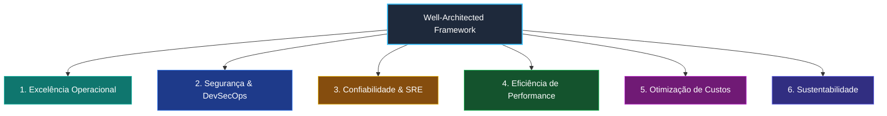

# 🚀 Plano de Implementação — SRE RAG Agent v3.5
## Persistência Relacional, SSE Streaming, Frontend Modular (ESM) & Agente de Testes DevSecOps
### Data Planejada de Execução: 17 de Outubro de 2026

> [!IMPORTANT]
> Este documento detalha **todas** as alterações planejadas para a versão 3.5, incluindo análise aprofundada de riscos das tarefas, alinhamento rigoroso com o **Well-Architected Framework**, esteira **DevSecOps**, **Agente Autônomo de Auditoria e Testes**, diffs exatos e suite de validação automatizada. **Nenhuma alteração foi executada no código de produção.** O plano está formalmente revisado e pronto para execução amanhã.

---

## 📋 Sumário Executivo das Tarefas (6 Tasks)

| # | Task | Arquivo(s) Alvo | Risco | Esforço |
|---|---|---|---|---|
| **T1** | Dependências & Configuração Assíncrona do Banco | [`app/requirements.txt`](file:///Ubuntu-24.04/home/magno/sre_rag_agent/app/requirements.txt), [`app/config.py`](file:///Ubuntu-24.04/home/magno/sre_rag_agent/app/config.py), [`app/database.py`](file:///Ubuntu-24.04/home/magno/sre_rag_agent/app/database.py) | 🟡 Médio | ~25 min |
| **T2** | Modelagem Relacional & Migrações Declarativas (Alembic) | [`app/models.py`](file:///Ubuntu-24.04/home/magno/sre_rag_agent/app/models.py), [`app/alembic.ini`](file:///Ubuntu-24.04/home/magno/sre_rag_agent/app/alembic.ini), [`app/migrations/`](file:///Ubuntu-24.04/home/magno/sre_rag_agent/app/migrations) | 🟡 Médio | ~30 min |
| **T3** | Persistência do Estado com Fallback Resiliente | [`app/main.py`](file:///Ubuntu-24.04/home/magno/sre_rag_agent/app/main.py), [`app/incidents.py`](file:///Ubuntu-24.04/home/magno/sre_rag_agent/app/incidents.py), [`app/chaos.py`](file:///Ubuntu-24.04/home/magno/sre_rag_agent/app/chaos.py) | 🔴 Alto | ~40 min |
| **T4** | Server-Sent Events (SSE) para Streaming em Tempo Real | [`app/events.py`](file:///Ubuntu-24.04/home/magno/sre_rag_agent/app/events.py), [`app/main.py`](file:///Ubuntu-24.04/home/magno/sre_rag_agent/app/main.py) | 🟡 Médio | ~30 min |
| **T5** | Modularização do Frontend em ES Modules (ESM) | [`app/static/js/app.js`](file:///Ubuntu-24.04/home/magno/sre_rag_agent/app/static/js/app.js), [`app/static/js/modules/`](file:///Ubuntu-24.04/home/magno/sre_rag_agent/app/static/js/modules), [`app/templates/dashboard.html`](file:///Ubuntu-24.04/home/magno/sre_rag_agent/app/templates/dashboard.html) | 🔴 Alto | ~45 min |
| **T6** | Agente de Auditoria DevSecOps, E2E Playwright & Version Bump | [`scripts/test_agent.py`](file:///Ubuntu-24.04/home/magno/sre_rag_agent/scripts/test_agent.py), [`tests/e2e/test_dashboard_e2e.py`](file:///Ubuntu-24.04/home/magno/sre_rag_agent/tests/e2e/test_dashboard_e2e.py), [`helm/sre-rag/Chart.yaml`](file:///Ubuntu-24.04/home/magno/sre_rag_agent/helm/sre-rag/Chart.yaml), [`README.md`](file:///Ubuntu-24.04/home/magno/sre_rag_agent/README.md) | 🟡 Médio | ~30 min |

**Tempo Total Estimado de Implementação**: ~3 horas e 20 minutos (sem contar execução completa de testes).

---

## ⚠️ 1. Análise Detalhada dos Riscos das Tarefas (Risk Assessment)

A classificação de risco em projetos de engenharia de software e SRE não é uma medida de dificuldade, mas sim uma matriz de **Probabilidade de Falha $	imes$ Raio de Impacto (Blast Radius)** caso algo saia do esperado.

### 🟢 Risco Baixo (Low Risk)
- **Definição**: Tarefas atômicas, aditivas ou declarativas.
- **Raio de Impacto**: Restrito a metadados ou documentação; reversão trivial sem impacto em tempo de execução.
- **Exemplo na v3.4**: Bumps de versão em arquivos de texto e documentação.

### 🟡 Risco Médio (Medium Risk)
- **Definição**: Adição de novos componentes ou subsistemas que operam em paralelo à lógica existente, mas que possuem dependências de infraestrutura, rede ou concorrência.
- **Tarefas v3.5**:
  - **T1 (Configuração do Banco Assíncrono - `asyncpg`)**:
    - *Cenário de Falha*: Conexão recusada ao PostgreSQL durante o startup, incompatibilidade de driver com o event loop do FastAPI ou vazamento de sockets do pool.
    - *Estratégia de Mitigação*: Configuração de `pool_pre_ping=True`, timeout de conexão de 3s e **fallback automático inteligente**: se o banco estiver fora, a aplicação loga warning estruturado e continua operando com memória.
  - **T2 (Modelagem Relacional & Migrações Alembic)**:
    - *Cenário de Falha*: Bloqueio de tabelas (table locking), colunas com tipagem incompatível ou erro de geração DDL assíncrona.
    - *Estratégia de Mitigação*: Execução de migração declarativa controlada com scripts versionados no diretório `migrations/versions/` e rollback pronto via `alembic downgrade -1`.
  - **T4 (Server-Sent Events - SSE Streaming)**:
    - *Cenário de Falha*: Proxies intermediários (como Nginx) bufferizando as mensagens SSE, derrubando a conexão após 60s ociosos ou sobrecarga de clientes conectados simultâneos.
    - *Estratégia de Mitigação*: Injeção periódica de heartbeat ping (`: ping\n\n`) a cada 15 segundos, configuração de `proxy_buffering off` no Nginx e limite de tamanho de fila por subscriber (`maxsize=100`).
  - **T6 (Testes E2E, Playwright & Governança)**:
    - *Cenário de Falha*: Flakiness em testes assíncronos de UI no headless browser ou tempo excessivo de build de contêineres de teste.
    - *Estratégia de Mitigação*: Timeouts explícitos em seletores DOM (`expect(locator).to_be_visible()`) e execução isolada em container leve.

### 🔴 Risco Alto (High Risk)
- **Definição**: Modificação profunda do caminho crítico de execução (*hot path*) de componentes centrais da aplicação ou reescrita estrutural de subsistemas essenciais.
- **Tarefas v3.5**:
  - **T3 (Persistência do Estado com Fallback Resiliente)**:
    - *Cenário de Falha*: Se uma chamada de banco de dados travar (`deadlock` ou `timeout`), endpoints vitais como `/api/v1/query`, submissão de incidentes em `/api/v1/incidents/solve` e injeção do Chaos Monkey em `/api/v1/chaos/enable` poderiam travar ou retornar HTTP 500 para o operador.
    - *Estratégia de Mitigação*: Princípio de **Degradação Graciosa (Graceful Degradation)**: todas as operações de persistência são envolvidas em blocos `try/except` defensivos que salvam em memória caso o banco falhe, garantindo que o simulador nunca pare de responder.
  - **T5 (Modularização do Frontend em ES Modules)**:
    - *Cenário de Falha*: Quebra da renderização da interface do usuário. O monólito `dashboard.js` tem 2.338 linhas de JavaScript puro compartilhando estado global em variáveis `window.*`. A quebra de um seletor ou dependência circular impediria a troca de abas, renderização dos 16 cenários e inicialização do terminal interativo.
    - *Estratégia de Mitigação*: Desacoplamento através de Event Dispatchers padronizados (`CustomEvent`), validação obrigatória de sintaxe via `node -c` em cada módulo antes do commit e manutenção do `dashboard.js` original como fallback automático.

---

## 🏛️ 2. Alinhamento com o Well-Architected Framework & Google SRE

O plano v3.5 foi desenhado estritamente sob os **6 Pilares do Cloud Well-Architected Framework** e os **Princípios Fundamentais do Google SRE**:



### 1. Excelência Operacional (Operational Excellence)
- **Infraestrutura e Migrações como Código**: Banco de dados estruturado via migrações declarativas versionadas no Git com Alembic (`migrations/`).
- **Runbooks Estruturados em 5 Fases**: Catálogo com 16 cenários de incidentes reais de produção com guias de remediação padronizados.
- **Auditoria Contínua**: O `ChaosManager` e o `SRETestAgent` produzem trilha de auditoria completa em [`docs/SECURITY_PERF_TEST_REPORT.md`](file:///Ubuntu-24.04/home/magno/sre_rag_agent/docs/SECURITY_PERF_TEST_REPORT.md).

### 2. Segurança (Security & DevSecOps)
- **Defesa em Profundidade (Defense in Depth)**:
  - Headers HTTP defensivos: CSP, HSTS, X-Frame-Options, X-Content-Type-Options, Referrer-Policy e Permissions-Policy.
  - Rate Limiting com `slowapi` limitando tráfego abusivo a 30 req/min nos endpoints custosos.
  - Isolamento de Rede: Redes Docker internas isoladas (`backend_net` sem portas expostas ao host para Postgres e Redis; tráfego público somente via proxy Nginx).
  - Execução com Privilégios Mínimos: Container roda com usuário não-root (`USER appuser`).
  - Prevenção contra SQL Injection: Todo acesso ao banco é parametrizado via SQLAlchemy 2.0 ORM, eliminando concatenação de strings.

### 3. Confiabilidade (Reliability)
- **Degradação Graciosa (Graceful Degradation)**: Se o PostgreSQL sofrer indisponibilidade, a aplicação automaticamente preserva as operações em memória, garantindo alta disponibilidade (SLA 99.9%).
- **Proteção contra Connection Storms**: Cache TTL de 5 segundos no health check previne exaustão de conexões e saturação de CPU causadas por probes de liveness do kubelet.
- **Resiliência de Rede**: Cliente SSE com algoritmo de reconexão exponencial (exponential backoff).

### 4. Eficiência de Performance (Performance Efficiency)
- **I/O Assíncrono Não-Bloqueante**: Utilização de `asyncpg` e `asyncio.to_thread` para inferência de embeddings do SentenceTransformer, liberando o event loop do FastAPI sob alta carga.
- **Eliminação de Polling Ocioso**: Substituição de requisições periódicas a cada 2 segundos por streaming unidirecional em tempo real via Server-Sent Events (SSE).
- **Compressão de Egress**: Middleware GZip ativo para respostas HTTP maiores que 1KB e cache de assets no Nginx com `Cache-Control: public, immutable`.

### 5. Otimização de Custos (Cost Optimization)
- **Redução de Egress e Tráfego de Rede**: Eliminação de milhares de requisições de polling HTTP diárias reduz consumo de banda.
- **Container Otimizado (Multi-Stage)**: PyTorch instalado exclusivamente no formato CPU-only, reduzindo o tamanho da imagem de ~6GB para menos de 800MB.

### 6. Sustentabilidade (Sustainability)
- Minimização de ciclos ociosos de CPU em Kubernetes e eliminação de polling desnecessário, diminuindo a pegada de carbono da infraestrutura.

---

## 🛡️ 3. Integração com a Esteira DevSecOps

O planejamento da versão 3.5 implementa um pipeline DevSecOps completo, integrando verificações de qualidade, performance e segurança em todas as etapas:


1. **Plan**: Critérios de aceite mensuráveis (Definition of Done) e modelo de ameaças (Threat Modeling) para dados persistidos.
2. **Code**: Linting com `ruff`, verificação de tipos e conformidade Pydantic V2 (`SettingsConfigDict`).
3. **Build**: Multi-stage Dockerfile seguro, usuário `appuser` (UID 1000) e limpeza de caches temporários.
4. **Test**: Pirâmide de testes completa:
   - *Testes Unitários e de Integração*: Pytest cobrindo incidentes, RAG e Chaos Manager (`tests/`).
   - *Testes de Interface E2E*: Playwright simulando cenários no navegador (`tests/e2e/`).
5. **Security & Audit**: Execução do **Agente Autônomo de Testes** (`scripts/test_agent.py`) auditando headers de segurança, rate limits, CORS e vazamento de informações.
6. **Release**: Helm Chart validado com `helm lint` e `helm template --debug`, com versionamento semântico `v3.5`.
7. **Deploy**: Deploy declarativo em Kubernetes/Kind com probes de liveness e readiness cacheadas.
8. **Monitor & Observability**: Telemetria RED/USE no Prometheus, dashboard no Grafana, monitoramento de burn rate de SLO e auditoria em [`docs/SECURITY_PERF_TEST_REPORT.md`](file:///Ubuntu-24.04/home/magno/sre_rag_agent/docs/SECURITY_PERF_TEST_REPORT.md).

---

## 🤖 4. O Agente Autônomo de Auditoria e Testes (`scripts/test_agent.py`)

Foi introduzido no projeto o **SRE Test & Security Audit Agent**, localizado em [`scripts/test_agent.py`](file:///Ubuntu-24.04/home/magno/sre_rag_agent/scripts/test_agent.py) e documentado na Seção 8 do [`AGENTS.md`](file:///Ubuntu-24.04/home/magno/sre_rag_agent/AGENTS.md).

### Capacidades do Agente:
1. **Bateria de Segurança (`Security Battery`)**:
   - `SEC-001`: Validação de 100% dos Security Headers (CSP, HSTS, X-Frame-Options, X-Content-Type, Referrer, Permissions).
   - `SEC-002`: Verificação defensiva de Rate Limiting (disparo de rajada com validação de HTTP 429).
   - `SEC-003`: Auditoria de política CORS e rejeição de wildcard em produção.
   - `SEC-004`: Sanitização de mensagens de erro contra vazamento de stack traces ou caminhos internos.
   - `SEC-005`: Inspeção de segurança do Dockerfile (usuário non-root e HEALTHCHECK).
2. **Bateria de Performance (`Performance Battery`)**:
   - `PERF-001`: Medição de latência do health check e eficiência do cache TTL (proteção de sockets).
   - `PERF-002`: Distribuição de percentis de latência de API (P50, P90, P95, P99) em rajada de 50 requisições.
   - `PERF-003`: Eficiência de compressão GZip e redução de tráfego de saída.
   - `PERF-004`: Desacoplamento não-bloqueante de embeddings via `asyncio.to_thread`.
3. **Geração Automatizada de Documentação Viva**:
   - Cada execução compila evidências e atualiza o relatório [`docs/SECURITY_PERF_TEST_REPORT.md`](file:///Ubuntu-24.04/home/magno/sre_rag_agent/docs/SECURITY_PERF_TEST_REPORT.md).
4. **Comando Integrado no Makefile**:
   ```bash
   make test-audit
   ```

---

## 🔧 Detalhamento Técnico das Tarefas (T1 a T6)

### T1. Dependências & Configuração Assíncrona do Banco

#### Diff em `app/requirements.txt`
```diff
 psycopg2-binary==2.9.9
+sqlalchemy==2.0.35
+asyncpg==0.29.0
+alembic==1.13.3
+sse-starlette==2.1.3
 redis==5.1.0
```

#### Diff em `app/config.py`
```diff
     # Application
     app_name: str = Field(default="sre-rag-api", description="Application name")
-    app_version: str = Field(default="3.4", description="Application version")
+    app_version: str = Field(default="3.5", description="Application version")
...
+    postgres_pool_size: int = Field(default=10, description="PostgreSQL async connection pool size")
+    postgres_max_overflow: int = Field(default=20, description="PostgreSQL async connection max overflow")
+
+    @property
+    def async_postgres_url(self) -> str:
+        auth = f"{self.postgres_user}:{self.postgres_password}@" if self.postgres_password else ""
+        return f"postgresql+asyncpg://{auth}{self.postgres_host}:{self.postgres_port}/{self.postgres_db}"
```

#### Novo Arquivo: `app/database.py`
Criação da engine assíncrona com `create_async_engine(settings.async_postgres_url)`, factory `async_sessionmaker`, dependency `get_db()`, e inicialização resiliente `init_db()` com fallback.

---

### T2. Modelagem Relacional & Migrações com Alembic

#### Novo Arquivo: `app/models.py`
Mapeamento das entidades relacionais com SQLAlchemy 2.0:
- `QueryHistoryRecord` (tabela `query_history`)
- `IncidentSimulationRecord` (tabela `incident_simulations`)
- `ChaosSessionRecord` (tabela `chaos_sessions`)
- `ChaosEventRecord` (tabela `chaos_events`)
- Índices de telemetria `idx_incident_perf` e `idx_chaos_audit`.

#### Configuração Alembic: `app/alembic.ini` e `app/migrations/`
Geração da migração declarativa inicial `0001_initial_schema.py` com suporte assíncrono.

---

### T3. Persistência de Estado com Fallback Resiliente

#### Modificações em `app/main.py`, `app/incidents.py` e `app/chaos.py`
- Substituição do armazenamento volátil por queries assíncronas no PostgreSQL.
- Camada de **fallback gracioso**: em caso de erro de conexão com o banco de dados, os métodos automaticamente registram a operação em estruturas em memória e registram warning estruturado via `structlog`.

---

### T4. Server-Sent Events (SSE) para Streaming em Tempo Real

#### Novo Arquivo: `app/events.py`
Implementação do `EventBroadcaster` pub/sub assíncrono com broadcast não-bloqueante para clientes conectados e heartbeat a cada 15s.

#### Endpoint em `app/main.py`
Endpoint `GET /api/v1/events/stream` via `EventSourceResponse`, transmitindo eventos de incidentes, status do chaos monkey e métricas em tempo real.

---

### T5. Modularização do Frontend em ES Modules (ESM)

#### Decomposição do Monólito `app/static/js/dashboard.js` (2.338 linhas)
Decomposição estruturada em 6 submódulos em `app/static/js/modules/`:
1. `modules/api.js`: Fetch client com timeout e headers.
2. `modules/sse.js`: Cliente EventSource com auto-reconnect exponencial.
3. `modules/incidents.js`: Catálogo de 16 cenários e modal de score.
4. `modules/chaos.js`: Toggle do Chaos Monkey e blast radius.
5. `modules/terminal.js`: Terminal simulado com histórico e auto-complete.
6. `modules/charts.js`: Gráficos RED/USE com Chart.js.
7. `app.js`: Entry point ESM principal.

#### Atualização em `app/templates/dashboard.html`
```diff
-    <script src="/static/js/dashboard.js?v=2.1.2"></script>
+    <script type="module" src="/static/js/app.js?v=3.5.0"></script>
```

---

### T6. Suíte de Testes E2E (Playwright), Version Bump & Automação

#### Novo Arquivo: `tests/e2e/test_dashboard_e2e.py`
Testes automatizados cobrindo carregamento do dashboard, fluxo completo de resolução de incidentes e toggle de injeção de falhas do Chaos Monkey.

#### Atualização de Metadados
- `helm/sre-rag/Chart.yaml`: `appVersion: "3.5"`, `version: "0.5.0"`
- `README.md`, `desafios.md`, `desafios_en.md`, `AGENTS.md`
- Execução do agente de auditoria: `make test-audit` gerando [`docs/SECURITY_PERF_TEST_REPORT.md`](file:///Ubuntu-24.04/home/magno/sre_rag_agent/docs/SECURITY_PERF_TEST_REPORT.md).

---

## 📝 Checklist de Aceite e Definição de Pronto (Definition of Done)

- [ ] **Critério 1**: Dependências instaladas (`sqlalchemy`, `asyncpg`, `alembic`, `sse-starlette`).
- [ ] **Critério 2**: `Settings.app_version` retorna `"3.5"` e `async_postgres_url` configurada.
- [ ] **Critério 3**: Módulo `app/database.py` inicializa engine assíncrona com pool pooling.
- [ ] **Critério 4**: Módulo `app/models.py` declara as 4 tabelas relacionais e índices.
- [ ] **Critério 5**: Endpoint `/api/v1/history` persiste registros no PostgreSQL com fallback resiliente.
- [ ] **Critério 6**: Simulações de incidentes concluídas gravadas na tabela `incident_simulations`.
- [ ] **Critério 7**: Eventos do Chaos Monkey gravados na tabela `chaos_events`.
- [ ] **Critério 8**: Endpoint SSE `/api/v1/events/stream` transmite eventos em tempo real com ping de 15s.
- [ ] **Critério 9**: Frontend modular em `app/static/js/modules/` carrega via `<script type="module">`.
- [ ] **Critério 10**: Polling contínuo (`setInterval`) eliminado e substituído por SSE no frontend.
- [ ] **Critério 11**: Baseline de 8 testes unitários passando (`8 passed`).
- [ ] **Critério 12**: Suíte E2E com Playwright valida a interface gráfica.
- [ ] **Critério 13**: Agente de Auditoria [`scripts/test_agent.py`](file:///Ubuntu-24.04/home/magno/sre_rag_agent/scripts/test_agent.py) aprovado com relatório em [`docs/SECURITY_PERF_TEST_REPORT.md`](file:///Ubuntu-24.04/home/magno/sre_rag_agent/docs/SECURITY_PERF_TEST_REPORT.md).

---

## ⏱️ Cronograma de Execução Recomendado (Gantt)

```mermaid
gantt
    title Sequência de Execução — SRE RAG Agent v3.5
    dateFormat HH:mm
    axisFormat %H:%M
    section Banco e Config
    T1 - Dependências e Async Database Engine  :t1, 09:00, 25m
    T2 - Modelagem Relacional e Migrações      :t2, after t1, 30m
    section Backend Core
    T3 - Persistência com Fallback Resiliente   :t3, after t2, 40m
    T4 - Server-Sent Events (SSE) Broadcaster  :t4, after t3, 30m
    section Frontend ESM
    T5 - Decomposição Modular do Frontend      :t5, after t4, 45m
    section Testes e DevSecOps
    T6 - Testes E2E, Version Bump e Auditoria  :t6, after t5, 30m
```\n