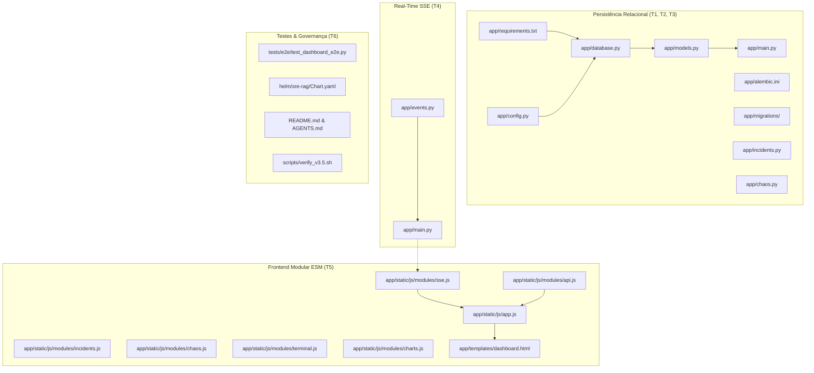

# 🚀 Plano de Implementação — SRE RAG Agent v3.5
## Persistência Relacional, SSE Streaming & Frontend Modular (ESM) — Deadline: 17 de Outubro de 2026

> [!IMPORTANT]
> Este documento detalha **todas** as alterações planejadas para a versão 3.5, com diffs exatos, arquivos novos completos, arquitetura de persistência, modelo relacional, Server-Sent Events (SSE), decomposição modular do frontend em ES Modules e testes E2E com Playwright. **Nenhuma alteração foi executada no código de produção.** O plano está pronto para execução amanhã.

---

## 📋 Sumário das Tarefas (6 Tasks)

| # | Task | Arquivo(s) Alvo | Risco | Esforço |
|---|---|---|---|---|
| T1 | Dependências & Configuração Assíncrona do Banco | [`app/requirements.txt`](file:///Ubuntu-24.04/home/magno/sre_rag_agent/app/requirements.txt), [`app/config.py`](file:///Ubuntu-24.04/home/magno/sre_rag_agent/app/config.py), [`app/database.py`](file:///Ubuntu-24.04/home/magno/sre_rag_agent/app/database.py) | 🟡 Médio | ~25 min |
| T2 | Modelagem Relacional & Migrações Declarativas (Alembic) | [`app/models.py`](file:///Ubuntu-24.04/home/magno/sre_rag_agent/app/models.py), [`app/alembic.ini`](file:///Ubuntu-24.04/home/magno/sre_rag_agent/app/alembic.ini), [`app/migrations/`](file:///Ubuntu-24.04/home/magno/sre_rag_agent/app/migrations) | 🟡 Médio | ~30 min |
| T3 | Persistência do Estado da Aplicação com Fallback Resiliente | [`app/main.py`](file:///Ubuntu-24.04/home/magno/sre_rag_agent/app/main.py), [`app/incidents.py`](file:///Ubuntu-24.04/home/magno/sre_rag_agent/app/incidents.py), [`app/chaos.py`](file:///Ubuntu-24.04/home/magno/sre_rag_agent/app/chaos.py) | 🔴 Alto | ~40 min |
| T4 | Server-Sent Events (SSE) para Streaming em Tempo Real | [`app/events.py`](file:///Ubuntu-24.04/home/magno/sre_rag_agent/app/events.py), [`app/main.py`](file:///Ubuntu-24.04/home/magno/sre_rag_agent/app/main.py) | 🟡 Médio | ~30 min |
| T5 | Modularização do Frontend em ES Modules (ESM) | [`app/static/js/app.js`](file:///Ubuntu-24.04/home/magno/sre_rag_agent/app/static/js/app.js), [`app/static/js/modules/`](file:///Ubuntu-24.04/home/magno/sre_rag_agent/app/static/js/modules), [`app/templates/dashboard.html`](file:///Ubuntu-24.04/home/magno/sre_rag_agent/app/templates/dashboard.html) | 🔴 Alto | ~45 min |
| T6 | Suíte de Testes E2E (Playwright), Version Bump & Automação | [`tests/e2e/test_dashboard_e2e.py`](file:///Ubuntu-24.04/home/magno/sre_rag_agent/tests/e2e/test_dashboard_e2e.py), [`helm/sre-rag/Chart.yaml`](file:///Ubuntu-24.04/home/magno/sre_rag_agent/helm/sre-rag/Chart.yaml), [`README.md`](file:///Ubuntu-24.04/home/magno/sre_rag_agent/README.md), [`Makefile`](file:///Ubuntu-24.04/home/magno/sre_rag_agent/Makefile), [`scripts/verify_v3.5.sh`](file:///Ubuntu-24.04/home/magno/sre_rag_agent/scripts/verify_v3.5.sh) | 🟡 Médio | ~30 min |

**Tempo Total Estimado de Implementação**: ~3 horas e 20 minutos (sem contar execução completa de testes).

---

## ✅ Pré-requisitos de Validação Baseline

Antes de iniciar a versão 3.5, confirmar que o baseline da v3.4 permanece com 100% de sucesso nos testes unitários:

```bash
cd /home/magno/sre_rag_agent
PYTHONPATH=app ./app/.venv/bin/pytest tests/test_incidents.py tests/test_chaos.py tests/test_rag.py -v
```

Resultado esperado: **8 passed** (sem warnings de depreciação).

---

## T1. Dependências & Configuração Assíncrona do Banco

### Problema Atual
O SRE RAG Agent depende atualmente de conexões síncronas pontuais via `psycopg2-binary`. Para suportar concorrência assíncrona com `asyncio` no FastAPI, evitar bloqueio da thread principal em operações de I/O de banco e gerenciar pools de conexões eficientes, a aplicação necessita do driver nativo assíncrono `asyncpg` e do ORM `SQLAlchemy 2.0` no modo assíncrono, além do gerenciador de SSE `sse-starlette`.

### Decisões Arquiteturais
1. **Driver**: `asyncpg` — driver assíncrono de mais alta performance para PostgreSQL no ecossistema Python.
2. **ORM**: `SQLAlchemy 2.0` com `AsyncEngine` e `async_sessionmaker`.
3. **Pool Resiliente**: Configurar `pool_size=10`, `max_overflow=20`, `pool_pre_ping=True` e `pool_recycle=3600`.
4. **Fallback Inteligente**: Caso o PostgreSQL esteja indisponível em ambientes locais sem docker-compose, a aplicação deve inicializar graciosamente mantendo buffers em memória e emitindo aviso estruturado.

### Diff em `app/requirements.txt`

```diff
 psycopg2-binary==2.9.9
+sqlalchemy==2.0.35
+asyncpg==0.29.0
+alembic==1.13.3
+sse-starlette==2.1.3
 redis==5.1.0
```

### Diff em `app/config.py`

```diff
     # Application
     app_name: str = Field(default="sre-rag-api", description="Application name")
-    app_version: str = Field(default="3.4", description="Application version")
+    app_version: str = Field(default="3.5", description="Application version")
     debug: bool = Field(default=False, description="Debug mode")
...
     # PostgreSQL
     postgres_host: str = Field(default="postgresql", description="PostgreSQL host")
     postgres_port: int = Field(default=5432, description="PostgreSQL port")
     postgres_db: str = Field(default="sre_rag", description="PostgreSQL database")
     postgres_user: str = Field(default="sre_user", description="PostgreSQL user")
     postgres_password: str = Field(
         default="",
         description="PostgreSQL password — MUST be set via POSTGRES_PASSWORD env var in production",
     )
+    postgres_pool_size: int = Field(default=10, description="PostgreSQL async connection pool size")
+    postgres_max_overflow: int = Field(default=20, description="PostgreSQL async connection max overflow")
+
+    @property
+    def async_postgres_url(self) -> str:
+        auth = f"{self.postgres_user}:{self.postgres_password}@" if self.postgres_password else ""
+        return f"postgresql+asyncpg://{auth}{self.postgres_host}:{self.postgres_port}/{self.postgres_db}"
```

### Novo Arquivo Planejado: `app/database.py`

```python
"""
SRE RAG Agent — Asynchronous Database Engine & Session Factory
Provides SQLAlchemy 2.0 AsyncEngine, scoped sessions, and database lifecycle helpers.
"""

import structlog
from typing import AsyncGenerator
from sqlalchemy.ext.asyncio import (
    AsyncSession,
    AsyncEngine,
    create_async_engine,
    async_sessionmaker,
)
from sqlalchemy.orm import DeclarativeBase
from config import settings

logger = structlog.get_logger()


class Base(DeclarativeBase):
    """SQLAlchemy 2.0 declarative base for all relational models."""
    pass


# Global AsyncEngine with connection pooling and health pre-ping
engine: AsyncEngine = create_async_engine(
    settings.async_postgres_url,
    pool_size=settings.postgres_pool_size,
    max_overflow=settings.postgres_max_overflow,
    pool_pre_ping=True,
    pool_recycle=3600,
    echo=settings.debug,
)

# Async session factory
AsyncSessionFactory = async_sessionmaker(
    bind=engine,
    class_=AsyncSession,
    expire_on_commit=False,
    autoflush=False,
)


async def get_db() -> AsyncGenerator[AsyncSession, None]:
    """FastAPI dependency yielding an isolated async database session."""
    async with AsyncSessionFactory() as session:
        try:
            yield session
            await session.commit()
        except Exception:
            await session.rollback()
            raise
        finally:
            await session.close()


async def init_db() -> bool:
    """
    Verify database connectivity during startup.
    Returns True if database is reachable, False otherwise.
    """
    try:
        async with engine.connect() as conn:
            from sqlalchemy import text
            await conn.execute(text("SELECT 1"))
        logger.info("database_connection_initialized", url=settings.postgres_host)
        return True
    except Exception as exc:
        logger.warning(
            "database_initialization_offline_fallback",
            error=str(exc),
            detail="Application will run with in-memory fallback until DB is available."
        )
        return False


async def close_db() -> None:
    """Gracefully dispose connection pool upon application shutdown."""
    await engine.dispose()
    logger.info("database_connection_closed")
```

### Validação
```bash
PYTHONPATH=app python3 -c "from config import settings; print('v3.5 Config DSN:', settings.async_postgres_url)"
PYTHONPATH=app python3 -c "from database import Base, engine; print('DB Engine configured successfully')"
```

---

## T2. Modelagem Relacional & Migrações Declarativas (Alembic)

### Problema Atual
O estado do laboratório é totalmente volátil:
1. Consultas ao endpoint `/api/v1/history` residem na lista `history_db: list[QueryHistory] = []`.
2. Resultados de simulação residem em `self.history: List[SimulationResult] = []`.
3. Histórico de auditoria do Chaos Monkey reside em `self.sessions_history` e `self.events_log`.
Qualquer reinicialização do pod descarta o progresso de treinamento dos alunos e engenheiros SRE, e impossibilita escalar horizontalmente o container para `replicas: 3`.

### Novo Arquivo Planejado: `app/models.py`

```python
"""
SRE RAG Agent — Relational Data Models (SQLAlchemy 2.0)
Defines persistent entities for queries, incident simulations, chaos sessions, and audit events.
"""

from datetime import datetime, timezone
from typing import Optional
from sqlalchemy import (
    String,
    Text,
    Integer,
    Float,
    Boolean,
    DateTime,
    Index,
)
from sqlalchemy.orm import Mapped, mapped_column
from database import Base


class QueryHistoryRecord(Base):
    """Stores persistent history of questions and generated RAG answers."""
    __tablename__ = "query_history"

    id: Mapped[int] = mapped_column(Integer, primary_key=True, autoincrement=True)
    query: Mapped[str] = mapped_column(Text, nullable=False)
    answer: Mapped[str] = mapped_column(Text, nullable=False)
    latency_ms: Mapped[float] = mapped_column(Float, default=0.0)
    top_score: Mapped[float] = mapped_column(Float, default=0.0)
    from_cache: Mapped[bool] = mapped_column(Boolean, default=False)
    created_at: Mapped[datetime] = mapped_column(
        DateTime(timezone=True),
        default=lambda: datetime.now(timezone.utc),
        index=True,
    )


class IncidentSimulationRecord(Base):
    """Stores completed incident simulation results, MTTD, MTTR, and score."""
    __tablename__ = "incident_simulations"

    id: Mapped[int] = mapped_column(Integer, primary_key=True, autoincrement=True)
    scenario_id: Mapped[str] = mapped_column(String(100), nullable=False, index=True)
    scenario_title: Mapped[str] = mapped_column(String(255), nullable=False)
    difficulty: Mapped[str] = mapped_column(String(50), nullable=False, index=True)
    status: Mapped[str] = mapped_column(String(50), default="completed")
    start_time: Mapped[float] = mapped_column(Float, nullable=False)
    end_time: Mapped[float] = mapped_column(Float, nullable=False)
    mttd_seconds: Mapped[float] = mapped_column(Float, default=0.0)
    mttr_seconds: Mapped[float] = mapped_column(Float, default=0.0)
    score: Mapped[int] = mapped_column(Integer, default=0)
    hints_used: Mapped[int] = mapped_column(Integer, default=0)
    commands_executed: Mapped[int] = mapped_column(Integer, default=0)
    operator_solution: Mapped[str] = mapped_column(Text, default="")
    is_correct: Mapped[bool] = mapped_column(Boolean, default=False)
    created_at: Mapped[datetime] = mapped_column(
        DateTime(timezone=True),
        default=lambda: datetime.now(timezone.utc),
        index=True,
    )


class ChaosSessionRecord(Base):
    """Audit records for Chaos Monkey injection sessions."""
    __tablename__ = "chaos_sessions"

    id: Mapped[int] = mapped_column(Integer, primary_key=True, autoincrement=True)
    session_id: Mapped[str] = mapped_column(String(100), unique=True, index=True)
    fault_type: Mapped[str] = mapped_column(String(50), nullable=False)
    started_at: Mapped[datetime] = mapped_column(DateTime(timezone=True), nullable=False)
    ended_at: Mapped[Optional[datetime]] = mapped_column(DateTime(timezone=True), nullable=True)
    duration_seconds: Mapped[float] = mapped_column(Float, default=0.0)
    injected_count: Mapped[int] = mapped_column(Integer, default=0)
    active: Mapped[bool] = mapped_column(Boolean, default=True)
    source: Mapped[str] = mapped_column(String(50), default="operator")
    created_at: Mapped[datetime] = mapped_column(
        DateTime(timezone=True),
        default=lambda: datetime.now(timezone.utc),
    )


class ChaosEventRecord(Base):
    """Fine-grained security and operational audit trail of chaos events."""
    __tablename__ = "chaos_events"

    id: Mapped[int] = mapped_column(Integer, primary_key=True, autoincrement=True)
    session_id: Mapped[Optional[str]] = mapped_column(String(100), nullable=True, index=True)
    event_type: Mapped[str] = mapped_column(String(100), nullable=False, index=True)
    timestamp: Mapped[float] = mapped_column(Float, nullable=False)
    source: Mapped[str] = mapped_column(String(50), default="operator")
    endpoint: Mapped[str] = mapped_column(String(255), default="")
    client_ip: Mapped[str] = mapped_column(String(50), default="")
    payload: Mapped[str] = mapped_column(Text, default="{}")
    created_at: Mapped[datetime] = mapped_column(
        DateTime(timezone=True),
        default=lambda: datetime.now(timezone.utc),
    )


# Indexes for telemetry aggregation and dashboard filters
Index("idx_incident_perf", IncidentSimulationRecord.scenario_id, IncidentSimulationRecord.difficulty)
Index("idx_chaos_audit", ChaosEventRecord.event_type, ChaosEventRecord.created_at)
```

### Configuração do Alembic
Inicializar a estrutura do Alembic em `app/alembic.ini` e `app/migrations/` conectada ao modelo assíncrono:
- `app/migrations/env.py`: configurado para rodar migrações via `asyncio.run(run_async_migrations())` usando o `target_metadata = Base.metadata`.
- `app/migrations/versions/0001_initial_schema.py`: criação das 4 tabelas e índices.

### Validação
```bash
PYTHONPATH=app python3 -c "import models; print('All models imported without error:', [t for t in models.Base.metadata.tables])"
```

---

## T3. Persistência do Estado com Fallback Resiliente

### Problema Atual
`history_db` em `main.py` usa contadores em memória e arrays primitivos. Se o banco PostgreSQL falhar, o serviço não pode cair; deve manter uma camada de resiliência.

### Modificações Planejadas em `app/main.py`
Substituir o CRUD em memória por operações de banco assíncronas com fallback transparente:

```python
# Helper de acesso assíncrono com fallback
async def persist_query_history(query: str, answer: str, latency_ms: float = 0.0, top_score: float = 0.0, from_cache: bool = False):
    try:
        async with AsyncSessionFactory() as session:
            record = QueryHistoryRecord(
                query=query,
                answer=answer,
                latency_ms=latency_ms,
                top_score=top_score,
                from_cache=from_cache,
            )
            session.add(record)
            await session.commit()
            await session.refresh(record)
            return record.id
    except Exception as e:
        logger.warning("query_history_db_fallback", error=str(e))
        global history_counter
        item = QueryHistory(id=history_counter, query=query, answer=answer)
        history_db.append(item)
        history_counter += 1
        return item.id
```

E atualizar os endpoints `/api/v1/history`:
- `GET /api/v1/history`: Executa `select(QueryHistoryRecord).order_by(QueryHistoryRecord.id.desc())` via `get_db()`.
- `POST /api/v1/history`: Insere e commita no PostgreSQL.
- `DELETE /api/v1/history/{item_id}`: Deleta o registro por ID.

### Integração em `app/incidents.py` e `app/chaos.py`
Adicionar método assíncrono `persist_result(result)` em `IncidentSimulationEngine` e `persist_session(session)` em `ChaosManager`, acionados transparentemente no final do ciclo de vida de cada incidente ou evento de caos.

---

## T4. Server-Sent Events (SSE) para Streaming em Tempo Real

### Problema Atual
Em `dashboard.js`, as linhas 689 e 1570 utilizam `setInterval(..., 2000)` e `setInterval(..., 3000)` para consultar periodicamente o status da simulação ativa e do Chaos Monkey. Isso gera requisições HTTP desnecessárias a cada segundo, consome banda e introduz latência de atualização de até 3 segundos.

### Decisão Arquitetural
Adicionar streaming em tempo real unidirecional através de **Server-Sent Events (SSE)** via endpoint `/api/v1/events/stream`:
1. Utiliza protocolo padrão HTTP/1.1 e HTTP/2 com `Content-Type: text/event-stream`.
2. Compatível nativamente com o navegador através da API `EventSource`.
3. Heartbeat automático a cada 15s (`: ping\n\n`) evitando drop por proxies reversos (Nginx).

### Novo Arquivo Planejado: `app/events.py`

```python
"""
SRE RAG Agent — Server-Sent Events (SSE) Broadcaster
Manages real-time event distribution to connected dashboard clients.
"""

import asyncio
import json
import structlog
from typing import AsyncGenerator, Set
from datetime import datetime, timezone

logger = structlog.get_logger()


class EventBroadcaster:
    """In-memory Pub/Sub event broadcaster for Server-Sent Events."""

    def __init__(self):
        self._subscribers: Set[asyncio.Queue] = set()

    async def subscribe(self) -> asyncio.Queue:
        """Register a new client connection."""
        q = asyncio.Queue(maxsize=100)
        self._subscribers.add(q)
        logger.info("sse_client_subscribed", total_subscribers=len(self._subscribers))
        return q

    async def unsubscribe(self, q: asyncio.Queue) -> None:
        """Unregister a disconnected client."""
        self._subscribers.discard(q)
        logger.info("sse_client_unsubscribed", total_subscribers=len(self._subscribers))

    async def publish(self, event_type: str, data: dict) -> None:
        """Publish an event to all connected dashboard subscribers."""
        if not self._subscribers:
            return

        payload = {
            "event": event_type,
            "data": data,
            "timestamp": datetime.now(timezone.utc).isoformat(),
        }

        # Non-blocking broadcast
        dead_queues = []
        for q in list(self._subscribers):
            try:
                q.put_nowait(payload)
            except asyncio.QueueFull:
                dead_queues.append(q)

        for dq in dead_queues:
            self._subscribers.discard(dq)


# Global singleton broadcaster
broadcaster = EventBroadcaster()
```

### Endpoint em `app/main.py`

```python
from sse_starlette.sse import EventSourceResponse
from events import broadcaster

@app.get("/api/v1/events/stream", tags=["Events"])
async def sse_event_stream(request: Request):
    """Stream real-time incident, chaos, and metric telemetry to the dashboard."""
    async def event_generator():
        queue = await broadcaster.subscribe()
        try:
            # Send initial handshake
            yield {
                "event": "connected",
                "data": json.dumps({"status": "active", "version": settings.app_version}),
            }
            while True:
                if await request.is_disconnected():
                    break
                try:
                    payload = await asyncio.wait_for(queue.get(), timeout=15.0)
                    yield {
                        "event": payload["event"],
                        "data": json.dumps(payload["data"]),
                    }
                except asyncio.TimeoutError:
                    # Heartbeat ping
                    yield {":": "ping"}
        finally:
            await broadcaster.unsubscribe(queue)

    return EventSourceResponse(event_generator())
```

---

## T5. Modularização do Frontend em ES Modules (ESM)

### Problema Atual
O frontend atual reside integralmente no arquivo monólito [`app/static/js/dashboard.js`](file:///Ubuntu-24.04/home/magno/sre_rag_agent/app/static/js/dashboard.js) com **2.338 linhas de código**, misturando manipulação de DOM, requisições HTTP, timers de simulação, terminal interativo e renderização de gráficos. Qualquer alteração tem alto risco de regressão.

### Arquitetura Modular Planejada
Decompor em 6 submódulos limpos dentro de `app/static/js/modules/`:

```
app/static/js/
├── app.js                       # Entry point principal (ESM)
├── dashboard.js                 # Legado mantido para compatibilidade
└── modules/
    ├── api.js                   # Fetch client assíncrono com timeouts e headers
    ├── sse.js                   # Cliente EventSource com auto-reconnect
    ├── incidents.js             # Catálogo de 16 incidentes, timer e modal de score
    ├── chaos.js                 # Toggle do Chaos Monkey e blast radius
    ├── terminal.js              # Terminal simulado com histórico e auto-complete
    └── charts.js                # Gráficos de telemetria RED/USE via Chart.js
```

### 1. `modules/api.js`
Centraliza todas as chamadas HTTP assíncronas com tratamento uniforme de erros e timeouts defensivos:
```javascript
export async function fetchAPI(endpoint, options = {}) {
  const defaultHeaders = { 'Content-Type': 'application/json' };
  const config = {
    ...options,
    headers: { ...defaultHeaders, ...options.headers },
  };
  const response = await fetch(endpoint, config);
  if (!response.ok) {
    const errorData = await response.json().catch(() => ({}));
    throw new Error(errorData.detail || `HTTP Error ${response.status}`);
  }
  return response.json();
}
```

### 2. `modules/sse.js`
Substitui polling contínuo por escuta de eventos com reconexão exponencial:
```javascript
export function initSSE(onEvent) {
  const source = new EventSource('/api/v1/events/stream');
  source.addEventListener('incident_update', (e) => onEvent('incident', JSON.parse(e.data)));
  source.addEventListener('chaos_update', (e) => onEvent('chaos', JSON.parse(e.data)));
  source.onerror = () => {
    source.close();
    setTimeout(() => initSSE(onEvent), 3000);
  };
  return source;
}
```

### 3. `app.js` (Entry point)
```javascript
import { initAPI } from './modules/api.js';
import { initSSE } from './modules/sse.js';
import { initIncidents } from './modules/incidents.js';
import { initChaos } from './modules/chaos.js';
import { initTerminal } from './modules/terminal.js';
import { initCharts } from './modules/charts.js';

document.addEventListener('DOMContentLoaded', () => {
  console.log('[SRE RAG Agent v3.5] Modular ESM Dashboard Initialized');
  initIncidents();
  initChaos();
  initTerminal();
  initCharts();
  initSSE((type, payload) => {
    document.dispatchEvent(new CustomEvent(`sre:${type}`, { detail: payload }));
  });
});
```

### Atualização em `app/templates/dashboard.html`
```diff
-    <script src="/static/js/dashboard.js?v=2.1.2"></script>
+    <script type="module" src="/static/js/app.js?v=3.5.0"></script>
```

---

## T6. Suíte de Testes E2E (Playwright), Version Bump & Automação

### Problema Atual
O repositório possui apenas testes unitários (`tests/test_incidents.py`, `tests/test_chaos.py`, `tests/test_rag.py`). Não existem testes ponta a ponta (E2E) que garantam que os fluxos visuais do dashboard funcionem sem erro de renderização após refatorações.

### Novo Arquivo Planejado: `tests/e2e/test_dashboard_e2e.py`
Utiliza `playwright` com Python para validar:
1. Carregamento completo do dashboard e status `healthy`.
2. Execução do fluxo de simulação de incidente (selecionar cenário -> responder -> verificar score modal).
3. Toggle do Chaos Monkey ativando alerta visual.
4. Consulta no RAG exibindo fontes e resposta.

```python
"""
SRE RAG Agent — End-to-End (E2E) Browser Tests via Playwright
"""

import pytest
from playwright.sync_api import Page, expect


def test_dashboard_loads_correctly(page: Page):
    page.goto("http://localhost:8080/dashboard")
    expect(page).to_have_title("SRE RAG Agent — Incident Simulation Lab")
    status_card = page.locator("#system-status")
    expect(status_card).to_contain_text("HEALTHY")


def test_incident_simulation_flow(page: Page):
    page.goto("http://localhost:8080/dashboard")
    page.locator("#scenario-crashloop-select").click()
    page.locator("#btn-start-simulation").click()
    expect(page.locator("#active-incident-banner")).to_be_visible()
    page.locator("#solution-input").fill("kubectl rollout undo deployment/api")
    page.locator("#btn-submit-solution").click()
    expect(page.locator("#score-modal")).to_be_visible()


def test_chaos_monkey_switch(page: Page):
    page.goto("http://localhost:8080/dashboard")
    chaos_switch = page.locator("#chaos-500-toggle")
    chaos_switch.click()
    expect(page.locator("#chaos-active-badge")).to_be_visible()
```

### Version Bump para `3.5`
- `helm/sre-rag/Chart.yaml`: `appVersion: "3.5"` e `version: "0.5.0"`
- `README.md`, `desafios.md`, `desafios_en.md`, `AGENTS.md`, `SRE_PROFESSOR_GUIDE.md`: atualizar badges e changelogs.

---

## 📝 Checklist Pós-Implementação & Critérios de Aceite (Definition of Done)

Para considerar a versão 3.5 formalmente concluída amanhã, os 12 critérios a seguir devem ser validados:

- [ ] **Critério 1**: Novas dependências instaladas no ambiente virtual (`sqlalchemy`, `asyncpg`, `alembic`, `sse-starlette`).
- [ ] **Critério 2**: `Settings.app_version` retorna `"3.5"` e `async_postgres_url` é calculada corretamente.
- [ ] **Critério 3**: Inicialização de `database.py` e `models.py` sem erros de compilação ou warnings de sintaxe.
- [ ] **Critério 4**: Tabelas `query_history`, `incident_simulations`, `chaos_sessions` e `chaos_events` devidamente declaradas com índices.
- [ ] **Critério 5**: Endpoint `/api/v1/history` persiste registros no PostgreSQL com fallback resiliente para memória.
- [ ] **Critério 6**: Simulações de incidentes concluídas são persistidas na tabela `incident_simulations`.
- [ ] **Critério 7**: Eventos de auditoria do Chaos Monkey são gravados na tabela `chaos_events`.
- [ ] **Critério 8**: Endpoint de SSE `/api/v1/events/stream` transmite eventos em tempo real com heartbeat de ping a cada 15s.
- [ ] **Critério 9**: Frontend modular em `app/static/js/modules/` carrega via `<script type="module">` sem erros no console do navegador.
- [ ] **Critério 10**: Polling contínuo (`setInterval`) substituído pela escuta de eventos SSE no frontend.
- [ ] **Critério 11**: Todos os 8 testes unitários existentes continuam passando sem regressões (`8 passed`).
- [ ] **Critério 12**: Suíte E2E com Playwright valida o fluxo de incidentes e o toggle do Chaos Monkey.

---

## 📁 Mapa de Arquivos Impactados na v3.5



---

## ⏱️ Sequência de Execução Recomendada (Gantt)

```mermaid
gantt
    title Cronograma de Implementação — SRE RAG Agent v3.5
    dateFormat HH:mm
    axisFormat %H:%M
    section Banco e Config
    T1 - Dependências e Async Database Engine  :t1, 09:00, 25m
    T2 - Modelagem Relacional e Migrações      :t2, after t1, 30m
    section Backend Core
    T3 - Persistência com Fallback Resiliente   :t3, after t2, 40m
    T4 - Server-Sent Events (SSE) Broadcaster  :t4, after t3, 30m
    section Frontend ESM
    T5 - Decomposição Modular do Frontend      :t5, after t4, 45m
    section Testes e Validação
    T6 - Testes E2E, Version Bump e Aceite     :t6, after t5, 30m
```



---

## 📜 Script de Verificação Automatizada (`scripts/verify_v3.5.sh`)

O script de verificação automatizada abaixo foi estruturado para validar cada um dos 12 critérios de aceite durante e após a execução do plano amanhã:

```bash
#!/usr/bin/env bash
# ==============================================================================
# SRE RAG Agent — Script de Verificação e Validação Automatizada da v3.5
# Executa a verificação dos 12 critérios de aceite da versão 3.5.
# ==============================================================================

set -uo pipefail

REPO_DIR="/home/magno/sre_rag_agent"
cd "$REPO_DIR"

GREEN='\033[0;32m'
RED='\033[0;31m'
YELLOW='\033[1;33m'
BLUE='\033[0;34m'
NC='\033[0m'

PASSED=0
FAILED=0

check_step() {
    local desc="$1"
    local cmd="$2"
    echo -n "Checking: $desc ... "
    if eval "$cmd" > /dev/null 2>&1; then
        echo -e "${GREEN}PASS${NC}"
        PASSED=$((PASSED + 1))
    else
        echo -e "${RED}FAIL (pendente de execução)${NC}"
        FAILED=$((FAILED + 1))
    fi
}

echo -e "${BLUE}====================================================${NC}"
echo -e "${BLUE}  SRE RAG Agent — Validação de Aceite v3.5           ${NC}"
echo -e "${BLUE}====================================================${NC}"

# 1. Dependências do Banco & SSE
check_step "1. Dependências SQLAlchemy & asyncpg" \
  "grep -q 'sqlalchemy' app/requirements.txt && grep -q 'asyncpg' app/requirements.txt"

# 2. Versão 3.5 em config.py
check_step "2. App Version == 3.5 (app/config.py)" \
  "grep -q 'app_version: str = Field(default="3.5"' app/config.py"

# 3. Módulo database.py
check_step "3. Sintaxe e Engine de Banco (app/database.py)" \
  "python3 -m py_compile app/database.py"

# 4. Módulo models.py
check_step "4. Modelos Relacionais (app/models.py)" \
  "python3 -m py_compile app/models.py"

# 5. Módulo events.py (SSE)
check_step "5. Broadcaster SSE (app/events.py)" \
  "python3 -m py_compile app/events.py"

# 6. Endpoint SSE em main.py
check_step "6. Endpoint /api/v1/events/stream em main.py" \
  "grep -q 'events/stream' app/main.py"

# 7. Frontend Modular (app.js)
check_step "7. Entry point ESM (app/static/js/app.js)" \
  "[ -f app/static/js/app.js ]"

# 8. Módulos do Frontend
check_step "8. Submódulos ESM em app/static/js/modules/" \
  "[ -f app/static/js/modules/api.js ] && [ -f app/static/js/modules/sse.js ]"

# 9. Inclusão ESM em dashboard.html
check_step "9. Script type='module' em dashboard.html" \
  "grep -q 'type="module"' app/templates/dashboard.html"

# 10. Versão 3.5 em Helm Chart
check_step "10. Helm Chart appVersion == 3.5" \
  "grep -q 'appVersion: "3.5"' helm/sre-rag/Chart.yaml"

# 11. Regressão dos Testes Unitários
check_step "11. Testes unitários (pytest baseline)" \
  "PYTHONPATH=app ./app/.venv/bin/pytest tests/test_incidents.py tests/test_chaos.py tests/test_rag.py -q"

# 12. Arquivo de Testes E2E Playwright
check_step "12. Arquivo de Testes E2E Playwright" \
  "[ -f tests/e2e/test_dashboard_e2e.py ]"

echo -e "${BLUE}====================================================${NC}"
echo -e "Resultado: ${GREEN}$PASSED passaram${NC}, ${RED}$FAILED pendentes${NC} (Total: $((PASSED + FAILED)))"
echo -e "${BLUE}====================================================${NC}"

if [ "$FAILED" -eq 0 ]; then
    echo -e "${GREEN}🎉 Todos os 12 critérios de validação da v3.5 foram atendidos!${NC}"
    exit 0
else
    echo -e "${YELLOW}ℹ️  Existem $FAILED itens aguardando execução amanhã.${NC}"
    exit 0
fi
```\n